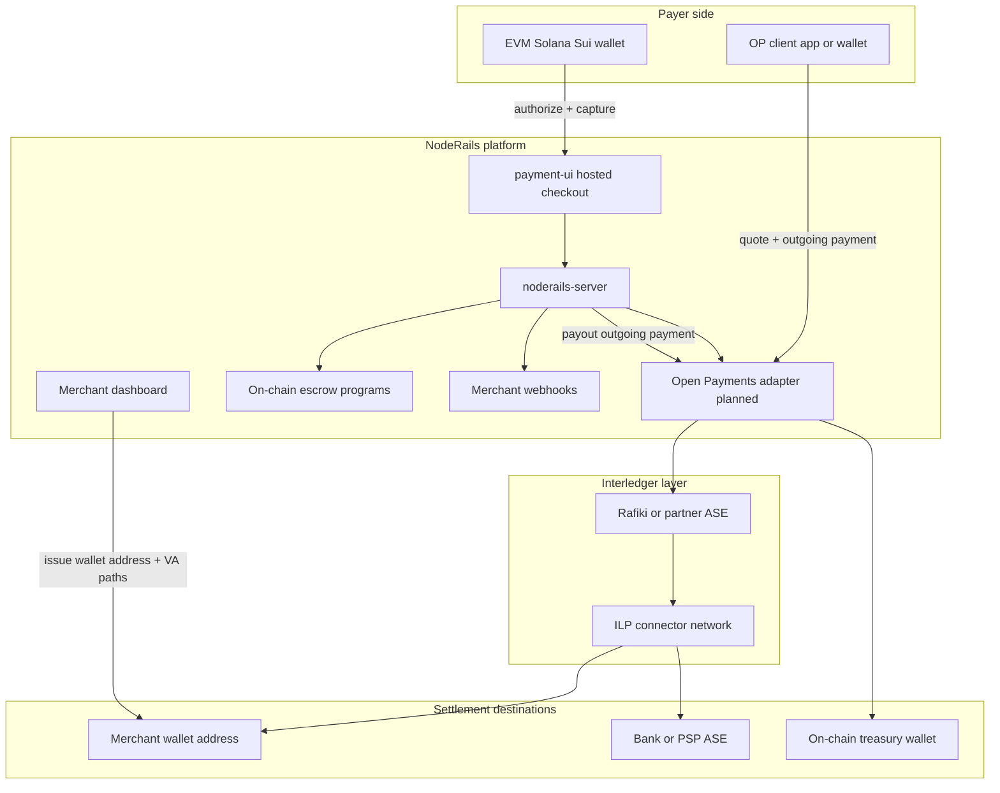
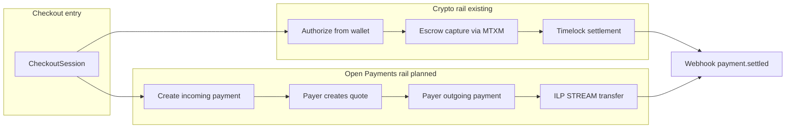
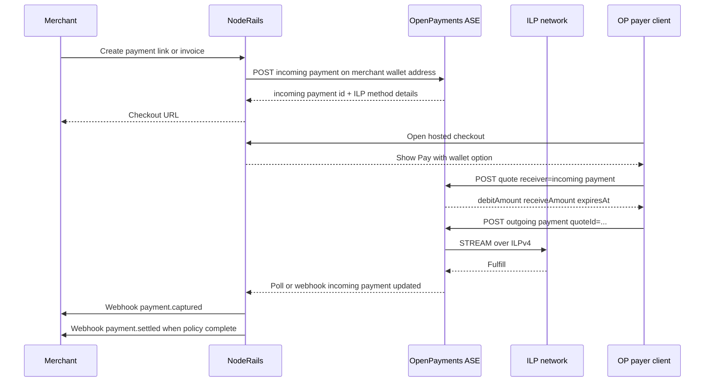
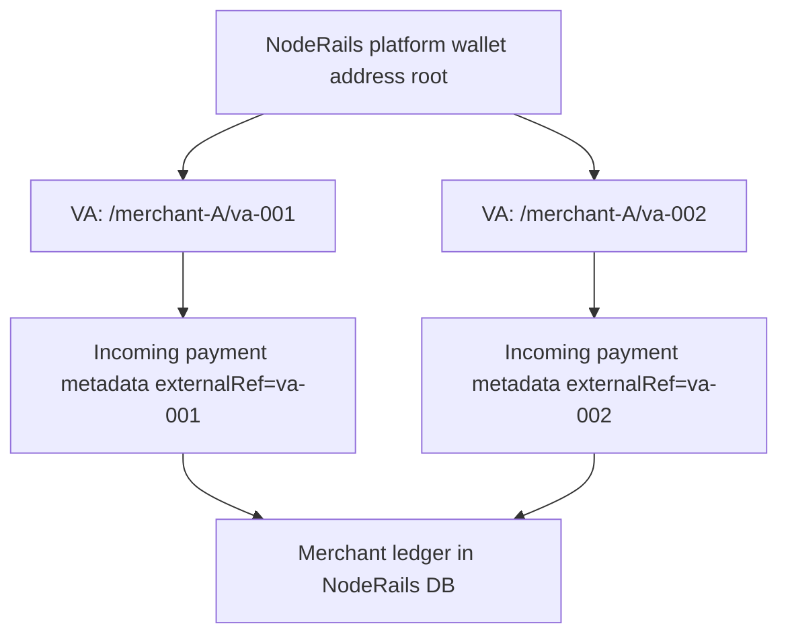
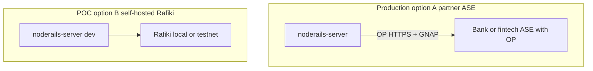

# Architecture overview

NodeRails + Interledger integration at the system level. **Documentation only**; components marked *planned* are not implemented in the monorepo yet.

---

## System context

---

## Dual-rail checkout

Merchants receive **one webhook model** regardless of rail. Internally, `PaymentIntent.railType` would distinguish `CRYPTO` vs `OPEN_PAYMENTS` (schema extension in a future phase).

---

## Open Payments sequence (planned)

---

## Component responsibilities

| Component | Responsibility | Status |
|-----------|----------------|--------|
| `apps/payment-ui` | Hosted checkout UX; chain wallet connect; *future* OP pay button | Crypto: live |
| `services/noderails-server` | Sessions, intents, authorize, capture, settle, webhooks | Live |
| `modules/payments/authorize.service.ts` | Universal authorize from checkout session | Live (crypto) |
| `modules/payments/settlement.worker.ts` | Timelock auto-settle on-chain | Live |
| **Open Payments adapter** | GNAP client, incoming/outgoing payment CRUD, quote, polling | Planned |
| **ASE / Rafiki** | Wallet addresses, ledger balances, ILP connector | Partner or self-hosted |
| MTXM | Sign and broadcast on-chain txs | Live |
| Indexer | Observe escrow events | Live |
| `apps/dashboard` | Merchant config, wallet address display, VA management | Partial; OP UI planned |

---

## Object mapping

| NodeRails object | Open Payments resource | Notes |
|------------------|------------------------|-------|
| `CheckoutSession` | Incoming payment (one-time) | Link via `metadata.checkoutSessionId` |
| `PaymentIntent` | Unified lifecycle record | Add `railType` enum later |
| `PaymentLink` | Wallet path or incoming payment | `$pay.noderails.com/link/{slug}` |
| `Invoice` | Incoming payment with `incomingAmount` + `externalRef` | Invoice number in metadata |
| `Subscription` | Recurring incoming payments or standing authorization | Phase 2+ |
| Virtual account | Sub-path wallet address + incoming payment | See [05-merchant-wallet-addresses.md](./05-merchant-wallet-addresses.md) |
| Payout | Outgoing payment from merchant wallet address | Quote-first |
| On-chain settlement wallet | Unchanged | Crypto rail only |

---

## Data flow: virtual account reconciliation

Each virtual account gets a **distinct incoming payment** (or metadata filter) so bank-style reconciliation maps 1:1 to payer references.

---

## Failure modes and handling

| Failure | Crypto rail | Open Payments rail (planned) |
|---------|-------------|------------------------------|
| Payer abandons checkout | Session expires | Incoming payment expires; no funds received |
| Insufficient balance | Wallet rejects tx | Quote or outgoing payment fails at ASE |
| Route not found | N/A (same chain) | Quote fails; show fallback crypto or card |
| Partial network failure | MTXM retry, indexer confirm | OP client retries; ILP packet retry per STREAM |
| Dispute window | On-chain dispute modules | OP dispute policy + merchant ops (partner-dependent) |
| FX slippage | Price oracle at authorize | Quote `expiresAt`; re-quote before pay |

NodeRails should **never** mark `payment.captured` until the ASE reports `receivedAmount` increased (OP) or indexer confirms escrow capture (crypto).

---

## Security boundaries

- **GNAP tokens** are short-lived and scoped to grants (incoming payment create, outgoing payment create, etc.).
- **NodeRails server** holds ASE client credentials; never expose to browser except public wallet address URLs.
- **Webhook signing** unchanged: HMAC for merchant endpoints.
- **ILP shared secrets** stay between ASE and payer client; NodeRails sees incoming payment status, not STREAM secrets.

See [07-security-and-compliance.md](./07-security-and-compliance.md).

---

## Deployment topology (future)

Production likely uses **partner ASE** for compliance. Engineering POC uses **Rafiki testnet** ([rafiki.money](https://rafiki.money/)).

---

## Related docs

- [Protocol stack primer](./03-protocol-stack-primer.md)
- [Open Payments integration](./04-open-payments-integration.md)
- [Settlement rails](./06-settlement-rails.md)
