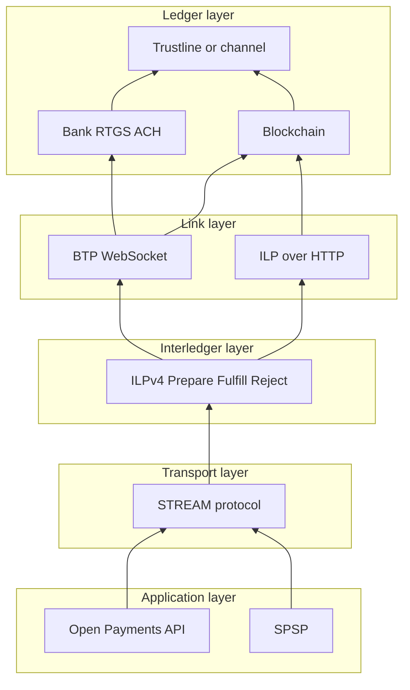
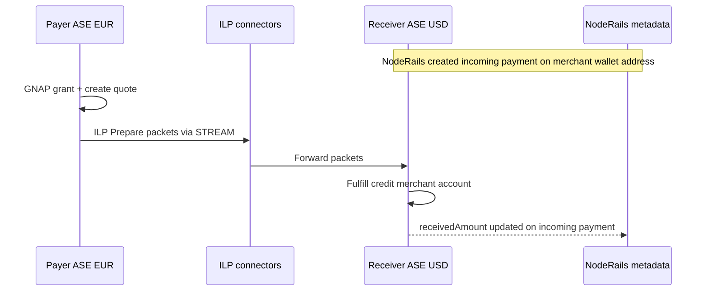

# Protocol stack primer

A NodeRails engineer's guide to the Interledger stack, from ledgers up to Open Payments. Read [Interledger Architecture](https://interledger.org/developers/rfcs/interledger-architecture/) for the authoritative spec.

---

## Layer model

NodeRails integration primarily targets the **Open Payments** box. Understanding lower layers helps debug failed quotes and settlement delays.

---

## Layer 1: Ledger protocols

**What:** Real-world systems where value ultimately settles (banks, blockchains, mobile money, payment channels).

**NodeRails today:** EVM, Solana, Sui smart contract escrows are ledger layers for the crypto rail.

**Interledger view:** Connectors track **bilateral Interledger accounts** with peers and periodically **settle** net balances onto a ledger both peers trust. Settlement must not depend on unrelated accounts ([architecture spec](https://interledger.org/developers/rfcs/interledger-architecture/)).

**HTLAs:** [Hashed-Timelock Agreements](https://interledger.org/developers/rfcs/hashed-timelock-agreements/) describe how to secure transfers on ledgers with or without native HTLC support.

---

## Layer 2: Link protocols

**What:** Authenticated transport between **connectors** (peers on the Interledger graph).

| Protocol | Transport | Use case |
|----------|-----------|----------|
| [ILP over HTTP](https://interledger.org/developers/rfcs/ilp-over-http/) | HTTPS POST | Both peers reachable on public URLs |
| [BTP](https://interledger.org/developers/rfcs/bilateral-transfer-protocol/) | WebSocket | One peer behind firewall |

Link protocols carry ILP packets and settlement-related messages. NodeRails does not implement link protocols directly; **Rafiki or partner ASE** does.

---

## Layer 3: Interledger Protocol v4 (ILPv4)

**What:** Core **packet switching** for value. Three packet types:

| Type | Direction | Meaning |
|------|-----------|---------|
| **Prepare** | Request | Possible transfer; includes amount, expiry, condition (hash) |
| **Fulfill** | Response | Receiver accepts; includes preimage matching condition |
| **Reject** | Response | Payment declined or failed |

**Packetized money:** Large payments split into many small Prepare packets. Benefits: lower connector risk, faster settlement, better FX option handling.

**Addresses:** [ILP addresses](https://interledger.org/developers/rfcs/ilp-addresses/) like `g.noderails.merchant.invoice42` enable routing via longest-prefix match at each connector.

**NodeRails relevance:** You will not construct ILP packets in application code. ASE + STREAM handle this when a payer completes an outgoing payment.

---

## Layer 4: STREAM (transport)

**What:** [STREAM](https://interledger.org/developers/rfcs/stream-protocol/) multiplexes money and data between two endpoints over ILP.

Key properties:

- **Shared secret** authenticates and encrypts frames
- **Conditions and fulfillments** for each ILP Prepare derived from STREAM
- **Chunking** of large payments into many packets
- **Flow control** via StreamMaxMoney / StreamMaxData
- **Bidirectional** streams (useful for streaming payments later)

SPSP and Open Payments use STREAM internally after setup.

---

## Layer 5: SPSP (application)

**What:** [Simple Payment Setup Protocol](https://interledger.org/developers/rfcs/simple-payment-setup-protocol/) exchanges connection info over HTTPS **before** ILP payment:

1. Client resolves [payment pointer](https://paymentpointers.org/syntax/) (e.g. `$bob.shop.com`)
2. GET on SPSP endpoint returns `destination_account` (ILP address) + `shared_secret`
3. Client opens STREAM connection and sends value

Open Payments largely **supersedes SPSP for app integration**, but payment pointers and `.well-known/pay` resolution remain relevant.

---

## Layer 6: Open Payments (application API)

**What:** REST API standard at [openpayments.dev](https://openpayments.dev/). Four resource types:

| Resource | Role |
|----------|------|
| **Wallet address** | HTTPS URL identifying an OP-enabled account; API root |
| **Incoming payment** | Receive side: amount cap, expiry, metadata, ILP receive details |
| **Outgoing payment** | Send side: debit from wallet address to receiver |
| **Quote** | ASE commitment on amounts and FX before outgoing payment |

**Authorization:** [GNAP](https://datatracker.ietf.org/doc/html/draft-ietf-gnap-core-protocol) grants produce access tokens for scoped operations.

**NodeRails touchpoint:** This is the primary integration surface. See [04-open-payments-integration.md](./04-open-payments-integration.md).

---

## End-to-end: how a euro payer pays a dollar invoice

FX and path selection happen inside connectors. The payer sees a **quote** with `debitAmount` (EUR) and `receiveAmount` (USD).

---

## Rafiki in the stack

[Rafiki](https://rafiki.dev/) bundles:

- Open Payments resource server (incoming/outgoing payments, quotes)
- GNAP authorization server
- ILP connector (peer routing)
- Admin UI for ASE operators

For NodeRails POC, Rafiki stands in for a **production banking ASE**. NodeRails talks HTTPS to Rafiki's OP API; Rafiki handles everything below Open Payments.

---

## Glossary

| Term | Definition |
|------|------------|
| **ASE** | Account Servicing Entity: institution holding customer accounts and implementing Open Payments |
| **Connector** | Interledger node that forwards ILP packets between peers for a fee |
| **Wallet address** | HTTPS URL serving Open Payments API for one account |
| **Payment pointer** | User-facing `$host/path` alias resolving to wallet address |
| **Incoming payment** | Receive instruction with optional amount cap and metadata |
| **Outgoing payment** | Send instruction from a wallet address |
| **GNAP** | Grant Negotiation and Authorization Protocol for OAuth-like API access |

---

## Further reading

- [00-portal-inventory.md](./00-portal-inventory.md) for all official URLs
- [02-architecture-overview.md](./02-architecture-overview.md) for NodeRails component diagram
