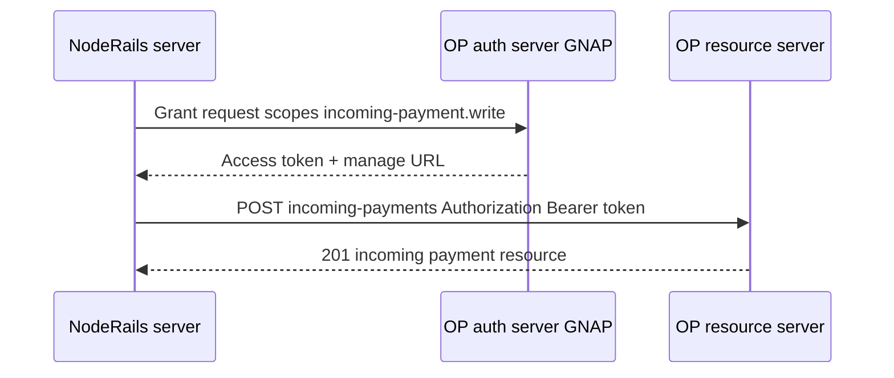
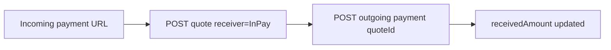

# Open Payments integration

Design reference for integrating NodeRails with the [Open Payments](https://openpayments.dev/) API. **Planned implementation**; no live endpoints in `noderails-server` yet.

---

## Integration role

NodeRails acts as an **Open Payments client** (application) talking to one or more **ASE resource servers**:

- **Receive:** create and manage **incoming payments** on merchant wallet addresses
- **Send (payouts):** create **quotes** and **outgoing payments** from merchant wallet addresses (with appropriate GNAP grants)
- **Reconcile:** poll or subscribe to payment state; map to `PaymentIntent` and webhooks

NodeRails is **not** the ASE in production (unless explicitly building a licensed wallet product). Partner ASE or Rafiki testnet fills that role.

---

## Resource model

All OP resources hang off a **wallet address URL**:

```
https://wallet.example.com/alice          ← wallet address (root)
https://wallet.example.com/alice/incoming-payments/{id}
https://wallet.example.com/alice/outgoing-payments/{id}
https://wallet.example.com/alice/quotes/{id}
```

Reference: [Resource server overview](https://openpayments.dev/apis/resource-server/)

| Resource | HTTP (typical) | NodeRails usage |
|----------|----------------|-----------------|
| Wallet address | GET | Resolve merchant identity, asset code, scale |
| Incoming payment | POST, GET, LIST | Checkout receive leg |
| Quote | POST | Payout FX; payer-side checkout |
| Outgoing payment | POST, GET | Payer checkout; merchant payout |

---

## GNAP authorization flow



**Scopes (conceptual):**

| Operation | Grant scope (examples) |
|-----------|------------------------|
| Create incoming payment on merchant WA | `incoming-payment.create` on wallet address |
| Read incoming payment status | `incoming-payment.read` |
| Create outgoing payment (payout) | `outgoing-payment.create` |
| Create quote | `quote.create` |

Exact scope strings follow Open Payments + GNAP spec for your ASE. Store tokens encrypted; rotate on expiry.

---

## Checkout: incoming payment creation

When merchant creates checkout session or payment link (existing API), **add planned step**:

1. Resolve merchant **wallet address URL** from dashboard config
2. Obtain GNAP access token (server-side, merchant-scoped)
3. `POST {walletAddress}/incoming-payments`:

```json
{
  "incomingAmount": {
    "value": "2500",
    "assetCode": "USD",
    "assetScale": 2
  },
  "expiresAt": "2026-12-31T23:59:59.000Z",
  "metadata": {
    "checkoutSessionId": "cs_...",
    "orderId": "order_123",
    "merchantId": "m_..."
  }
}
```

4. Persist `incomingPaymentId`, `incomingPaymentUrl`, ILP method details on `PaymentIntent` or session extension table
5. Return hosted checkout URL; payment-ui shows crypto **or** OP pay path

Reference: [Create incoming payment](https://openpayments.dev/apis/resource-server/operations/create-incoming-payment/)

---

## Checkout: payer-side flow (client or payer ASE)

Hosted checkout **does not** hold payer GNAP tokens in NodeRails browser if payer uses their own wallet app. Two UX patterns:

### Pattern A: External wallet (recommended for production)

1. Checkout displays QR or deep link with **incoming payment URL**
2. Payer's OP wallet app creates quote + outgoing payment
3. NodeRails polls incoming payment until `receivedAmount` increases

### Pattern B: Embedded payer (partnership / testnet)

1. NodeRails obtains payer grant (OAuth-style redirect)
2. Server creates quote + outgoing payment on payer wallet address
3. Requires strong compliance review; likely testnet only

---

## Quote and outgoing payment (payer)



Quote request (payer wallet address):

```json
{
  "walletAddress": "https://ilp.test.dev/payer",
  "receiver": "https://ilp.test.dev/incoming-payments/{id}",
  "method": "ilp"
}
```

Response includes `debitAmount`, `receiveAmount`, `expiresAt`. Outgoing payment references `quoteId`.

References:

- [Create quote](https://openpayments.dev/apis/resource-server/operations/create-quote/)
- [Create outgoing payment](https://openpayments.dev/apis/resource-server/operations/create-outgoing-payment/)

---

## Reconciliation and webhooks

| Event | Source | NodeRails action |
|-------|--------|------------------|
| Incoming payment funded | OP GET incoming payment | `payment.captured` webhook |
| Incoming payment completed | `completed: true` | `payment.settled` webhook |
| Outgoing payment failed | `failed: true` | `payout.failed` webhook (future) |
| Quote expired | Payer retry | Keep checkout OPEN |

**Polling vs push:** Prefer ASE webhooks if partner exposes them; else poll with backoff from worker queue (same pattern as indexer confirmation).

Map OP amounts using `assetCode` + `assetScale` (minor units). Store raw string values; never float.

---

## Planned module layout (`noderails-server`)

```
services/noderails-server/src/modules/open-payments/
  op-client.ts           # HTTP client, GNAP token refresh
  op-incoming.service.ts # Create/list/get incoming payments
  op-outgoing.service.ts # Quotes + outgoing payments (payouts)
  op-reconcile.worker.ts # Poll + state machine → webhooks
  op-config.ts           # ASE base URLs, client credentials per env
```

**Interfaces (pluggable ASE):**

```typescript
interface OpenPaymentsPort {
  createIncomingPayment(input: CreateIncomingPaymentInput): Promise<IncomingPayment>;
  getIncomingPayment(url: string): Promise<IncomingPayment>;
  createQuote(input: CreateQuoteInput): Promise<Quote>;
  createOutgoingPayment(input: CreateOutgoingPaymentInput): Promise<OutgoingPayment>;
}
```

Swap Rafiki vs bank ASE by changing base URL and credentials.

---

## SDK choice

Official SDKs: [openpayments.dev/sdk](https://openpayments.dev/sdk/before-you-begin/)

NodeRails should use **`@interledger/open-payments` (TypeScript)** in `noderails-server` only (never expose ASE client secrets to payment-ui).

**Dependency note:** Adding this package requires team approval per monorepo dependency rules.

---

## Error handling

| OP error | Merchant-facing behavior |
|----------|-------------------------|
| 401 / invalid grant | Internal alert; retry token refresh |
| 403 insufficient grant | Dashboard prompt to reconnect ASE |
| 404 incoming payment expired | Checkout shows expired; create new session |
| Quote expired | Ask payer to refresh checkout |
| ILP path failure (failed outgoing) | Offer crypto rail fallback if configured |

Align with existing [docs/errors](https://noderails.com/docs/errors) patterns for API consumers.

---

## Testing strategy

1. **Rafiki local playground:** https://rafiki.dev/integration/playground/overview/
2. **Testnet wallets:** https://rafiki.money/
3. **Integration tests:** create incoming payment → simulate outgoing payment from second wallet → assert webhook fired

---

## Related docs

- [05-merchant-wallet-addresses.md](./05-merchant-wallet-addresses.md)
- [06-settlement-rails.md](./06-settlement-rails.md)
- [08-roadmap-phases.md](./08-roadmap-phases.md)
