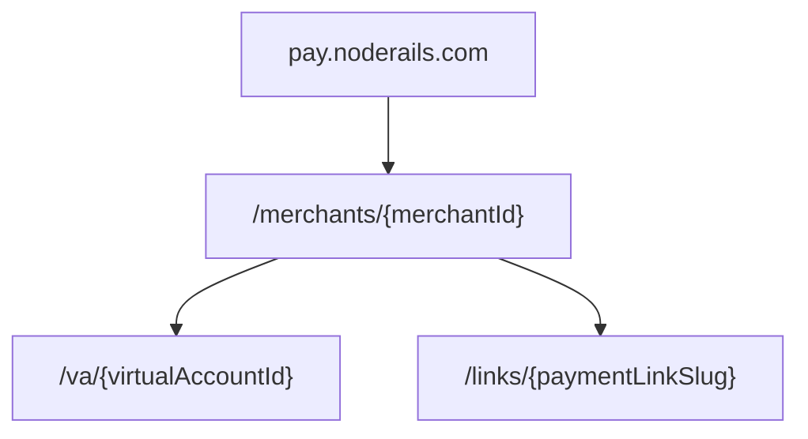
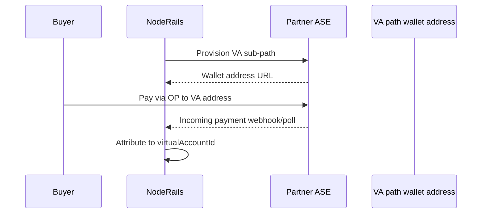

# Merchant wallet addresses and virtual accounts

How NodeRails merchants receive money via **wallet addresses**, **payment pointers**, and **virtual account** paths. Architecture only; not implemented in production yet.

---

## Wallet address vs payment pointer

| Concept | Format | Example |
|---------|--------|---------|
| **Wallet address** | HTTPS URL (Open Payments API root) | `https://pay.noderails.com/merchant/acme-corp` |
| **Payment pointer** | User-facing alias | `$pay.noderails.com/merchant/acme-corp` |

Payment pointers resolve via [RFC 8615](https://www.rfc-editor.org/rfc/rfc8615) well-known URI:

```
GET https://pay.noderails.com/.well-known/pay/acme-corp
→ wallet address URL + auth server hints
```

Canonical syntax: [paymentpointers.org/syntax](https://paymentpointers.org/syntax/)

**NodeRails hosting model (planned):**

- Platform operates ASE subdomain or delegates to partner ASE
- Each onboarded merchant receives a **stable wallet address path**
- Dashboard displays payment pointer for copy/paste and QR

---

## Address hierarchy



| Path level | Purpose |
|------------|---------|
| `/merchants/{merchantId}` | Default receive address for merchant treasury |
| `/va/{virtualAccountId}` | Virtual account isolation |
| `/links/{slug}` | One-time or reusable payment link checkout |

Each path is a distinct **wallet address URL** in Open Payments, or a redirect to an **incoming payment** resource created at checkout time.

**Design choice:** Prefer **incoming payment per checkout** for fixed-amount invoices; use **open wallet address** for donation-style or variable-amount flows.

---

## Mapping to NodeRails objects

| NodeRails object | Open Payments mapping |
|------------------|----------------------|
| `Merchant` | Root wallet address path + GNAP client registration |
| `PaymentLink` slug | Incoming payment metadata `paymentLinkSlug`; optional dedicated sub-path |
| `CheckoutSession` | One incoming payment per session (amount + expiry) |
| `VirtualAccount` | Sub-path wallet address + `metadata.externalRef` for reconciliation |
| `PrivatePaymentInvite` | Signed checkout URL; incoming payment with short expiry + invite token in metadata |

---

## Virtual accounts

**Use case:** Platform or marketplace assigns sub-accounts to sellers, projects, or end customers for inbound settlement without separate KYB for each VA (policy-dependent).

**Planned model:**

1. Merchant creates virtual account in dashboard → NodeRails registers path with ASE
2. ASE exposes wallet address: `https://pay.noderails.com/merchants/{merchantId}/va/{vaId}`
3. All incoming payments on that path tag `metadata.virtualAccountId`
4. Reconciliation reports group by VA; payouts can sweep VA balance to merchant default address



**Compliance note:** Virtual accounts do not bypass AML. Platform policy must define whether VA holders are screened and whether aggregate limits apply. See [07-security-and-compliance.md](./07-security-and-compliance.md).

---

## Private payments

**Use case:** Invite-only checkout links (no public product page).

**Planned flow:**

1. Merchant creates private payment link with expiry and optional password
2. NodeRails creates incoming payment with:
   - Short `expiresAt`
   - `metadata.inviteId`, `metadata.checkoutSessionId`
   - Optional `incomingAmount` cap
3. Hosted checkout URL is unlisted; no wallet address published in public directory
4. GNAP grants for **creating** incoming payments remain server-side only

Private payments share crypto rail semantics (session-scoped) with OP rail (incoming payment scoped).

---

## Payment links and hosted checkout

Existing flow ([`apps/payment-ui`](../../../apps/payment-ui), [`payment-link-checkout`](../../../apps/payment-ui/src/components/payment-link-checkout.tsx)):

```
GET /pay/{slug} → load session → authorize → capture (crypto)
```

**Planned hybrid:**

```
GET /pay/{slug}
  ├─ Pay with wallet (crypto)     → unchanged
  └─ Pay with Open Payments       → show incoming payment URL / QR
```

Order summary and merchant branding stay in payment-ui; OP details fetched from `noderails-server` after session load.

---

## Dashboard UX (planned)

| Screen | Fields |
|--------|--------|
| Merchant settings | Default wallet address, payment pointer, connected ASE status |
| Virtual accounts | List VAs, paths, balances (from ASE), external refs |
| Payment links | Toggle "Accept Open Payments", show pointer for link |
| Payouts | Source wallet address for outgoing payments |

---

## DNS and TLS

Production requirements:

- `pay.noderails.com` (or partner subdomain) with valid TLS
- `.well-known/pay` served by ASE or NodeRails reverse proxy to ASE
- CAA and certificate rotation documented in ops runbook

---

## Related docs

- [04-open-payments-integration.md](./04-open-payments-integration.md)
- [06-settlement-rails.md](./06-settlement-rails.md)
- [02-architecture-overview.md](./02-architecture-overview.md)
