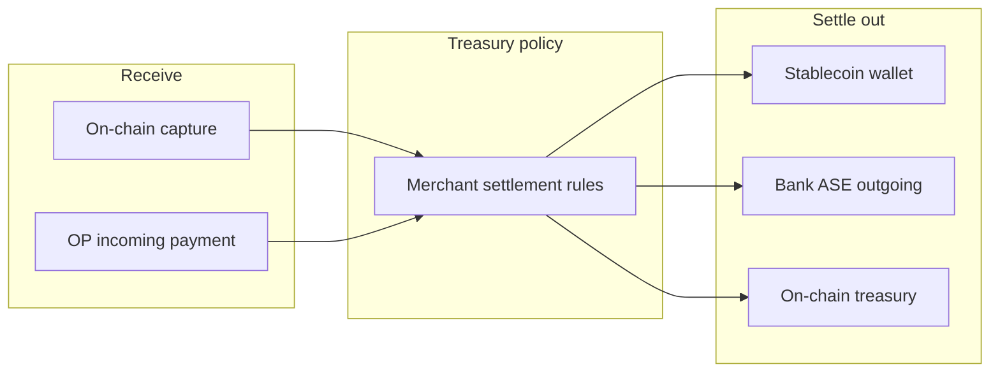
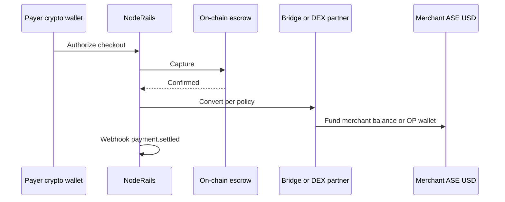
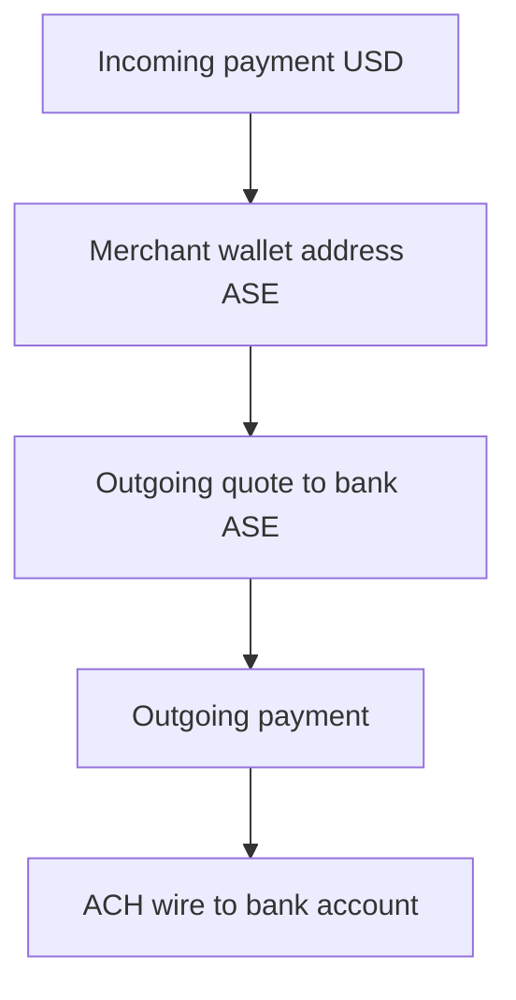

# Settlement rails

How NodeRails uses Open Payments and Interledger for **crypto-to-stablecoin**, **bank settlement**, and **payouts** alongside existing on-chain escrow. Architecture only.

---

## Dual-rail overview



**Crypto rail (today):** Authorize → capture → timelock settle on EVM / Solana / Sui. Workers: [`settlement.worker.ts`](../../../services/noderails-server/src/modules/payments/settlement.worker.ts).

**Open Payments rail (planned):** Incoming payments credit merchant ASE balance; **outgoing payments** move value to stablecoin partners, bank ASEs, or bridged on-chain wallets.

NodeRails orchestrates policy; regulated partners hold fiat and stablecoin ledger balances where required.

---

## Rail comparison

| Dimension | Crypto escrow | Open Payments |
|-----------|---------------|---------------|
| Payer requirement | Same-chain wallet + token | Any OP-enabled wallet |
| FX | DEX or fixed token | ILP quote across connectors |
| Custody | Non-custodial smart contract | ASE-mediated account |
| Settlement speed | Chain confirmation + timelock | ILP stream + ASE ledger |
| NodeRails role | Orchestrator + indexer | OP client + webhooks |

---

## Crypto to stablecoin settlement

**Scenario:** Buyer pays in SOL, USDC on Sui, or ETH; merchant wants USD stablecoin in ASE or on-chain USDC.

**Planned paths:**

### Path 1: Crypto capture → treasury bridge → OP outgoing

1. Checkout completes on crypto rail (existing)
2. Merchant policy: `onCapture: routeToStablecoin`
3. NodeRails treasury service swaps or bridges via existing MTXM / partner liquidity (out of scope for ILP doc)
4. Optional: credit merchant OP wallet address via partner ASE deposit API

### Path 2: Payer uses OP with crypto-backed ASE

1. Payer ASE holds crypto; quote converts to merchant USD incoming payment
2. ILP connectors handle conversion
3. NodeRails only tracks incoming payment state

**NodeRails value:** Unified `payment.settled` webhook whether settlement landed on-chain or in ASE.



---

## Bank settlement

**Scenario:** Merchant receives OP payments and settles to fiat bank account.

**Planned flow:**

1. Merchant completes KYB with **bank ASE partner** (NodeRails does not hold fiat)
2. Merchant wallet address hosted on partner ASE or federated from NodeRails path
3. Incoming payments credit ASE ledger balance
4. Merchant requests payout (dashboard) or auto-sweep rule runs
5. NodeRails creates **quote** + **outgoing payment** to beneficiary:
   - Beneficiary = partner-defined bank payout wallet address, or
   - Internal ASE transfer that triggers ACH/wire off OP graph



**ILP role:** Connectors route between ASEs if merchant ASE and bank ASE are different institutions. NodeRails sees OP API only.

**Compliance:** Bank settlement requires partner KYC/KYB, sanctions screening, and travel rule where applicable. NodeRails passes merchant metadata; partner executes screening.

---

## Payouts

**Scenario:** Marketplace pays sellers, affiliate payouts, or treasury sweeps.

**Planned API shape (conceptual, mirrors existing payout roadmap):**

```
POST /v1/payouts
{
  "merchantId": "...",
  "sourceWalletAddress": "https://pay.noderails.com/merchants/...",
  "beneficiary": {
    "walletAddress": "https://partner.example/beneficiary/..."
  },
  "amount": { "value": "10000", "assetCode": "USD", "assetScale": 2 },
  "metadata": { "payoutId": "po_...", "externalRef": "..." }
}
```

**Server steps:**

1. Validate merchant balance (ASE query or cached ledger)
2. GNAP grant with `outgoing-payment.create`
3. `POST quote` with receiver = beneficiary wallet address or incoming payment
4. `POST outgoing-payment` with `quoteId`
5. Poll until completed or failed
6. Webhook `payout.completed` or `payout.failed`

**Idempotency:** Use `metadata.payoutId` on outgoing payment; reject duplicate creates.

**FX payouts:** Quote returns debit/receive amounts; store both for merchant reporting.

---

## Reconciliation

| Source | Key | NodeRails record |
|--------|-----|------------------|
| Incoming payment | `incomingPaymentUrl` | `PaymentIntent.opIncomingPaymentUrl` |
| Outgoing payment | `outgoingPaymentUrl` | `Payout.opOutgoingPaymentUrl` |
| Crypto tx | `txHash` + chain | Existing indexer fields |

Daily reconciliation job:

1. List incoming payments by date range from ASE
2. Match `metadata.checkoutSessionId` / `metadata.payoutId`
3. Flag orphans for ops queue

---

## Failure modes

| Failure | Mitigation |
|---------|------------|
| Quote expires before outgoing payment | Retry quote; surface clear error to merchant |
| ILP path unavailable | Fallback rail if configured; alert ops |
| Partial incoming payment | Support underpay rules per merchant settings |
| ASE downtime | Queue workers; degrade checkout to crypto-only |
| Bridge slippage (crypto path) | Policy limits; pre-trade quotes from liquidity partner |

---

## Webhook unification

Target event names (aligned with existing crypto webhooks):

| Event | Rail |
|-------|------|
| `payment.authorized` | Crypto only today |
| `payment.captured` | Crypto + OP incoming funded |
| `payment.settled` | Crypto timelock + OP completed |
| `payout.completed` | OP outgoing completed |
| `payout.failed` | OP outgoing failed |

Same signing secret and delivery semantics as current merchant webhooks.

---

## Related docs

- [04-open-payments-integration.md](./04-open-payments-integration.md)
- [05-merchant-wallet-addresses.md](./05-merchant-wallet-addresses.md)
- [07-security-and-compliance.md](./07-security-and-compliance.md)
- [08-roadmap-phases.md](./08-roadmap-phases.md)
