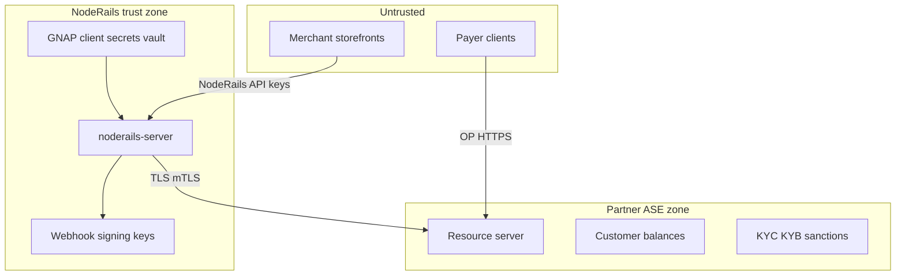

# Security and compliance

Security and compliance considerations for NodeRails Open Payments integration. Architecture and policy reference only.

---

## Trust boundaries

**Principles:**

- NodeRails **never** stores payer ASE passwords or long-lived payer tokens in payment-ui
- Merchant API keys remain separate from GNAP grants
- Fiat and stablecoin **ledger custody** stays with licensed ASE partners

Aligns with NodeRails AML/CFT policy: non-custodial on-chain flows; regulated partners for account rails.

---

## GNAP and consent

| Actor | Grant type | Storage |
|-------|------------|---------|
| NodeRails → merchant ASE | Client credentials or merchant-delegated grant | Encrypted env / vault; rotate |
| Payer → payer ASE | Interactive consent in payer wallet | Not stored on NodeRails |
| NodeRails payout automation | Merchant-scoped outgoing-payment grant | Revocable from dashboard |

**Scope minimization:** Request only scopes needed per operation (`incoming-payment.create` vs full admin).

**Audit:** Log grant creation, refresh, revocation with merchant ID and timestamp.

Reference: [Open Payments auth](https://openpayments.dev/identity/authentication/)

---

## Webhook security

**Inbound (from ASE):** If partner sends payment events to NodeRails:

- Verify HMAC or mTLS per partner contract
- Idempotent processing by `incomingPaymentUrl` / event ID
- Reject replay via timestamp window

**Outbound (to merchants):** Unchanged from today:

- Sign payload with merchant webhook secret
- Retry with backoff; dead-letter after N failures
- Include `railType: OPEN_PAYMENTS | CRYPTO` in payload for routing

---

## Data handling

| Data | Classification | Retention |
|------|----------------|-----------|
| Wallet address URLs | Business | Life of merchant account |
| Incoming payment metadata | Business + PII if payer included | Per privacy policy |
| GNAP tokens | Secret | Until expiry; no logs |
| ILP shared secrets | Secret | Never persist client-side |
| Quote amounts | Financial | Reconciliation retention |

Do not log full Authorization headers or GNAP access tokens.

---

## AML / CFT alignment

NodeRails platform policy ([AML/CFT policy PDF](../../../apps/landing/public/legal/noderails-aml-cft-policy.pdf)) applies:

| Control | Crypto rail | OP rail |
|---------|-------------|---------|
| Merchant KYB | NodeRails onboarding | Plus ASE partner requirements |
| Payer screening | Wallet risk signals | ASE partner responsibility |
| Sanctions | Policy + tooling | ASE primary for fiat/stablecoin |
| Transaction monitoring | Fraud engine + velocity | Partner reports + NodeRails metadata |
| SAR | NodeRails procedures | Escalate with ASE where required |

**Metadata for partners:** Pass `merchantId`, `checkoutSessionId`, `country`, `amount`, `externalRef` on incoming payment creation so ASE can screen and report.

**Virtual accounts:** Define whether sub-account holders trigger additional KYC tiers before receive limits increase.

---

## Fraud and abuse

| Risk | Mitigation |
|------|------------|
| Incoming payment URL scraping | Short expiry; private links unlisted |
| Overpayment / underpayment | Enforce `incomingAmount`; partial pay rules |
| Quote manipulation | Server-side quote only from trusted payer wallet in embedded flows |
| Merchant impersonation | Verified domain for wallet address paths |
| Payout fraud | Step-up auth for new beneficiaries; velocity limits |

Integrate with existing NodeRails fraud engine signals where checkout session is shared across rails.

---

## Availability and incident response

| Incident | Response |
|----------|----------|
| GNAP secret leak | Rotate credentials; invalidate grants |
| ASE breach (partner) | Disable OP checkout; notify merchants |
| Erroneous payout | Partner recall procedures; NodeRails audit trail |
| Webhook forgery attempt | Block IP; alert security |

Runbooks should name partner contacts and escalation for production ASE.

---

## Regulatory positioning

NodeRails as **orchestration platform**:

- Does not operate as ASE or money transmitter for OP balances unless licenses obtained
- Contracts with ASE partners clarify roles (NodeRails = tech provider; partner = regulated entity)
- Merchant agreements disclose dual-rail settlement and partner terms

Legal review required before production OP launch in each jurisdiction.

---

## Related docs

- [06-settlement-rails.md](./06-settlement-rails.md)
- [08-roadmap-phases.md](./08-roadmap-phases.md)
- [01-why-interledger.md](./01-why-interledger.md)
