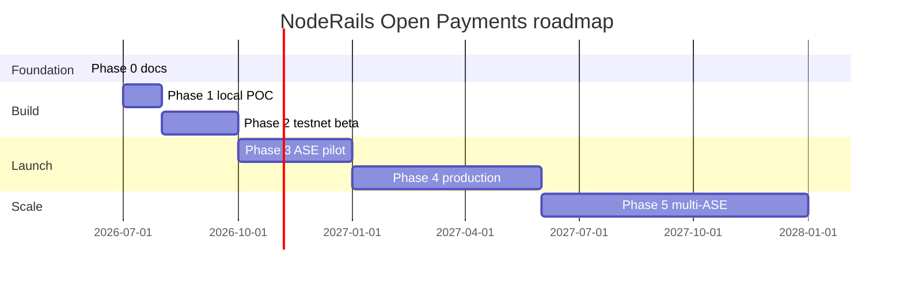

# Roadmap phases

Phased plan for NodeRails Open Payments and Interledger integration. **Nothing in this document is implemented yet** unless explicitly marked shipped elsewhere.

---

## Phase summary

| Phase | Goal | Exit criteria |
|-------|------|---------------|
| **0** | Documentation and alignment | This doc suite approved; partner shortlist |
| **1** | Local POC | Rafiki playground; incoming payment → webhook |
| **2** | Testnet beta | Merchants on testnet; hybrid checkout UI |
| **3** | Partner ASE pilot | One regulated ASE; KYB merchants; USD receive |
| **4** | Production rails | Bank settlement, payouts, virtual accounts |
| **5** | Scale | Multi-ASE, multi-currency, SLA monitoring |

---

## Phase 0: Documentation (current)

**Status:** In progress

**Deliverables:**

- [x] `docs/interledger/` suite (this folder)
- [ ] Engineering review with payments team
- [ ] Legal review of ASE partnership model
- [ ] Dependency approval for `@interledger/open-payments`

**Out of scope:** Code, schema, landing site links

---

## Phase 1: Local POC

**Goal:** Prove NodeRails can create an incoming payment and receive a simulated payer flow end-to-end.

**Work items:**

1. Deploy [Rafiki playground](https://rafiki.dev/integration/playground/overview/) locally
2. Add `open-payments` module skeleton in `noderails-server` (feature flag)
3. Implement `OpenPaymentsPort` against Rafiki
4. Script: create incoming payment → payer wallet outgoing payment → poll state
5. Emit internal event → existing webhook pipeline (test merchant)

**Success metrics:**

- Incoming payment reaches `completed` within 60s in local env
- Webhook payload includes `railType: OPEN_PAYMENTS`

**Not in phase 1:** payment-ui changes, production credentials, Prisma migration (in-memory or JSON file OK for POC)

---

## Phase 2: Testnet beta

**Goal:** Hybrid hosted checkout on [Interledger testnet](https://rafiki.money/) for design partners.

**Work items:**

1. payment-ui: "Pay with Interledger wallet" on payment link checkout
2. Display QR / copy incoming payment URL
3. Prisma: extend `PaymentIntent` with `railType`, OP URLs (migration)
4. Dashboard: show payment pointer (read-only)
5. Document testnet onboarding for merchants

**Success metrics:**

- 3+ design partners complete testnet checkout
- Crypto rail unchanged for existing merchants

---

## Phase 3: Partner ASE pilot

**Goal:** Production-grade receive on USD (or EUR) via one licensed ASE partner.

**Work items:**

1. Sign ASE agreement; obtain sandbox + production URLs
2. Merchant KYB flow handoff to partner
3. Provision merchant wallet addresses on partner ASE
4. GNAP production credentials in vault
5. Reconciliation job v1
6. Security review ([07-security-and-compliance.md](./07-security-and-compliance.md))

**Success metrics:**

- First live incoming payment with real funds (pilot merchants only)
- Reconciliation match rate > 99%

---

## Phase 4: Production rails

**Goal:** Full **Universal Settlement** feature set from [01-why-interledger.md](./01-why-interledger.md).

| Feature | Phase 4 deliverable |
|---------|---------------------|
| Private payments | Short-expiry incoming payments + invite URLs |
| Crypto → stablecoin | Treasury policy hooks + partner bridge |
| Bank settlement | Outgoing payments to bank ASE beneficiaries |
| Virtual accounts | Sub-path wallet addresses + reporting |
| Payouts | Quote-first outgoing payments API |

**Work items:**

1. Payout API and dashboard
2. Virtual account CRUD + ASE provisioning automation
3. Auto-sweep rules (incoming → outgoing)
4. Landing docs page + sidebar link (optional)
5. Public API documentation

**Success metrics:**

- Payout SLA defined and monitored
- Merchant NPS on dual-rail checkout

---

## Phase 5: Scale

**Goal:** Multi-region, multi-ASE, operational excellence.

**Work items:**

1. Second ASE for redundancy or geography
2. FX reporting across connectors
3. Advanced fraud rules for OP rail
4. 24/7 on-call runbooks with partner SLAs
5. Optional: evaluate NodeRails-operated connector (high bar; likely never for v1)

---

## Dependencies and blockers

| Blocker | Owner | Notes |
|---------|-------|-------|
| ASE partner selection | Business dev | Required for phase 3+ |
| Legal / MTL analysis | Legal | Before real funds |
| Open Payments SDK dependency | Engineering | npm approval |
| Treasury bridge for crypto→stable | Engineering + liquidity partner | Parallel track |

---

## What we explicitly defer

- Running NodeRails as primary ASE (unless strategic pivot)
- Custom ILP connector implementation
- Replacing crypto escrow rail
- Landing site integration until phase 4 optional item
- Changes to `memory.md` until implementation starts (per phase 0 scope)

---

## Milestone diagram

Dates are illustrative; adjust after phase 0 review.

---

## Related docs

- [README.md](./README.md)
- [02-architecture-overview.md](./02-architecture-overview.md)
- [04-open-payments-integration.md](./04-open-payments-integration.md)
