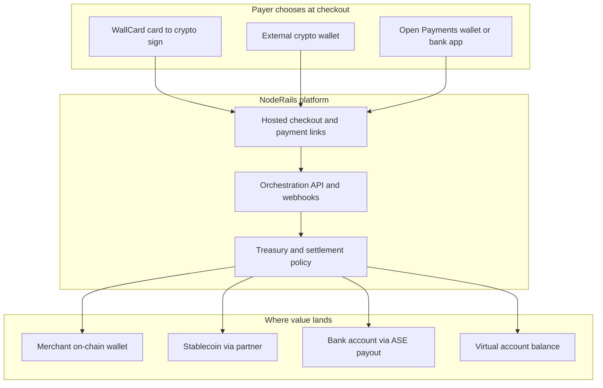
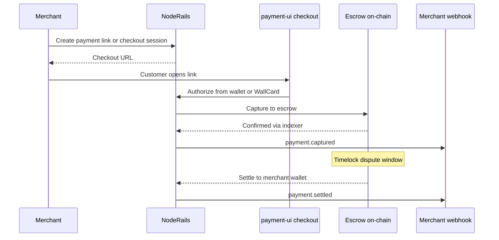
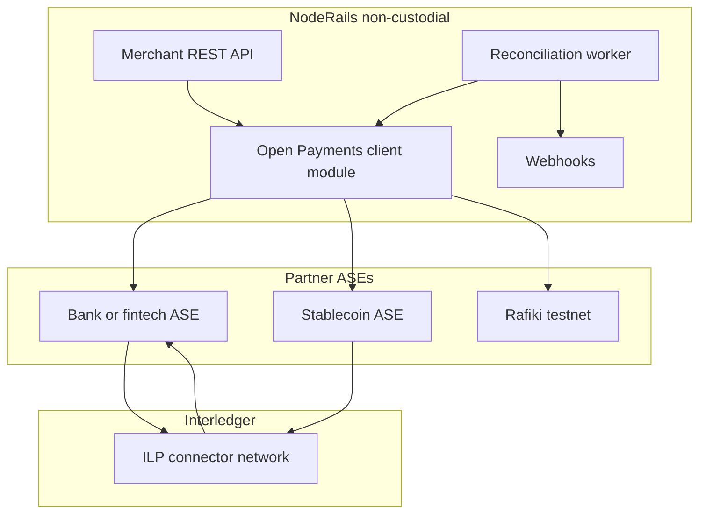
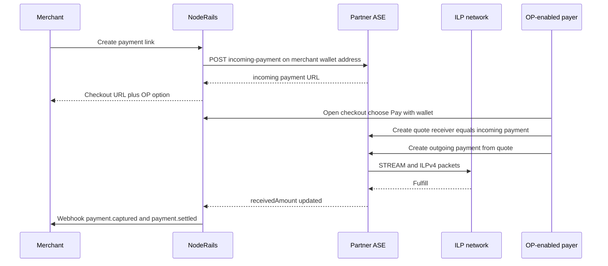
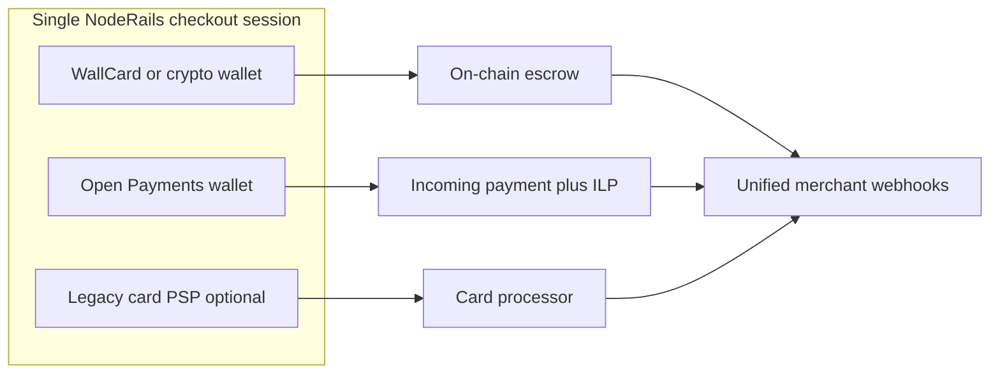

# NodeRails Open Payments Accelerator Proposal

**Universal Settlement for Crypto Commerce**

Submitted to the Interledger Open Payments Accelerator  
**Website:** [noderails.com](https://www.noderails.com) · **WallCard:** [wallcard.noderails.com](https://wallcard.noderails.com)  
**Contact:** hello@noderails.com · [LinkedIn](https://www.linkedin.com/company/noderails) · [X @noderails](https://x.com/noderails)

---

## Executive summary

NodeRails is a **non-custodial payment platform** for businesses that want to accept programmable money without giving up control of their funds. Today we run production-grade **hosted checkout**, **payment links**, **invoices**, **subscriptions**, **disputes**, and **webhooks** across **EVM, Solana, and Sui**, with funds held in audited on-chain escrow until settlement.

Our next step is **Universal Settlement**: the same merchant API and checkout experience, extended with **Open Payments** and **Interledger**, so payers who do not hold crypto can still pay a merchant using **wallet addresses**, **bank-linked accounts**, or **stablecoin balances** at regulated partners (ASEs). Value routes over ILP. Merchants still get one dashboard, one webhook model, and one reconciliation story.

**WallCard** ([wallcard.noderails.com](https://wallcard.noderails.com)) is our **card-first payer wallet** for the crypto rail: shoppers pay with familiar card steps (PAN, CVV, PIN, OTP) while the app signs like a normal Web3 wallet on Solana and EVM. It removes the "install MetaMask for every purchase" barrier without NodeRails taking custody of keys.

We are **not** applying to become a bank or ASE. We are applying to build the **reference merchant orchestration layer** on Open Payments: checkout, virtual accounts, bank settlement, and payouts, integrated with our existing crypto stack and WallCard.

**What we want from the accelerator:** technical mentorship on Open Payments and Rafiki, introductions to ASE partners, support for a public testnet pilot, and co-marketing as an example of **hybrid crypto + Open Payments commerce**.

---

## 1. What is NodeRails?

NodeRails is payment infrastructure for merchants and developers who sell online with crypto today and need **account-based rails** tomorrow.

### Core product today

| Capability | Description |
|------------|-------------|
| **Hosted checkout** | Branded payment pages at `pay.noderails.com` with chain and token selection |
| **Payment links** | Shareable links for one-off or reusable payments |
| **Invoices** | Line items, sequential numbering, customer accounts, payment status |
| **Subscriptions** | Recurring billing with product plans and trial periods |
| **Escrow capture** | Smart contract escrow on EVM, Solana, and Sui |
| **Timelock settlement** | Funds release to merchant wallet after dispute window |
| **Disputes and refunds** | On-chain dispute flow with buyer protection |
| **Webhooks** | Signed events for `payment.captured`, `payment.settled`, and related lifecycle |
| **Merchant dashboard** | Apps, API keys, stats, wallet connect, chain enablement |
| **SDK and REST API** | Integrate checkout and payments into any stack |

### Design principles

1. **Non-custodial on crypto.** NodeRails orchestrates transactions. Escrow rules live on-chain. Merchants and payers keep wallet control.
2. **Multi-chain by default.** One integration covers EVM L1/L2, Solana, and Sui rather than one chain per integration.
3. **Merchant-first operations.** Links, invoices, subscriptions, and reporting match what teams expect from Stripe-style tooling.
4. **Compliance-aware.** Published AML/CFT policy, screening hooks, and audit-friendly payment traces.

### Positioning

NodeRails sits between **raw blockchain tooling** and **traditional PSPs**:

- Unlike a custodial exchange checkout, funds are not held in a NodeRails omnibus account on the crypto rail.
- Unlike wiring directly to smart contracts, merchants get hosted UX, webhooks, disputes, and multi-chain routing without building it themselves.

---

## 2. What is WallCard?

**WallCard** is the shopper-facing wallet in the **NodeRails Network**: a card-first experience that behaves like a standard Web3 wallet for developers.

### The problem WallCard solves

Crypto checkout still asks mainstream buyers to install browser extensions, manage seed phrases, and hold the right token on the right chain. That friction kills conversion for e-commerce, SaaS, and marketplaces.

### How WallCard works

1. Shopper sees a **card-style flow** at checkout (PAN, CVV, PIN, OTP).
2. Behind the scenes, WallCard runs a **secure signer**. Keys do not leave the secure environment.
3. The merchant app still calls the same **`provider.request`** surface used by MetaMask-style wallets: message signing, typed data (EIP-712), and sends on **Solana and EVM**.
4. NodeRails escrow capture and settlement proceed exactly as they do for external wallets.

### WallCard vs Open Payments (important distinction)

| | **WallCard** | **Open Payments** |
|---|-------------|-------------------|
| **Payer experience** | Card in, crypto signature out | Bank, fintech, or OP wallet |
| **Rail** | On-chain escrow (crypto) | ASE account + ILP |
| **NodeRails role** | Payer UX partner | Orchestrator to partner ASE |
| **Custody** | Secure signer, not NodeRails server | Regulated ASE holds balances |

WallCard and Open Payments are **complementary payer paths** on the same checkout page. They are not substitutes.

### Live today

WallCard is public at **[wallcard.noderails.com](https://wallcard.noderails.com)** with product details, SDK playground, and demo flows.

---

## 3. Current traction and what we have shipped

We are an **early-stage, product-heavy** company. We lead with what is built and live rather than inflated metrics.

### Platform status

| Area | Status |
|------|--------|
| **Production monorepo** | `noderails-server`, `payment-ui`, merchant dashboard, admin, landing, SDK |
| **Chains live** | EVM (multiple networks), Solana, Sui |
| **On-chain programs** | Escrow and merchant manager on EVM; Anchor programs on Solana; Move on Sui |
| **Transaction ops** | MTXM (multichain tx manager) + indexer for send, confirm, and webhook ingestion |
| **WallCard** | Live demo and SDK at wallcard.noderails.com |
| **Developer docs** | Public docs at noderails.com/docs |
| **Compliance** | AML/CFT policy published at noderails.com/compliance |
| **Open Payments** | Architecture documented; integration not yet in production |

### Backing and ecosystem

- **Investors:** [W3X Fund](https://www.w3x.network/), [LvlUp Ventures](https://www.lvlup.vc/)
- **Community:** Active [Discord](https://discord.gg/8uwSfv9Tvk), [Telegram](https://t.me/+fzUTcAYr-zhhZjg1), and developer outreach
- **Reference integrations:** Buy-me-coffee demo, merchant dashboard, multi-app API key model

### Commercial model (today)

- **1% introductory transaction fee** on crypto commerce
- Merchant self-serve onboarding via dashboard
- Pricing designed to undercut legacy crypto gateways while staying sustainable at scale

### What traction means for us right now

We have **finished the hard infrastructure work** (multi-chain escrow, checkout, ops tooling) that typically takes teams 12 to 18 months. We are now entering **merchant acquisition and rail expansion**. Open Payments is the strategic expansion that lets us serve merchants whose buyers pay in **fiat accounts and OP wallets**, not only on-chain assets.

We will share **pilot merchant names and volume** with the accelerator team under NDA as design partners onboard through the program.

---

## 4. The problem

Merchants using NodeRails today face three gaps that crypto escrow alone cannot close:

### Gap 1: Payer asset mismatch

A buyer with a EUR bank wallet or USDC at a fintech app should not need to buy SOL on Sui before paying a $20 invoice. Crypto-native checkout optimizes for people who already hold chain assets.

### Gap 2: Settlement destination sprawl

Merchants want:

- Crypto in treasury wallets
- Stablecoin for treasury policy
- **Bank accounts** in USD, EUR, GBP, and local rails
- **Virtual accounts** for marketplace sellers and B2B reconciliation

Each destination today implies a **custom partner API**. That does not scale for a platform product.

### Gap 3: Identifier and privacy models

B2B invoices, private payment links, and virtual accounts need **human-readable, account-style identifiers** (payment pointers, wallet address paths), not only hex and base58 strings.

**Interledger and Open Payments address all three** with one standard object model and a ledger-agnostic routing layer.

---

## 5. Vision: Universal Settlement

Our vision is that a merchant integrates **NodeRails once** and accepts payers from **any supported rail**:

### Product name internally: **NodeRails Universal Settlement**

| Merchant need | Rail |
|---------------|------|
| Accept crypto with buyer protection | Existing escrow (EVM / Solana / Sui) |
| Accept without forcing wallet extensions | WallCard on crypto rail |
| Accept bank and OP wallet payers | Open Payments incoming payments |
| Reconcile sub-merchants and B2B | Virtual account wallet address paths |
| Pay suppliers and affiliates | Open Payments outgoing payments + crypto batch payouts |
| Settle to bank after crypto sale | Treasury policy + OP payout to bank ASE |

**One webhook vocabulary.** `payment.captured`, `payment.settled`, and future `payout.completed` mean the same thing regardless of rail.

---

## 6. How NodeRails works today (crypto rail)

### Technical stack (abbreviated)

- **`noderails-server`:** Auth, apps, payment intents, capture, settle workers, webhooks (BullMQ)
- **`payment-ui`:** Hosted checkout and payment link UX
- **MTXM + Indexer:** Multichain transaction submission and confirmation
- **Smart contracts / programs:** Escrow with timelock, disputes, refunds

This rail **stays unchanged**. Open Payments is a **parallel adapter**, not a replacement.

---

## 7. How Interledger and Open Payments work with NodeRails

### Shared primitives (all use cases)

| Primitive | Role |
|-----------|------|
| **Wallet address** | HTTPS URL identifying an OP-enabled account (e.g. `https://pay.noderails.com/merchants/acme`) |
| **Payment pointer** | User-facing alias (e.g. `$pay.noderails.com/merchants/acme`) |
| **Incoming payment** | Money expected in; tied to order, link, or invoice via metadata |
| **Quote** | ASE commitment on amounts, FX, and fees before send |
| **Outgoing payment** | Money sent out; used for payer checkout and merchant payouts |
| **GNAP grants** | Fine-grained, time-bounded consent for apps and agents |
| **ILP / STREAM** | Network layer routing value between ASEs |

An **ASE (Account Servicing Entity)** is a bank, wallet provider, or licensed fintech that holds balances and implements Open Payments. **NodeRails does not become the ASE in production.** We integrate with partner ASEs (and Rafiki in development).

### Integration pattern: non-custodial orchestrator

NodeRails:

1. Creates **incoming payments** when merchants create checkout sessions or links
2. Exposes checkout URLs and payment pointers to payers
3. Polls or receives events when incoming payments are funded
4. Creates **quotes and outgoing payments** for payouts and bank settlement
5. Maps OP state to existing **PaymentIntent** lifecycle and webhooks

### Hybrid checkout flow (planned)

---

## 8. Use cases we will ship (focused scope)

We are **not** pursuing every Open Payments use case. We focus on **merchant commerce** plus **WallCard** on crypto.

### In scope

| # | Use case | NodeRails + Open Payments | WallCard role |
|---|----------|---------------------------|---------------|
| 1 | **Stripe-like merchant checkout** | Incoming payment per order; hosted checkout; webhooks | Crypto tab at same checkout |
| 2 | **Payment links and invoices** | One incoming payment per link or invoice; metadata reconciliation | Optional payer on crypto links |
| 3 | **Virtual accounts** | Sub-path wallet address per VA; attribute deposits by metadata | N/A |
| 4 | **Bank settlement and payouts** | Quote + outgoing payment to bank ASE beneficiary | N/A |
| 5 | **Crypto to stablecoin policy** | On-chain capture then OP outgoing per treasury rules | Capture leg unchanged |
| 6 | **Private payments** | Short-expiry incoming payments; invite-only URLs | Private crypto links unchanged |
| 7 | **Subscriptions (phase 2)** | GNAP grants with spend limits; renewal outgoing payments | Recurring crypto via WallCard |
| 8 | **Agent budgets (future)** | GNAP scoped grants for automated spend | Agent card signing via WallCard |

### Out of scope (for this program)

| Use case | Why defer |
|----------|-----------|
| NodeRails as primary ASE / Rafiki operator | Requires licensing; we stay orchestrator |
| Full consumer P2P wallet app | WallCard is checkout-focused, not Revolut clone |
| Web Monetization streaming micropayments | Different product surface; optional later |
| Replacing crypto escrow | Dual rail, not migration |

---

## 9. Target customers

### Primary segments

**1. Crypto-native merchants scaling to mainstream buyers**

- NFT marketplaces, gaming, creator tools, SaaS with crypto pricing
- **Pain:** Buyers without wallets abandon checkout
- **Solution:** WallCard for crypto path; Open Payments for account-based payers

**2. Marketplaces and platforms**

- Need **virtual accounts** per seller and unified payouts
- **Pain:** Reconciliation across many beneficiaries and rails
- **Solution:** Wallet address paths + incoming payment metadata + outgoing payout API

**3. Cross-border B2B and services**

- Invoices in USD/EUR; buyers in multiple countries
- **Pain:** FX and local rail fragmentation
- **Solution:** OP quotes across ASEs via ILP; single NodeRails invoice object

**4. AI and agent commerce (emerging)**

- Agents need **delegated spend** with hard limits
- **Pain:** No standard for agent-to-merchant pay across ledgers
- **Solution:** GNAP grants + WallCard or OP outgoing payments within budget

**5. Developers building on NodeRails SDK**

- Want one integration for crypto + account rails
- **Pain:** Separate PSP, crypto gateway, and payout APIs
- **Solution:** Universal Settlement API with `railType: CRYPTO | OPEN_PAYMENTS`

### Geography and rails (roadmap)

Initial OP pilot: **USD and EUR** corridors with partner ASEs. Virtual account roadmap aligns with **USD, EUR, GBP, MXN, BRL, COP** onramp specs already on our product roadmap.

---

## 10. Why NodeRails and Interledger are a strong match

1. **We already have merchant-grade checkout.** Most OP examples are wallet or ASE demos. We bring **production checkout, links, invoices, subscriptions, and webhooks**.

2. **We prove hybrid rails.** Interledger wins when crypto and account ledgers coexist. NodeRails + WallCard + Open Payments is a **live story**, not a greenfield slide.

3. **We stay non-custodial where it matters.** Our brand is trust-minimized crypto commerce. Open Payments fits as **orchestration to ASEs**, matching Interledger's open network model.

4. **We reduce integration surface for merchants.** One NodeRails API replaces many proprietary bank and wallet APIs behind one OP adapter.

5. **GNAP-ready product roadmap.** Subscriptions, agents, and private payments need delegated auth. We will implement grants as first-class dashboard features.

---

## 11. What we ask from the accelerator

| Ask | Outcome |
|-----|---------|
| **Technical mentorship** | Rafiki playground to production patterns; OP SDK best practices; GNAP scope design |
| **ASE partner introductions** | At least one pilot ASE for USD/EUR receive and payout |
| **Testnet co-pilot** | 3 to 5 design merchants on Interledger testnet with public case study |
| **Spec feedback** | Real-world metadata and reconciliation requirements from our checkout model |
| **Ecosystem visibility** | Listed as reference **merchant orchestration** integration |

---

## 12. Ninety-day plan (with accelerator)

| Week | Milestone |
|------|-----------|
| **1 to 2** | Rafiki local playground; `@interledger/open-payments` POC in `noderails-server` (feature flag) |
| **3 to 4** | Create incoming payment on checkout session create; internal webhook mapping |
| **5 to 6** | `payment-ui` hybrid tab: "Pay with Open Payments wallet" + QR on testnet |
| **7 to 8** | Design partner onboarding (3 merchants); reconciliation report v1 |
| **9 to 10** | Outgoing payment payout POC; virtual account path provisioning design |
| **11 to 12** | Public demo video; accelerator demo day; partner ASE sandbox kickoff |

**Success metrics at day 90:**

- End-to-end testnet checkout: incoming payment funded → NodeRails webhook delivered
- At least **one** design partner live on testnet
- Documented **Open Payments adapter** interface swappable between Rafiki and partner ASE
- WallCard + OP **dual-rail checkout** demo on staging

---

## 13. Team and links

| Resource | URL |
|----------|-----|
| **NodeRails** | [noderails.com](https://www.noderails.com) |
| **WallCard** | [wallcard.noderails.com](https://wallcard.noderails.com) |
| **Developer docs** | [noderails.com/docs](https://www.noderails.com/docs) |
| **Interledger architecture docs (internal)** | `docs/interledger/` in our monorepo |
| **LinkedIn** | [linkedin.com/company/noderails](https://www.linkedin.com/company/noderails) |
| **X** | [@noderails](https://x.com/noderails) |

---

## Appendix A: Three-rail checkout (summary diagram)

---

## Appendix B: Mapping NodeRails objects to Open Payments

| NodeRails object | Open Payments resource |
|------------------|------------------------|
| `CheckoutSession` | Incoming payment (one-time) |
| `PaymentIntent` | Unified record; `railType: CRYPTO \| OPEN_PAYMENTS` |
| `PaymentLink` slug | Wallet path or incoming payment metadata |
| `VirtualAccount` | Wallet address sub-path + `metadata.externalRef` |
| `Payout` | Outgoing payment from merchant wallet address |
| `Subscription` renewal | GNAP-limited outgoing payment series |

---

## Appendix C: Compliance note

NodeRails publishes an AML/CFT policy and runs screening and fraud tooling on platform flows. Fiat and stablecoin account balances on the Open Payments rail are held by **regulated ASE partners**. NodeRails passes merchant and order metadata for partner KYC/KYB and sanctions workflows. Legal structure for production OP launch will be finalized with counsel and ASE agreements before mainnet funds.

---

*This proposal reflects architecture and product direction as of June 2026. Open Payments integration is planned; crypto and WallCard rails are live or in active deployment.*
