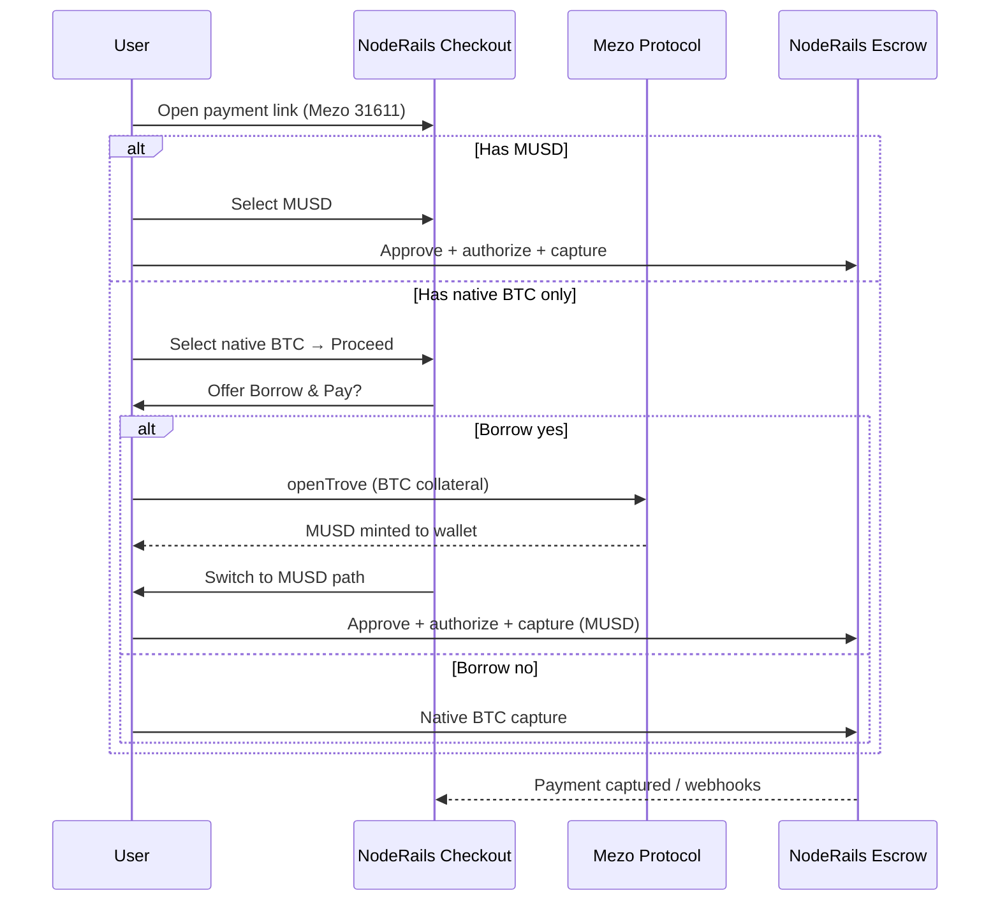

# NodeRails × Mezo — Hackathon Submission

**What we built:** Merchant payment infrastructure on **Mezo Testnet (chain 31611)** so customers can pay with **MUSD** or **native BTC**, including a **Borrow & Pay** path that opens a Mezo trove (BTC collateral → MUSD) and completes checkout in one hosted flow.

**Network:** Mezo Testnet only for the demo (`31611`). Mainnet (`31612`) is planned, not shipped in this build.

**Explorer:** https://explorer.test.mezo.org  
**Mezo borrow reference:** https://testnet.mezo.org/borrow

---

## 1. One-liner for judges

> **NodeRails brings Stripe-style hosted checkout to Mezo:** deploy escrow on 31611, accept **MUSD** and **native BTC**, and let payers who only hold BTC **borrow MUSD against collateral** inside the same payment link—then capture to the merchant via NodeRails escrow.

---

## 2. What is implemented on Mezo (summary)

| Layer | What | Status |
|-------|------|--------|
| **Smart contracts** | `NodeRailsEscrow` + `NodeRailsMerchantManager` on **31611** | Deployed (May 2026) |
| **Deploy tooling** | `mezo_testnet` in Foundry `chains.json` (`london` EVM, direct RPC) | Done |
| **Hosted checkout** | Standard ERC-20 **MUSD** authorize → capture via NodeRails escrow | Works when chain/token enabled in admin |
| **Hosted checkout** | **Native BTC** capture to escrow | Supported (same EVM native path as ETH on other chains) |
| **Borrow & Pay** | Client-side trove open + auto-switch to MUSD checkout | **Differentiator** — `payment-ui` feature module |
| **Pricing** | MUSD priced via USDC proxy; BTC/USD for borrow math | Server price API |
| **Mezo protocol reads** | `minNetDebt`, fees, gas compensation, MCR via Mezo RPC | Client-only (`viem`) |

**Not in this hackathon slice:** Mezo mainnet, Mezo Passport / Bitcoin-native wallets, atomic “borrow + pay in one contract call,” server-side `openTrove` (by design—user wallet signs).

---

## 3. On-chain: what we deployed on Mezo

NodeRails uses the **same escrow pattern** as on Sepolia/Base: merchant registers, payer authorizes, capture settles to merchant, disputes use timelocks.

### 3.1 NodeRails contracts (31611)

| Contract | Address |
|----------|---------|
| **NodeRailsEscrow** | `0x5a4bc03b982a909fc1e665cf63c5e662ee74cb2a` |
| **NodeRailsMerchantManager** | `0x2fa8ec8170e74afa89991e44e7d8c984f7867e86` |

Deployed with existing Foundry scripts; chain config uses `https://rpc.test.mezo.org` and **native BTC (18 decimals)** for gas.

### 3.2 Mezo protocol contracts we integrate with (not deployed by us)

| Contract | Address | Role in our flow |
|----------|---------|------------------|
| **MUSD** (ERC-20) | `0x118917a40FAF1CD7a13dB0Ef56C86De7973Ac503` | Payment token after borrow or direct pay |
| **BorrowerOperations** | `0xCdF7028ceAB81fA0C6971208e83fa7872994beE5` | `openTrove` — user locks **native BTC**, mints MUSD |
| **TroveManager** | `0xE47c80e8c23f6B4A1aE41c34837a0599D5D16bb0` | Read min collateral ratio, gas compensation |

---

## 4. How it works — two payment paths

### Path A — Pay with MUSD (standard)

For payers who already have MUSD on Mezo:

1. Open NodeRails **payment link** → select **Mezo Testnet** + **MUSD**.
2. Connect wallet (EVM).
3. **Authorize** (approve/permit) → **capture** into **NodeRailsEscrow**.
4. Indexer + webhooks → merchant sees `payment.captured` (same lifecycle as USDC on Base).

No Mezo-specific UI beyond chain/token selection.

### Path B — Borrow & Pay (BTC → MUSD → pay) ★ demo path

For payers who selected **native BTC** but need **MUSD** to complete the link:

1. Same payment link; merchant must accept **both native BTC and MUSD** on 31611.
2. Customer selects **native BTC** and proceeds from customer info.
3. **NodeRails intercepts** and offers **“Borrow & Pay”** (Mezo trove) vs **“Pay with BTC instead”**.
4. If user chooses borrow:
   - **Quote panel** reads Mezo protocol on-chain (min debt ~**1,800 MUSD**, fees, 151% default collateralization, liquidation estimate, BTC/USD price).
   - User confirms → wallet tx: **`BorrowerOperations.openTrove`** with `msg.value` = BTC collateral.
   - On success, checkout **switches to MUSD** and continues to **review → authorize → capture** (Path A).
5. If user declines → normal **native BTC** escrow capture (Path A variant for native).

**Important product note:** Opening a trove always mints at least **~1,800 MUSD** on testnet (protocol `minNetDebt()`), even for a small cart. Surplus MUSD stays in the user’s wallet after payment.

---

## 5. End-to-end flow (diagram)

---

## 6. Borrow & Pay — technical flow (what the code does)

All borrow logic lives in **`apps/payment-ui/src/features/mezo-borrow/`** (removable module; feature flag `MEZO_BORROW_ENABLED`).

| Step | Component | Action |
|------|-----------|--------|
| Gate | `should-offer-borrow.ts` | Testnet + chain 31611 + native BTC selected + MUSD on link |
| Offer | `mezo-borrow-layer.tsx` | Modal: explain trove, link to testnet.mezo.org/borrow |
| Session | `borrow-quote.ts` + `mezo-public-client.ts` | RPC reads: `minNetDebt()`, `getBorrowingFee`, `MUSD_GAS_COMPENSATION`, `MCR`; BTC price from NodeRails API |
| Quote UI | `mezo-borrow-quote-panel.tsx` | Sliders: collateral BTC, CR % (default **151%**), fees, liquidation price |
| Tx | `open-trove.ts` (wagmi) | `openTrove(borrowWei, 0x0, 0x0, { value: collateralWei })` on 31611 |
| Success | `use-mezo-borrow-proceed.ts` | Set selected token to **MUSD** → `review` step → existing capture flow |

**Libraries:** `viem` + `wagmi` only. No `@mezo-checkout/core`. Protocol reads use **`https://rpc.test.mezo.org`** (12s timeout), not a generic aggregator.

**Checkout wiring:** Three lines in `payment-link-checkout.tsx` — `useMezoBorrowProceed`, `onProceed`, `<MezoBorrowLayer />`.

---

## 7. What NodeRails provides vs what Mezo provides

| Capability | Provider |
|------------|----------|
| Trove / CDP / MUSD minting | **Mezo** (`BorrowerOperations`) |
| Merchant escrow, capture, disputes, webhooks | **NodeRails** (`NodeRailsEscrow`) |
| Hosted payment link, billing, review UI | **NodeRails** (`payment-ui`) |
| Borrow quote math & trove tx UI | **NodeRails** (client module) |
| BTC gas, 18-decimal native asset | **Mezo** chain |

We do **not** replace Mezo’s borrow app—we **embed** borrow as a funding step before **our** payment capture.

---

## 8. Demo setup (for reviewers)

### 8.1 Merchant / platform

1. **Admin:** `SupportedChain` for **31611** with `rpcUrl: https://rpc.test.mezo.org`, escrow + merchant manager addresses above.
2. **Admin:** Tokens on 31611 — **MUSD** (`0x1189…c503`) and **native BTC** (platform native sentinel).
3. **MTXM + indexer:** Chain 31611 registered; escrow indexed from deploy block.
4. **Payment link:** Amount in USD; accepted tokens **MUSD + native BTC** on Mezo testnet; app in **testnet** mode.

### 8.2 Payer wallet

1. Fund via https://faucet.test.mezo.org (native BTC for gas + collateral).
2. Connect MetaMask (or EVM wallet) on **Mezo Testnet**.
3. Run **Borrow & Pay** demo: select BTC → borrow → pay with minted MUSD.
4. Optional: decline borrow and pay with native BTC only.

### 8.3 URLs to show

- Payment link: your hosted `/link/{slug}` on testnet app.
- Trove tx: `https://explorer.test.mezo.org` (linked from modal after confirm).
- Mezo borrow reference: `https://testnet.mezo.org/borrow`.

---

## 9. Why this matters for Mezo

1. **Real commerce use case** — not a standalone borrow demo; borrow is a **payment funding** step for merchants using NodeRails.
2. **Native BTC + MUSD** — matches Mezo’s asset model (BTC gas, MUSD settlements).
3. **Production-shaped** — same escrow, webhooks, and capture model as other EVM chains; Mezo is another chain row, plus one UX module.
4. **Composable** — borrow module can be disabled or removed without touching core checkout.

---

## 10. Limitations (honest scope for judges)

- **Testnet only** for Borrow & Pay gate (`isTestnet` + chain 31611).
- **Minimum borrow ~1,800 MUSD** — poor fit for very small carts unless user already has MUSD.
- **Sequential txs** — `openTrove` then MUSD approve/capture (two confirmations), not one atomic router tx.
- **One trove per user** — repeat `openTrove` may fail if user already has a trove (future: use existing MUSD balance).
- **Wallet** — EVM wallets (MetaMask); Mezo Passport / Xverse not integrated in v1.

---

## 11. File / repo map (for technical reviewers)

| Area | Location |
|------|----------|
| Mezo deploy config | `noderails-contracts/script/chains.json` → `mezo_testnet` |
| Deployed addresses | `noderails-contracts/deployData/contractAddresses.json` → `31611` |
| Borrow & Pay UI | `apps/payment-ui/src/features/mezo-borrow/` |
| Checkout integration | `apps/payment-ui/src/components/payment-link-checkout.tsx` |
| MUSD pricing | `services/noderails-server/src/modules/prices/price.service.ts` (`MUSD` → `USDC` proxy) |
| Deep-dive research | `mezo-addition-docs/mezo-borrow-integration-research.md` |

---

## 12. Suggested demo script (60–90 seconds)

1. **Show merchant dashboard** — Mezo testnet enabled, MUSD + BTC on payment link.
2. **Open link as customer** — select Mezo, select **native BTC**, enter email, click proceed.
3. **Borrow & Pay modal** — “Check borrowing power” → show quote (151% CR, fees, min 1,800 MUSD note).
4. **Confirm in wallet** — `openTrove` on explorer.
5. **Auto-continue** — review with **MUSD** selected → authorize → capture.
6. **Show webhook / payment captured** in merchant view.
7. **Optional:** repeat flow, choose **“Pay with BTC instead”** for native capture only.

---

*NodeRails — hosted payments with escrow, disputes, and multi-chain support. Mezo testnet integration: contracts deployed May 2026; Borrow & Pay shipped in `payment-ui` feature module.*
