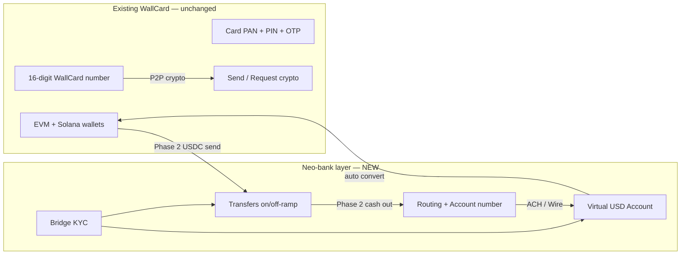
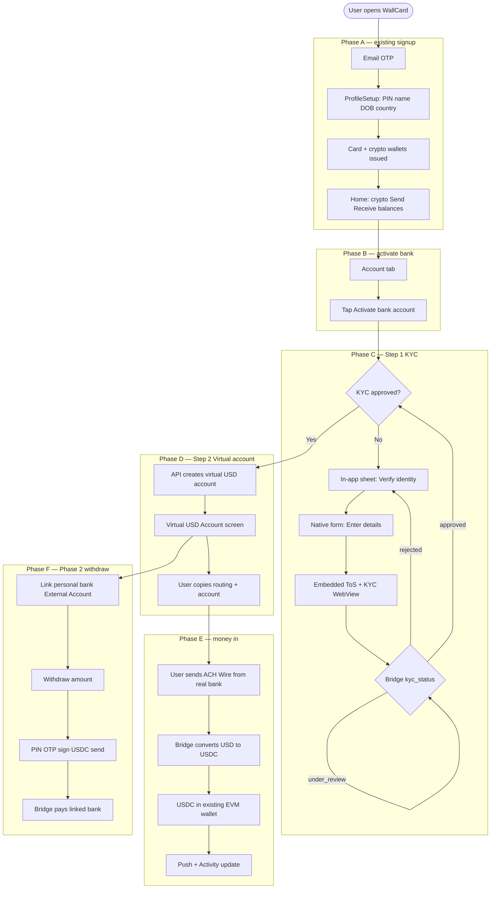
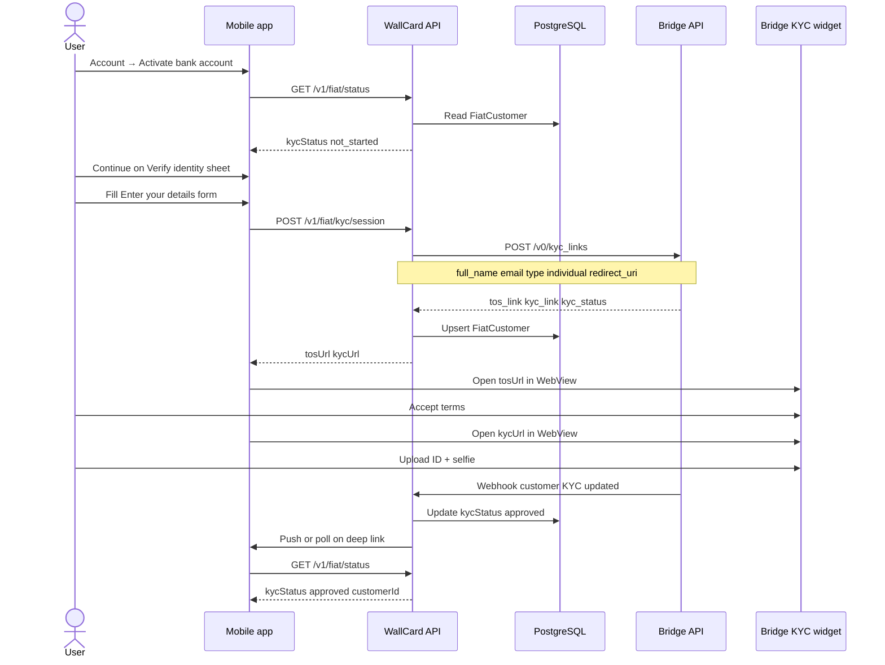
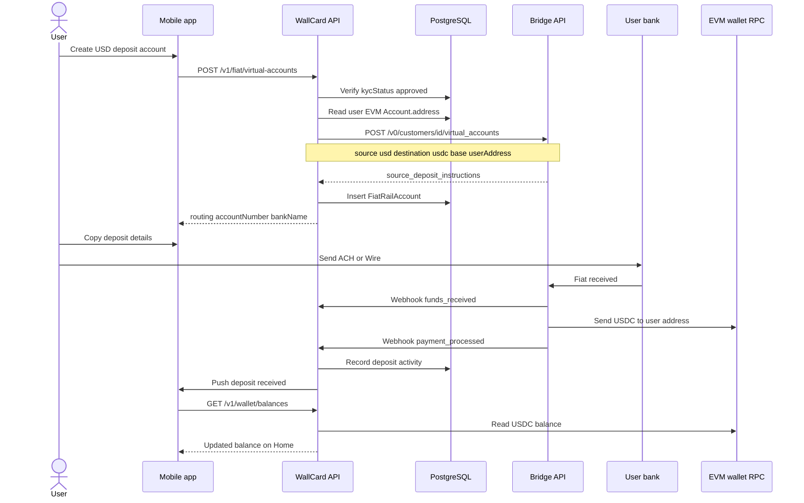
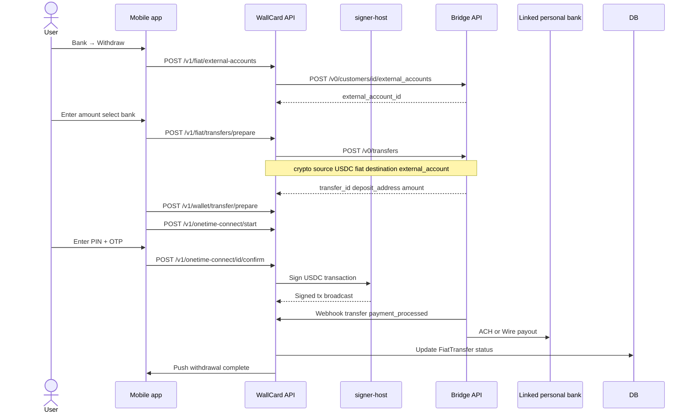
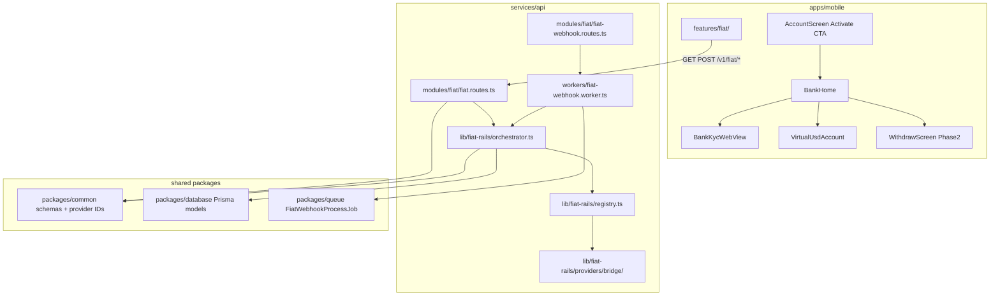
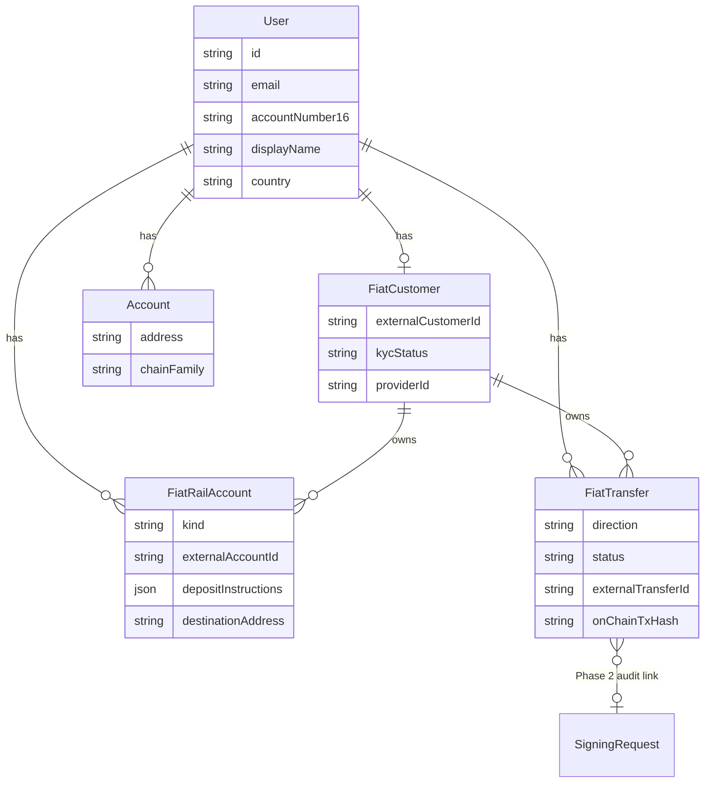
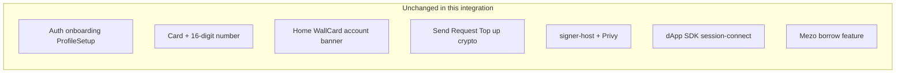

# Bridge Fiat Rails — Architecture Flow Diagrams

> How WallCard integrates KYC, virtual accounts, and transfers with Bridge.
> Existing crypto wallet features (card, 16-digit number, Send/Receive, signer-host) are unchanged.

---

## 1. High-level system architecture

What exists today vs what gets added.

```mermaid
flowchart TB
  subgraph clients [Client layer — member app only]
    Mobile[apps/mobile]
  end

  subgraph wallcard_api [WallCard API — services/api :9080]
    Auth[/v1/auth]
    Wallet[/v1/wallet]
    SignConnect[/v1/onetime-connect]
    Fiat[/v1/fiat — NEW]
    WebhookIn[/v1/webhooks/inbound/bridge — NEW]
    Workers[BullMQ workers]
  end

  subgraph wallcard_signer [Signer-host — unchanged]
    SignerHost[signer-host :9081]
    KeyRegistry[KeyProviderRegistry]
    Privy[PrivyKeyProvider]
  end

  subgraph data [Data layer]
    PG[(PostgreSQL)]
    Redis[(Redis)]
    SM[AWS Secrets Manager]
  end

  subgraph external [External services]
    Bridge[Bridge API v0]
    Bank[User real bank]
    RPC[EVM / Solana RPC]
    PrivyAPI[Privy API]
  end

  Mobile --> Auth
  Mobile --> Wallet
  Mobile --> SignConnect
  Mobile --> Fiat
  Mobile -.->|Phase 2 withdraw signing| SignConnect

  Auth --> PG
  Wallet --> PG
  Wallet --> RPC
  SignConnect --> SignerHost
  SignerHost --> KeyRegistry
  KeyRegistry --> Privy
  Privy --> PrivyAPI

  Fiat --> PG
  Fiat --> Bridge
  Bridge --> WebhookIn
  WebhookIn --> Workers
  Workers --> PG
  Workers --> Mobile

  Bank --> Bridge
  Bridge -->|USDC on-ramp| RPC

  Fiat --> SM
  SignerHost --> SM
```

**Trust boundary:** Mobile never holds Bridge API keys. Only `services/api` calls Bridge.

---

## 2. Two accounts in one app

WallCard keeps its existing identifiers. Bridge adds a separate fiat deposit account.



| Identifier | Purpose | Created when |
|---|---|---|
| 16-digit WallCard number | Other WallCard users send you crypto | ProfileSetup (today) |
| Virtual bank account | Your real bank sends you USD | After KYC approved |
| EVM address | Receives USDC from Bridge + on-chain sends | ProfileSetup (today) |

---

## 3. Complete user journey (start to end)



---

## 4. KYC flow — sequence diagram (Step 1)



---

## 5. Virtual account on-ramp — sequence diagram (Step 2)



---

## 6. Transfer off-ramp — sequence diagram (Step 3, Phase 2)



---

## 7. Backend module map (where code lives)



---

## 8. Bridge API mapping

| WallCard step | User action | WallCard API | Bridge API |
|---|---|---|---|
| **1 KYC** | Activate → verify identity | `POST /v1/fiat/kyc/session` | `POST /v0/kyc_links` |
| **1 KYC** | Wait for result | `GET /v1/fiat/status` + webhook | Customer / KYC status |
| **2 Virtual account** | Create deposit account | `POST /v1/fiat/virtual-accounts` | `POST /v0/customers/{id}/virtual_accounts` |
| **2 Virtual account** | View details | `GET /v1/fiat/virtual-accounts` | List / get VA |
| **2 Virtual account** | See deposits | `GET /v1/fiat/virtual-accounts/:id/activity` | VA activity |
| **3 Transfer off-ramp** | Link bank | `POST /v1/fiat/external-accounts` | `POST /v0/customers/{id}/external_accounts` |
| **3 Transfer off-ramp** | Withdraw | `POST /v1/fiat/transfers/prepare` | `POST /v0/transfers` |
| **All** | Async updates | `POST /v1/webhooks/inbound/bridge` | Bridge webhooks |

Every Bridge POST from WallCard API includes `Api-Key` and `Idempotency-Key`.

---

## 9. Data model relationships



---

## 10. What does NOT change



---

## Related docs

- Implementation plan: `.cursor/plans/bridge_neo-bank_integration_13a081c8.plan.md`
- Product guide: [WALLCARD_MASTER_GUIDE.md](./WALLCARD_MASTER_GUIDE.md)
- Bridge docs: https://apidocs.bridge.xyz/
