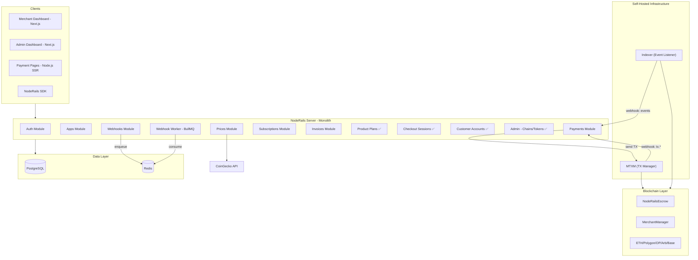
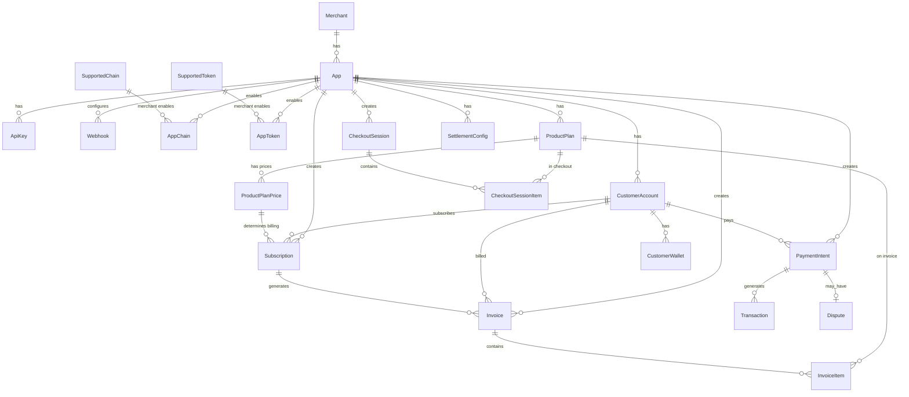
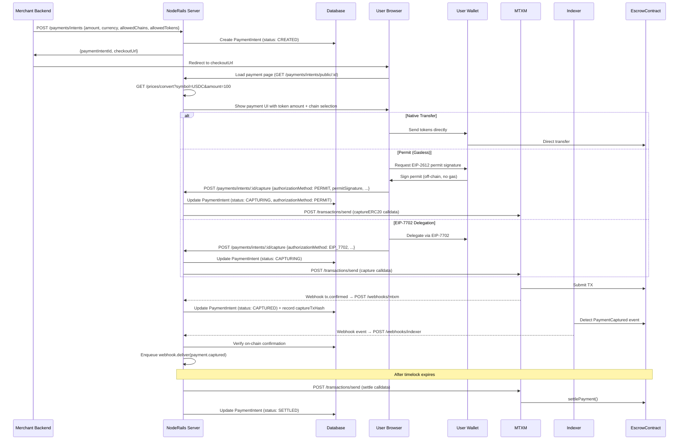

# What's Done

## Latest Updates (2026-04-15)

### APIS

- Added merchant password recovery endpoints: `POST /auth/forgot-password` (generic response to prevent account enumeration) and `POST /auth/reset-password` (token + new password).

### SERVICES

- Implemented secure password reset flow in auth service using one-time cryptographic reset tokens (`crypto.randomBytes(32)`), SHA-256 token hashing, Redis TTL expiry (30 min), latest-token invalidation per merchant, and per-email rate limiting to reduce abuse.
- Password reset email delivery now uses SES with a dashboard reset link (`/reset-password?token=...`) generated from server-configured dashboard base URL.

### FRONTEND

- Added dashboard merchant auth pages for password recovery: `/forgot-password` and `/reset-password`.
- Added `Forgot password?` entry point on `/login` and wired new API client methods for forgot/reset password endpoints.

## Latest Updates (2026-04-09)

### LANDING / WEBSITE

- **Pricing updated**: Introductory fee changed from 2% to 1%, Normal fee changed from 3% to 2%. Stats section also updated to reflect 1% fee.
- **Product pages created**: Five dedicated product pages under `/products/` with shared layout (nav + footer):
  - `/products/payments` — Multi-chain payment acceptance with dashboard-overview, payments-list, payment-details, customers screenshots
  - `/products/checkout` — Hosted checkout flow with payment-details, payment-transactions, payment-receipt screenshots
  - `/products/payment-links` — No-code payment link creation with payment-links, dashboard-overview screenshots
  - `/products/subscriptions` — Recurring billing with subscriptions, product-plans, subscription-details screenshots
  - `/products/invoicing` — Invoice creation and email delivery with invoice-email, tax-rates, payment-receipt screenshots
- **Footer links fixed**: All `href="#"` placeholder links now point to real routes — product links to `/products/*`, Status to `https://status.noderails.com`, Guides to `/docs`, Blog to `/blog`, About to `/about`, Careers to `/careers`.
- **Real screenshots added to homepage**: Replaced placeholder globe graphic with dashboard-overview screenshot in stats section. Replaced mock merchant console with payments-list screenshot in merchants section. Replaced OG image in risk/compliance section with payment-details screenshot.
- **Screenshots organized**: 16 product screenshots copied from `product-screeshots/` to `apps/landing/public/screenshots/` with clean names (dashboard-overview, payments-list, payment-details, payment-transactions, payment-links, customers, payment-receipt, dispute-center, invoice-email, dispute-payments, raise-dispute, product-plans, subscriptions, subscription-details, app-settings, tax-rates).

## Latest Updates (2026-04-01)

### CONTRACTS

- Deployment reliability was improved in `noderails-contracts/script/deploy.sh`: deploy metadata persistence (`deployData/contractAddresses.json`, `contractAbis.json`, `deploymentHistory.json`) now runs immediately after successful broadcast, and contract verification runs afterward as a best-effort step so verification failures no longer lose deployed address/ABI records.
- Deployment script verification is now explicitly optional by operator choice: `./script/deploy.sh <chainId> <target> --no-verify` skips verification, while `--verify` forces it (when API key is present).
- Deployment verification is now chain-aware: the script auto-selects Blockscout verification for Blockscout explorers and Etherscan mode for Etherscan-compatible explorers, preventing Flow/Filecoin verification attempts from failing with missing Etherscan URL mapping errors.
- `--no-verify` now also hard-disables implicit verifier usage during the initial `forge script --broadcast` step (by overriding verifier key env for that call), resolving Foundry nightly behavior where chain `545` broadcast could fail early with Etherscan URL lookup errors despite no-verify intent.

## Latest Updates (2026-03-25)

### FRONTEND

- Added a hosted LLM-readable documentation manifest at `apps/landing/public/llm.txt`, now served from the landing app as `/llm.txt` for AI/agent discovery of canonical docs and API reference sections.

## Latest Updates (2026-03-19)

### CONTRACTS

- Deployment role initialization was hardened: `NodeRailsEscrow` and `NodeRailsMerchantManager` now assign `SUPER_ADMIN_ADDRESS` and all comma-separated `ADMIN_ADDRESSES` directly in constructors, removing the post-deploy super-admin transaction previously needed to grant admin roles.
- Operational key management was tightened: `roles.sh add-tx-keys` now uses `ADMIN_PRIVATE_KEY` (must match the first `ADMIN_ADDRESSES` entry) so routine transaction-key assignment no longer requires using the super-admin private key.
- Role-management scripts now support partial deployments per chain: when only one contract address is available in `deployData/contractAddresses.json`, role updates execute for the deployed contract and skip the missing contract instead of failing.

### DATABASE

- Merchant identity modeling now includes `merchantType` (`BUSINESS` default, `INDIVIDUAL` optional) plus explicit `businessName` and `individualName` columns on `merchants`; existing records remain backward-compatible via default `BUSINESS` and nullable name fields.

### APIS

- Customer dispute auth moved to cookie-based JWT sessions: `POST /disputes/customer/verify-otp` now sets an `httpOnly` cookie (`nr_dispute_token`) and customer dispute endpoints authenticate via cookie instead of Bearer token headers.
- Payment list response from `GET /disputes/customer/payments` now returns formatted crypto amounts (converted from smallest-unit DB values using token decimals) and includes `chainName` in `Name (chainId)` format.
- Auth APIs now accept and return merchant identity type fields: `POST /auth/register` supports `merchantType` + conditional business/individual name, and `GET/PUT /auth/me` include the same fields while preserving `orgName` compatibility.
- Added public metadata endpoint `GET /public/supported-assets` that returns enabled chains and tokens for docs/marketing surfaces with resolved icon URLs.

### SERVICES

- Dispute customer portal flow now relies on server-managed cookie sessions (reload-safe without localStorage token persistence).
- Customer dispute portal now displays crypto token symbol from token key (`SYMBOL-CHAINID` => `SYMBOL`) and renders network display as chain name plus chain id.
- Payment authorization now includes a backend permit guard: for `PERMIT` flow, `permitSignature.amount` must be greater than or equal to submitted `cryptoAmount`, preventing under-allowance captures caused by frontend rounding or quote drift.
- Payment authorization now includes a backend non-permit ERC20 allowance preflight: before MTXM capture submission, server reads `allowance(wallet, escrow)` on-chain and rejects if allowance is below required `cryptoAmount`, preventing `transfer amount exceeds allowance` reverts.
- Checkout permit signing is now hardened to prefer on-chain EIP-712 domain metadata (`name()` and optional `version()`) with fallback to configured values, and signature `v` is normalized to 27/28 to avoid invalid-signature permit failures on tokens like USDC variants.
- PERMIT capture flow now performs backend permit simulation (`token.permit(...)`) whenever current allowance is below required amount; invalid signatures/domain/version mismatches fail fast with explicit validation errors instead of opaque escrow `transferFrom` allowance reverts.
- Team invite email links now use a validated `DASHBOARD_URL` server config (with `NEXT_PUBLIC_DASHBOARD_URL` fallback), and production no longer silently falls back to localhost when invite URL config is missing.
- Added production scaling runbook at repository root (`production_scaling_runbook.md`) documenting current API/worker coupling, multi-instance risk analysis, and phased rollout plan for role-based process separation on EC2.
- Merchant suspension now enforces read-only mode at middleware level for authenticated merchant/team and API-key requests: mutating methods are blocked when the owning merchant is suspended, while read methods remain available.
- Public asset metadata service now resolves chain/token logos from DB-provided `iconUrl` first with a lightweight symbol fallback URL strategy (no Redis/cache dependency), so docs and public UI can render logos without runtime cache coupling.
- Filecoin role-management broadcasts were hardened: `script/roles.sh` now applies `--skip-simulation` on chain `314159` (same approach as deploy flow) to avoid Foundry local gas-estimation underflow errors when adding tx keys/admin roles.
- Role-management broadcasts are now verifier-disabled by default (`ETHERSCAN_API_KEY=` scoped on `forge script`) to prevent Foundry nightly from attempting Etherscan URL resolution on non-Etherscan chains (for example Flow `545`) during add-tx-keys/add-admins/setup/remove-keys.

### FRONTEND

- PostHog analytics foundation is now integrated across all frontend apps (`landing`, `dashboard`, `payment-ui`, `admin`) via root layout providers with SPA pageview capture (`$pageview`) using Next.js pathname/search updates.
- Frontend auth contexts now identify signed-in users in PostHog (`merchant`, `team member`, `admin`) and reset identity on logout/unauthenticated state for cleaner cross-session user journey tracking.
- Frontend env now includes `NEXT_PUBLIC_POSTHOG_KEY` and `NEXT_PUBLIC_POSTHOG_HOST` for runtime PostHog configuration.
- Landing now tracks primary CTA click journeys (`signup/login/docs`) with location metadata to measure acquisition source-to-action conversion.
- Dashboard now tracks key activation lifecycle events (`login/register/logout`, app creation, checkout session creation, payment link creation, invoice/subscription creation, and team invite send/resend).
- Payment UI now tracks checkout funnel milestones end-to-end: checkout viewed, chain/token selection, step transitions, authorization submit/success/failure, native capture reporting, and capture terminal outcomes.
- Landing hero behavior was refined to show the original dashboard banner first and only transition to the R2 video after a 5-second post-load delay plus viewport readiness, so initial hero context is visible before video takeover.
- Hero video audio now uses best-effort default sound-on playback with automatic muted fallback when blocked by browser autoplay policy, and a persistent `Mute/Unmute` control is rendered once video is ready.
- Landing hero preview is now split into two separate components (`HeroDashboardPreview` and `HeroVideoPreview`) with a client-side switcher (`HeroPreviewSwitcher`) that renders only one at a time: dashboard banner + floating cards first, then video-only preview after a 5-second JS delay.
- Hero video preview now uses a dedicated browser-framed component (`HeroVideoPreview`) with merchant.noderails.com chrome and flexible video sizing that preserves the video's natural aspect ratio without cropping on sides; autoplay starts muted automatically without extra prompts, showing only an `Unmute`/`Mute` control button when video is ready.
- Landing marketing flow now includes dedicated downstream sections for merchant operations (`Built for Humans`) and AI payment infrastructure (`Built for AI & Agents`) before pricing, improving feature discoverability for human-led checkout and agent-native use cases.
- Agents section visual system was upgraded from generic feature tiles to a premium NFT-inspired crypto card banner (`Agent Crypto Card`) with NodeRails branding, holographic gradients, and card metadata plus KPI chips, aligning the section with high-end financial-product UI expectations.
- Landing now includes first-party legal routes at `/terms` and `/privacy` with platform-specific policy language covering non-custodial operations, merchant compliance obligations (KYC/AML/sanctions/tax), acceptable use, liability boundaries, and privacy/data-handling practices.
- Legal copy now explicitly uses a shared-responsibility compliance model: NodeRails provides compliance/risk tooling and workflow support, while merchants retain legal responsibility for jurisdiction-specific obligations and final compliance decisions.
- Terms fee language now reflects product policy that supported blockchain network execution costs are included in platform fees (no separate gas/network billing by default), with exceptions only for explicit custom enterprise terms.
- Terms reliability language was rewritten to be customer-friendly, emphasizing high availability intent and proactive product/API improvements with reasonable implementation-change notice.
- Dashboard onboarding now asks merchant identity type first (Business vs Individual) and collects a corresponding name field after signup/email verification, while preserving the existing app creation/wallet steps and keeping hosted checkout merchant display unchanged (still app name).
- Dashboard Settings now includes an editable merchant type field, and the identity label/value switches between `Organization name` and `Individual name` based on selected type.
- Admin merchant list and merchant detail pages now show merchant type and type-aware display name (`businessName`/`individualName` fallback), so operations teams see identity consistently with merchant settings.
- Merchant dashboard now renders a persistent red suspension notice (with reason and support email) when an account is suspended, while action attempts are denied by backend middleware.
- Merchant dashboard app settings now render chain and token logos (using `iconUrl` with local fallback badges) in the Chains and Tokens tabs for clearer asset selection.
- Docs homepage now includes an auto-updating `Supported Chains and Tokens` section that fetches supported assets from backend and renders chain/token cards with graceful icon fallbacks.
- Added a secure feedback intake flow spanning landing, backend, and admin: a side popup widget on landing posts feature/chain/general feedback to `POST /feedback`, data is persisted in `feedback_submissions`, and platform admins can review/update status from a new dashboard view.
- Feedback submission path includes anti-abuse controls: strict zod validation, honeypot field check, server-side sanitization + attack-pattern rejection, IP hashing for privacy-safe abuse monitoring, and dedicated rate limiting on `/feedback`.
- Landing feedback UX now opens automatically from the bottom after a 10-second delay (instead of a side tab), includes a mascot-style greeting prompt, and supports explicit dismiss via `Close feedback` so users can opt out per page load.

### DOCS

- Landing docs were realigned with current API + SDK behavior after rollback recovery: API key auth examples now use `x-api-key`, pagination examples use `totalPages`, Prices docs use `currency` + `amountFiat`/`priceFiat` (with `amountUsd` marked backward compatible), and invoice docs now reflect `VOID` status plus `invoices.send()` returning `{ sent: true }`.
- SDK docs were cross-checked against the sibling `noderails-sdk` repo and corrected for method signatures and return shapes (e.g., `customers` wallet params, `productPlans` `planType`/`prices`, `subscriptions.createCheckout`, `paymentIntents.refund` return shape, `taxRates.displayName`, and webhook list/test/delivery methods).
- Docs navigation now includes a dedicated `Supported Chains & Tokens` route under Getting Started (`/docs/supported-assets`), with discovery from Quick Start and sidebar navigation so merchants can verify supported assets before integration.
- Supported assets docs now separate chains into `Production Chains` and `Test Chains`, and include a curated hardcoded chain set (Ethereum, Polygon, Arbitrum, Optimism, Monad plus common testnets) merged with configured data for immediate visibility.
- Supported assets docs temporarily hide the token grid and show chain coverage only (production + test sections) until token presentation is finalized.
- Landing docs now fetch supported assets via a same-origin Next.js API proxy route (`/api/public/supported-assets`) instead of direct browser calls to backend host, preventing Chrome local-network access prompts during docs usage.
- Added a repository-root `brand-assets/` folder containing blue-only NodeRails SVG exports (icon-only and full lockup with `CRYPTO PAYMENT INFRA`) in multiple dimensions for immediate branding use across product, docs, and social placements.
- Docs introduction now includes a top support/community callout with direct Telegram and Discord channel links.
- Landing footer now includes official social/community links for X (`@noderails`), LinkedIn, Telegram, and Discord, with Discord + Telegram repeated in the final footer row for quick access.
- Landing root metadata now includes production social sharing tags via Next.js App Router `metadata` (canonical URL, Open Graph, and Twitter `summary_large_image`) using the generated 1200x630 preview image at `/og/landing-upper-panel.png`.
- Landing domain handling now normalizes canonical/OpenGraph metadata to `https://www.noderails.com` and adds permanent apex-domain redirect support (`noderails.com` -> `www.noderails.com`) in landing Next.js config.
- Landing FAQ now includes a dedicated subscriptions reliability question and expanded trust-focused dispute/fund-safety explanations with explicit lifecycle messaging (`Authorize -> Capture -> Dispute Window -> Settle`) and on-chain settlement fallback clarity.
- Landing FAQ copy now explicitly clarifies capture semantics (captured funds are on merchant settlement path unless user wins dispute), includes the `Authorize -> Capture -> Dispute -> Settle` flow, and states direct on-chain settle fallback if auto-settlement is delayed.
- Landing now includes a trust-focused FAQ section covering compliance posture (non-custodial model), escrow/timelock fund safety, dispute workflow, onboarding flow, and chain request escalation via Telegram/Discord.

## Phase 1: Smart Contracts ✅

| Component | Status | Description |
|-----------|--------|-------------|
| NodeRailsEscrow.sol | ✅ Done | Payment capture, settlement, disputes with timelock |
| NodeRailsMerchantManager.sol | ✅ Done | Stateless payout proxy with session signatures |
| TimelocksLib.sol | ✅ Done | Bit-packed timelock storage library |
| Interfaces | ✅ Done | INodeRailsEscrow, INodeRailsMerchantManager |
| Foundry Tests | ✅ Done | Comprehensive test coverage |
| Deploy Scripts | ✅ Done | Multi-chain deployment scripts |
| Testnet Deploy | ✅ Done | Deployed to Sepolia, Amoy |


## Phase 2: Backend Infrastructure ✅

### Packages ✅

| Package | Status | Description |
|---------|--------|-------------|
| @noderails/common | ✅ Done | Shared types, errors, utils, constants, central config |
| @noderails/database | ✅ Done | Prisma 7 schema with full data model |
| @noderails/queue | ✅ Done | Pluggable queue abstraction (BullMQ). **Design decision:** All queue producers use `queueRegistry.getOrCreateQueue()` (singleton cache by name) instead of `createQueue()` to prevent Redis connection exhaustion — each BullMQ Queue opens its own ioredis connection, so reusing instances is critical. `queueRegistry.closeAll()` is called during graceful shutdown. |
| @noderails/web3 | ✅ Done | ABI encoding (viem), EIP-712 typed data, timelock utils |
| @noderails/mtxm-client | ✅ Done | Typed HTTP client for MTXM REST API |
| @noderails/indexer-client | ✅ Done | Typed HTTP client for Indexer Project API |
| @noderails/service-base | ✅ Done | Express app factory, JWT/API key auth middleware, error handling, rate limiting, validation |
| @noderails/redis | ✅ Done | Shared ioredis singleton. **Design decision:** Separated from `@noderails/queue` to keep a lightweight, general-purpose Redis client for non-queue use cases (OTP storage, rate limiting, caching). Initialised once at startup via `createRedisClient({ url })`, accessed via `getRedis()`, disconnected in graceful shutdown. |
| @noderails/sdk | ✅ Done | Merchant-facing SDK (separate repo: `noderails-sdk/`). Zero runtime deps, native `fetch`, dual ESM/CJS via tsup, Node 18+/Deno/Bun. Stripe-style dot-notation (`noderails.checkoutSessions.create()`). Init: `new NodeRails({ appId, apiKey })`. 10 resources, webhook verification (HMAC-SHA256), typed errors. **Design decision:** Separate standalone repo (not in monorepo) since it's an npm package for external consumers. API key format changed to `nr_<env>_<type>_<random>` (e.g. `nr_live_sk_...`). SDK requires secret keys only. |

### Services ✅

| Service | Status | Description |
|---------|--------|-------------|
| setup-cli | ✅ Done | One-time MTXM/Indexer chain + webhook registration |
| noderails-server | ✅ Done | Unified monolith: auth, apps, api-keys, payments, webhooks, prices, payouts, subscriptions, invoices (port 3000) |

> **Architecture decision:** Auth, payments, webhooks, and prices are co-located in a single monolith (`noderails-server`) with domain-based folder structure. Only MTXM and Indexer remain as separate self-hosted infrastructure services.

### Server Modules ✅

| Module | Status | Description |
|--------|--------|-------------|
| payouts | ✅ Done | Merchant payout management |
| subscriptions | ✅ Done | Recurring payments with product plans, billing intervals, trial periods, permit-based auto-pulls. **First-period invoice:** When initial checkout payment is captured & subscription activates, a first-period invoice is automatically created, marked PAID, and linked to the payment intent — ensuring every billing period has a visible invoice and transaction record. First-period invoice now correctly includes `taxRateId` from the product plan (matching the renewal invoice flow in `subscription.worker.ts`), so tax details display correctly on the first invoice. |
| invoices | ✅ Done | Invoice generation with line items, customer accounts, sequential numbering. **Full E2E payment flow:** `createCheckoutSessionFromInvoice` creates a CheckoutSession (sourceType: INVOICE), payment-ui reuses `PaymentLinkCheckout` component, capture confirmation auto-marks invoice PAID via `markInvoicePaidIfApplicable` in both MTXM and indexer webhook paths. Dashboard has copy-payment-link button for OPEN invoices. **Tax computation fix:** `createInvoice()` now correctly handles item-level tax rate overrides — each item's tax rate is resolved independently (batch-fetched from DB), using its own percentage and inclusive flag instead of only the invoice-level values. Mixed inclusive/exclusive tax is supported. |
| payment-links | ✅ Done | Shareable payment URLs with slug-based routing, optional fixed amounts, usage tracking, per-link chain/token restrictions. **Subscription support (Stripe-like):** When a payment link references a SUBSCRIPTION-type product plan with a billing interval, the checkout session is created with `mode: 'SUBSCRIPTION'`, native tokens are auto-filtered (subscriptions require ERC20 transferFrom), and on capture a Subscription record is auto-created and activated. The payer gets a 1-year capped ERC20 approval for recurring charges. Full lifecycle (billing, retries, grace period) kicks in automatically via the existing subscription engine. |

> **Design decision (payment link subscriptions):** Payment links now support subscription product plans, mirroring Stripe's payment link → subscription flow. When `productPlan.planType === 'SUBSCRIPTION'` and `productPlanPrice.billingInterval` is set, `createCheckoutSessionFromLink` sets `mode: 'SUBSCRIPTION'` and filters out native tokens. On capture, `handlePaymentLinkSubscriptionCapture` in ingest.service.ts auto-creates a Subscription record and immediately activates it via `handleSubscriptionPaymentComplete`, which stores wallet/chain/token info and schedules the next billing cycle charge job. The payment-ui already handles subscription detection (1-year capped approval, "/month" display) from the existing frontend implementation.

> **Design decision (payment link chain/token validation):** `createPaymentLink` and `updatePaymentLink` now validate `allowedChains`/`allowedTokens` against the app's enabled chains and tokens (which are already validated against admin-level `SupportedChain.isEnabled`/`SupportedToken.isEnabled`). Previously, payment links could be created with any chain IDs including admin-disabled chains — this is now blocked by `validateAllowedChains` and `validateAllowedTokens` helpers. Dashboard payment link form now exposes "Accepted Networks" and "Accepted Tokens" multi-selects (with "All" toggles), allowing merchants to restrict which chains/tokens a specific link accepts. Tokens are grouped by chain in the picker and auto-filtered when chain selection changes.

### Database Redesign v2 ✅

> **Design decision:** Moved from single-field chain/token config to admin-managed `SupportedChain`/`SupportedToken` tables with merchant-level `AppChain`/`AppToken` enable/disable. Adopted Stripe-like Product Plans with pricing toggle (monthly/yearly on checkout page). Added 3 ERC20 authorization methods: native transfer, EIP-2612 permit (gasless), EIP-7702 delegation. Settlement support is table-ready but feature implementation is deferred.

> **Build system:** Root `pnpm dev` now uses `turbo run dev --ui stream` with `"dependsOn": ["^build"]` in turbo.json, ensuring all shared packages (database, common, queue, web3, etc.) are built before dev servers start. Previously used `concurrently` which skipped package builds.

| Change | Status | Description |
|--------|--------|-------------|
| Admin chains/tokens | ✅ Done | `SupportedChain`, `SupportedToken`, `AppChain`, `AppToken` models |
| Chain/token disable cascade | ✅ Done | Admin disabling a chain cascades: auto-disables all `SupportedToken`, `AppChain`, `AppToken` on that chain. Admin disabling a token cascades to all `AppToken`. Merchant disabling a chain also disables all `AppToken` on that chain for their app. |

> **Design decision (chain disable cascade):** Disabling a chain at admin level now triggers a transactional cascade that disables (1) all SupportedTokens on that chain, (2) all AppChain entries for that chain across all apps, (3) all AppToken entries for tokens on that chain across all apps. Similarly, disabling a token at admin level cascades to disable all AppToken entries. At merchant level, disabling a chain also disables AppTokens on that chain for that app. Checkout resolution queries (`getPaymentLinkBySlug`, `getIntentPublic`) now additionally filter by `chain.isEnabled: true` and `supportedToken.chain.isEnabled: true` so changes are immediately effective on live payment links/intents without any delay. Re-enabling a chain does NOT auto-re-enable tokens — admin must explicitly re-enable them (safer approach).
| Customer accounts | ✅ Done | `CustomerAccount`, `CustomerWallet` models per app |
| Product plans + prices | ✅ Done | `ProductPlan` (ONE_TIME/SUBSCRIPTION) + `ProductPlanPrice` with billing intervals |
| Checkout sessions | ✅ Done | `CheckoutSession` (universal payment hub) with `sourceType`, `sourceId`, `amount`, `currency`, `allowedChains`, `allowedTokens`. `CheckoutSessionItem` for line items. All payment flows funnel through CheckoutSession → PaymentIntent. |
| Invoice line items | ✅ Done | `InvoiceItem` model with product plan refs, sequential `invoiceNumber` |
| Payment intent v2 | ✅ Done | `amount`/`currency` (not amountUsd), `authorizationMethod`, `allowedChains`/`allowedTokens` as JSON, `sourceType`/`sourceId` |
| Subscription v2 | ✅ Done | Links to `ProductPlan`/`ProductPlanPrice`, permit fields, billing cycle tracking, `cancelAtPeriodEnd` |
| Settlement tables | ✅ Done | `SettlementConfig`, `Settlement` models (table-ready, feature later) |
| Updated enums | ✅ Done | `AuthorizationMethod`, `BillingInterval`, `PlanType`, `CheckoutMode`, `PaymentSourceType`, `SettlementStatus` |
| Service updates | ✅ Done | Updated intent, capture, ingest, subscription, invoice services and routes |

### Indexer Webhook Enhancement ✅

> **Design decision:** The indexer sends one contract-event webhook per call (not an array). Previous handler had a bug checking for `payload.events` array — never processed events. Now fixed: extracts `paymentIntentId` from on-chain `args` (bytes32), converts via `bytes32ToUuid()`, cross-validates against Transaction records, and updates PaymentIntent status with strict state-machine transitions.

| Feature | Status | Description |
|---------|--------|-------------|
| Payload format fix | ✅ Done | Fixed handler to process single `IndexerEventWebhookPayload` instead of non-existent `events` array |
| bytes32↔UUID conversion | ✅ Done | Shared `crypto-utils.ts` with `uuidToBytes32()` and `bytes32ToUuid()` — used by both authorize and ingest services |
| PaymentIntentId validation | ✅ Done | Extract bytes32 from `event.args.paymentIntentId`, decode to UUID, verify PI exists in DB |
| Cross-validation | ✅ Done | If Transaction exists for txHash, verify its `paymentIntentId` matches the on-chain value — abort on mismatch |
| Status updates | ✅ Done | `PaymentCaptured→CAPTURED`, `PaymentSettled→SETTLED`, `DisputeInitiated→DISPUTED`, `DisputeResolved→DISPUTE_RESOLVED`, `PaymentRefunded→REFUNDED` with valid-from-status checks |
| Transaction enrichment | ✅ Done | Stores `blockNumber` from indexer event on Transaction record; promotes PENDING→CONFIRMED if indexer observes tx on-chain before MTXM callback |
| Duplicate handling | ✅ Done | If PI is already in target status, skips update but still enqueues merchant webhook for idempotent delivery |
| Merchant webhook delivery | ✅ Done | Enqueues appropriate webhook event after every successful status update |


### Product Plans → Payment Links Integration (Stripe-like) ✅

> **Design decision:** Adopted Stripe's Product→Price→PaymentLink model. `PaymentLink` now references both `productPlanId` (the product) and `productPlanPriceId` (a specific price). When a price is linked, the link's amount/currency auto-derive from the price. **Simplified:** Chain/token config removed from ProductPlan entirely (migration `20260301182815_remove_plan_chain_token_config`). Chain/token restrictions are now 2-way intersection only: App ∩ Link. Products are purely about what's being sold — no network config. Checkout sessions store the **effective intersected** chain/token IDs for reload consistency. Invoice items validate plan/price existence before creation.

| Feature | Status | Description |
|---------|--------|-------------|
| PaymentLink → Price FK | ✅ Done | Added `productPlanPriceId` to `PaymentLink` model + `paymentLinks` relation on `ProductPlanPrice`. Migration `20250301163153_add_price_to_payment_link`. Index on `productPlanId` |
| PaymentLink auto-fill from price | ✅ Done | `createPaymentLink` validates plan is active, price belongs to plan, auto-fills amount/currency from price when not explicitly set |
| PaymentLink update validation | ✅ Done | `updatePaymentLink` validates price-to-plan association after update; clearing planId auto-clears priceId |
| 2-way chain/token intersection | ✅ Done | `resolveAcceptedChains`/`resolveAcceptedTokens` compute App ∩ Link intersection. Plan has no chain/token config (simplified from 3-way) |
| Checkout session plan refs | ✅ Done | `createCheckoutSessionFromLink` stores `productPlanId`/`productPlanPriceId` on items, uses plan name/description when available, includes price data in response |
| Session chain/token consistency | ✅ Done | Checkout session stores the effective intersected chain IDs and token keys (not raw link config), ensuring `getCheckoutSessionForPayment` returns identical options on page reload |
| Invoice plan/price validation | ✅ Done | `createInvoice` validates that referenced `productPlanId` exists, belongs to app, is active; if `productPlanPriceId` is set, validates it belongs to the referenced plan and is active |
| Product plan creation form UX | ✅ Done | Dashboard creation form with: name, description, image URL (with live preview), type selector, **multiple prices** at creation (add/remove), per-price nickname, billing interval, default toggle. Table shows product image thumbnail + default price summary |
| Plan simplification (no chain/token) | ✅ Done | Removed `allowedChains`/`allowedTokens` from ProductPlan model, service interfaces, Zod schemas, resolve functions, and checkout session queries. Migration applied. |

### Invoice E2E Payment Flow ✅

> **Design decision:** Invoice payment follows the exact same architecture as Payment Links — creates a CheckoutSession with `sourceType: 'INVOICE'`, then reuses the `PaymentLinkCheckout` component in payment-ui. Chain/token resolution uses App ∩ Invoice intersection (same `resolveAcceptedChains`/`resolveAcceptedTokens` helpers). On capture confirmation (via MTXM or indexer), `markInvoicePaidIfApplicable` first checks `Invoice.paymentIntentId` directly (fast path for subscription-generated invoices), then falls back to CheckoutSession lookup for standalone invoice payments. Dashboard provides a copy-payment-link button for OPEN invoices.

| Feature | Status | Description |
|---------|--------|-------------|
| `createCheckoutSessionFromInvoice` | ✅ Done | Checkout session service function — loads invoice with app chain/token config, validates OPEN status, resolves App ∩ Invoice chain/token intersection, creates CheckoutSession (sourceType: INVOICE, sourceId: invoice.id), returns session + display data (invoiceId, invoiceNumber, amount, currency, memo, dueDate, customer, items, acceptedChains, acceptedTokens) |
| `POST /checkout-sessions/from-invoice` | ✅ Done | Public route (no auth) with Zod validation `{ invoiceId: z.string().uuid() }`. Mirrors `from-link` pattern |
| Invoice auto-paid on capture | ✅ Done | `markInvoicePaidIfApplicable(paymentIntentId)` in `ingest.service.ts` — first checks `Invoice.paymentIntentId` directly (subscription charges set this), then falls back to CheckoutSession lookup (standalone invoice payments). Calls `markInvoicePaid(invoiceId, paymentIntentId)`. Called from both MTXM webhook (capture CONFIRMED) and indexer webhook (PaymentCaptured event) |
| Payment-UI invoice page | ✅ Done | `/invoice/[invoiceId]` — client component with state machine: fetch invoice → check status (show terminal states for PAID/VOID/inactive) → create CheckoutSession → adapt data to `PaymentLinkData` format → render `PaymentLinkCheckout` (full web3 checkout reuse). Includes `InvoiceShell` with line items table, memo, status badge, total |
| Dashboard copy invoice link | ✅ Done | OPEN invoices show copy-link button. Constructs `${NEXT_PUBLIC_PAYMENT_UI_URL}/invoice/${id}` (defaults to `http://localhost:3002`). Check icon animation for 2s after copy |
| Payment-UI API function | ✅ Done | `createCheckoutSessionFromInvoice(invoiceId)` in `apps/payment-ui/src/lib/api.ts` — POST to `/checkout-sessions/from-invoice` |

### Apps & Landing Page ✅

| App/Area | Status | Description |
|----------|--------|-------------|
| dashboard | ✅ Done | Next.js merchant dashboard (login, payments, invoices, payouts, subscriptions, settings) — merchant features only, no admin |
| admin | ✅ Done | Standalone Next.js admin dashboard (port 3004) — platform management: chains, tokens, merchants, contracts, health, settings |
| payment-ui | ✅ Done | Hosted checkout pages. `/link/[slug]` creates CheckoutSession from payment link, renders checkout UI. `/invoice/[invoiceId]` creates CheckoutSession from invoice, shows invoice details (line items, memo, status badge, total) then renders same `PaymentLinkCheckout` for crypto checkout. Authorization uses `checkoutSessionId`. Also: `/pay/[intentId]` for intent status. |
| landing-page | ✅ Done | Public landing page (Next.js, Tailwind, Inter font) |
| landing-copy-branding | ✅ Done | Finalized copy, branding, and product messaging |
| developer-docs | ✅ Done | Developer documentation and real SDK code example |

### Apps UI Redesign (TxManager-style) ✅

> **Design decision:** Redesigned Apps pages to match TxManager project UI pattern. Apps list now shows card grid with stat badges (Chains, Tokens, TXs) and status dot instead of vertical list with wallet addresses. App detail page has a left sub-navigation sidebar (Overview, Chains, Tokens, Wallets, API Keys) instead of stacked cards. Overview tab shows StatCards + API key preview + wallet summary. API Keys tab has full CRUD with create/revoke, one-time key display, and key type selector (PUBLIC/SECRET). `listApps` and `getApp` services now include `_count` for stats.

| Feature | Status | Description |
|---------|--------|-------------|
| Apps list card grid | ✅ Done | Card-based 3-column grid with app name, creation date, stat badges (X Chains, Y Tokens, Z TXs), environment status dot. `_count` added to `listApps` service |
| App detail sub-navigation | ✅ Done | Left sidebar tabs: Overview, Chains, Tokens, Wallets, API Keys — inspired by TxManager's project detail page. Content area renders tab-specific components |
| Overview tab | ✅ Done | 4 StatCards (Chains, Tokens, Payments, Webhooks) + API Key quick view with masked prefix + Wallets summary card. `_count` added to `getApp` service |
| API Keys tab | ✅ Done | Create key form (name + PUBLIC/SECRET type selector), one-time raw key display with copy, key list with prefix, type badge, revoke button. Dashboard API functions: `getApiKeys`, `createApiKey`, `revokeApiKey` |
| Chains/Tokens/Wallets tabs | ✅ Done | Same functionality as before (toggle chains/tokens, connect/change wallets) but now organized as dedicated tabs |

### Dashboard UX & Web3 Integration ✅

> **Design decision:** Dashboard redesigned with Stripe-inspired color palette (#635bff primary, #0a2540 foreground, #0abf53 success, #f6f9fc background, #e3e8ee border). Wagmi + viem integrated for wallet connection and message signing during app creation. Organization name (orgName) added to merchant model with first-login gate.

| Feature | Status | Description |
|---------|--------|-------------|
| Stripe UI redesign | ✅ Done | Complete color palette overhaul across globals.css, ui.tsx (Card, Button, Input, Select, Textarea, Toggle, Badge, StatCard, etc.), sidebar, login page, and all 13+ dashboard pages |
| wagmi/viem integration | ✅ Done | wagmi 2.19.5 + viem 2.46.2 + RainbowKit 2.2.10; `lib/wagmi.ts` config with 7 chains (mainnet, polygon, arbitrum, optimism, base, bsc, avalanche); `Web3Provider` wrapping dashboard with RainbowKitProvider; `WalletConnect` component using `ConnectButton.Custom` for wallet verification |
| orgName on Merchant | ✅ Done | `orgName` field added to Merchant model (schema + Prisma), included in register/login/profile flows. **Onboarding wizard** (3-step modal) collects orgName on first login instead of at signup. |
| Settings page | ✅ Done | `/dashboard/settings` with Account info (read-only: email, role, ID) and Organization section (editable orgName with save) |
| App detail page | ✅ Done | `/dashboard/apps/[id]` with wallet display (receivingWallet, payoutWallet with copy), Networks section with Toggle per chain, Tokens section with Toggle per token |
| Available chains/tokens API | ✅ Done | `GET /apps/available-chains` and `GET /apps/available-tokens` endpoints added before `:id` param routes in app.routes.ts; `listAvailableChains` and `listAvailableTokens` in app.service.ts |
| RainbowKit integration | ✅ Done | wagmi downgraded to v2.19.5 for RainbowKit 2.2.10 compatibility; `@rainbow-me/rainbowkit` provides wallet picker modal; `Web3Provider` wraps RainbowKitProvider with darkTheme |

### Wallet Change Audit & Safety ✅

> **Design decision:** Wallet address changes are a critical compliance concern. On-chain escrow already snapshots `merchant` at capture time (safe). Off-chain, we added: (1) `WalletChangeLog` table for full audit trail, (2) `merchantWallet` snapshot on `PayoutIntent` at creation time so pending payouts use the wallet that was active when they were created, (3) address format validation (`0x` + 40 hex), (4) sign message distinguishes receiving vs payout wallet, (5) dashboard warns merchants about in-flight payments when changing wallet.

| Feature | Status | Description |
|---------|--------|-------------|
| WalletChangeLog model | ✅ Done | Immutable audit log recording every wallet change: `walletType` (RECEIVING/PAYOUT), `previousAddress`, `newAddress`, `signature`, `changedBy`, `inFlightPayments`, `pendingPayouts` counts at time of change |
| PayoutIntent merchantWallet snapshot | ✅ Done | `merchantWallet` field added to `PayoutIntent` — snapshotted from `app.payoutWallet` at creation. `executePayout` now uses this snapshot instead of current `app.payoutWallet` |
| On-chain safety (already handled) | ✅ NA | `NodeRailsEscrow.Payment.merchant` is baked at capture time; `settlePayment` reads from on-chain storage — wallet changes don't affect already-captured payments |
| Address format validation | ✅ Done | Both Zod route schema and service-level `ETH_ADDRESS_RE` validate `^0x[a-fA-F0-9]{40}$` |
| Correct sign message per wallet type | ✅ Done | `WalletConnect` component accepts `walletType` prop; sign message says "receiving wallet" or "payout wallet" accordingly |
| In-flight payment warning | ✅ Done | Dashboard shows amber warning when changing an existing wallet, explaining that captured payments settle to old wallet and only new payments use the new address |
| Atomic wallet change | ✅ Done | `updateApp` uses Prisma `$transaction` to atomically update wallet + create change log entry |

### Standalone Admin Dashboard (apps/admin) ✅

> **Design decision:** Separated admin from merchant dashboard into its own standalone Next.js app (`apps/admin`, port 3004). Admin is a platform management tool — it has NO merchant features. Auth uses env-based credentials (`ADMIN_EMAIL`/`ADMIN_PASSWORD`) rather than the merchant registration flow. JWT token issued with `role: ADMIN`, `sub: platform-admin`. Admin uses the same Stripe-inspired palette but with a red accent (#df1b41) gradient instead of green to visually distinguish it from the merchant dashboard.

| Feature | Status | Description |
|---------|--------|-------------|
| Admin app scaffold | ✅ Done | `apps/admin` with Next.js 15.3, React 19, Tailwind v4, port 3004. Standalone output mode, no wagmi needed |
| Env-based admin auth | ✅ Done | `POST /admin/auth/login` validates against `ADMIN_EMAIL`/`ADMIN_PASSWORD` env vars, issues JWT. `AdminAuthProvider` with localStorage persistence |
| Admin login page | ✅ Done | Email + password form at `/login`, redirects to `/dashboard` on success |
| Admin sidebar & layout | ✅ Done | Shield logo with "ADMIN" badge, red accent, 8 nav items (Overview, Chains, Tokens, Merchants, All Apps, Contracts, System Health, Settings) |
| Overview page | ✅ Done | StatCards showing platform-wide counts (merchants, apps, chains, tokens, payments, subscriptions, invoices) |
| Chains management | ✅ Done | Full CRUD with inline form, Toggle enable/disable, EIP-7702 support flag, displayName |
| Tokens management | ✅ Done | Full CRUD with chain selector, Toggle enable/disable, supportsNativeTransfer flag |
| Merchants management | ✅ Done | Paginated list with suspend/unsuspend actions. Suspend modal requires reason. Shows orgName, suspension status |
| All Apps view | ✅ Done | Paginated cross-merchant app list with merchant info, environment badges, wallet addresses |
| Contract deployments | ✅ Done | CRUD for on-chain contract deployments (chain, chainId, escrowAddress, merchantManagerAddress, deployTxHash) |
| System health | ✅ Done | Auto-refresh (30s) service health monitoring — API server, database, Redis, MTXM, Indexer with latency and status indicators |
| Platform settings | ✅ Done | Static display of security config, port assignments, service URLs, notification settings |
| Merchant suspension | ✅ Done | `isSuspended` + `suspendedReason` fields on Merchant model. `POST /admin/merchants/:id/suspend` and `POST /admin/merchants/:id/unsuspend` endpoints |
| Contract deployment CRUD | ✅ Done | `POST/GET/PUT/DELETE /admin/contracts` endpoints in admin routes + service |
| Dashboard cleanup | ✅ Done | Removed all admin pages, nav items, and API functions from merchant dashboard (`apps/dashboard`). Admin is fully standalone |
| CORS updated | ✅ Done | `http://localhost:3004` added to default `CORS_ORIGIN` in server config |

### Dashboard CRUD & Payment Links ✅

> **Design decision:** Dashboard pages for subscriptions and invoices were read-only (list only). Rebuilt both with full create forms and lifecycle action buttons. Payment Links is a completely new feature — shareable URLs for accepting crypto payments without code. Built full stack: DB model, server CRUD module, and dashboard page.

| Feature | Status | Description |
|---------|--------|-------------|
| Subscriptions create form | ✅ Done | Inline card form with cascading selects: App → Customer (filtered) → Subscription Plan (filtered by app + SUBSCRIPTION type) → Pricing. Lifecycle buttons: Pause, Resume, Cancel per row |
| Subscription detail panel | ✅ Done | Slide-out detail panel (same pattern as payments page): click any row → shows amount/status, plan details, customer info, wallet/authorization, billing cycle dates (period start/end, trial, pausedAt, cancelledAt), last 10 invoices with status badges, identifiers (copyable IDs), metadata, timeline. Quick actions: Pause/Resume/Cancel/Get Checkout URL. Auto-refreshes after actions. Clicking an invoice navigates to invoices page with `?invoiceId=` param and auto-opens its detail panel |
| Test billing intervals | ✅ Done | Added `MINUTE` to `BillingInterval` enum (Prisma + Zod + `computePeriodEnd`). Gated behind `ENABLE_TEST_INTERVALS=true` env flag — server rejects MINUTE interval when flag is not set. Dashboard shows "⚡ Every Minute (test)" option in billing interval selects. Migration: `20260302131719_add_minute_billing_interval` |
| Invoices create form | ✅ Done | Inline card form with App → Customer, currency, due date, dynamic line items editor (add/remove rows with description, amount, quantity), live subtotal, memo. Two submit buttons: "Create Invoice" (saves as DRAFT) and "Create & Send Email" (creates + enqueues invoice payment email via BullMQ, auto-transitions to OPEN). Actions: Send/Open (DRAFT), Void (DRAFT/OPEN) |
| Product plan type bug fix | ✅ Done | Fixed `type` → `planType` field name mismatch in product-plans page (5 locations: formData, payload, form select, conditional render, table badge) |
| PaymentLink DB model | ✅ Done | `PaymentLink` model: id, appId, name, description, slug (unique), amount (Decimal?), currency, productPlanId?, productPlanPriceId?, allowedChains/Tokens (JSON), successUrl, cancelUrl, isActive, usageCount, metadata. Relations to App, ProductPlan, and ProductPlanPrice. Migrations: `20260227142944_add_payment_links`, `20250301163153_add_price_to_payment_link`. (`collectCustomerInfo` was added in `20260301194946` then removed in `20260302100000` — superseded by universal email collection) |
| Payment Links server module | ✅ Done | Full CRUD service + routes: `POST /` create, `GET /` list (paginated), `GET /:id` get, `PUT /:id` update, `DELETE /:id` delete, `GET /public/:slug` public view (increments usageCount). Zod validation, ownership checks, slug regex `^[a-z0-9-]+$` |
| Payment Links dashboard page | ✅ Done | `/dashboard/payment-links` with create/edit form (name, auto-slug, amount, currency, description, success/cancel URLs), list table with copy-link, edit, delete, toggle active/inactive. Sidebar nav added with Link2 icon |
| Dashboard API client functions | ✅ Done | Added subscription lifecycle (pause/resume/cancel), invoice lifecycle (open/void), payment links full CRUD to `apps/dashboard/src/lib/api.ts` |

### Payment UI Redesign & Wallet Integration ✅

> **Design decision:** Payment-UI switched from dark theme (zinc/black) to light Stripe-inspired theme matching the dashboard. ConnectKit + wagmi + viem integrated for real wallet connection. Payment link checkout now shows merchant's accepted chains and tokens (resolved from app-level AppChain + AppToken intersected with link-level allowedChains/allowedTokens). The server's `getPaymentLinkBySlug` public API now returns `acceptedChains` and `acceptedTokens` arrays with display metadata (displayName, iconUrl, symbol, etc.).

| Feature | Status | Description |
|---------|--------|-------------|
| Light theme | ✅ Done | Replaced dark zinc theme (#09090b bg) with Stripe-inspired light theme (#f6f9fc bg, #0a2540 text, #635bff primary, #e3e8ee borders). Removed `className="dark"` from layout.tsx. Added checkout-mesh ambient gradient |
| wagmi + ConnectKit | ✅ Done | Added `wagmi 2.19.5`, `viem 2.46.2`, `@tanstack/react-query 5.x`, `connectkit 1.9.1` to payment-ui. `Web3Provider` wraps app with WagmiProvider + QueryClientProvider + ConnectKitProvider (light mode). wagmi config in `lib/wagmi.ts` with 6 chains |
| Connect Wallet button | ✅ Done | Both `PaymentLinkCheckout` and `CheckoutCard` now use `ConnectKitButton.Custom` for real wallet connection. Shows connected address after connection |
| Chain/token resolution API | ✅ Done | `getPaymentLinkBySlug` now includes `app.appChains` and `app.appTokens` via Prisma include, then resolves to `acceptedChains[]` and `acceptedTokens[]` arrays. Strips internal app data before returning public response |
| Chain selector UI | ✅ Done | Payment link checkout shows 2-column grid of accepted chains with icons, displayName, native currency. Selected chain highlighted with primary ring |
| Token selector UI | ✅ Done | Token list filtered by selected chain. Shows symbol, name, stablecoin badge. Selected token highlighted |
| Checkout card redesign | ✅ Done | Payment intent checkout card updated with same light theme and ConnectKitButton. Status icons wrapped in colored circle backgrounds |

---

# NodeRails Payment Platform Architecture

## High-Level System Architecture



---

## Smart Contracts Design

### 1. NodeRailsEscrow Contract

Handles all payment captures and settlements with **timelock-based fund protection**.

```
State Variables:
- mapping(bytes32 => Payment) public payments;  // paymentIntentId => Payment
- mapping(address => bool) public authorizedKeys;  // backend signing keys
- mapping(address => KeyRole) public keyRoles;  // SuperAdmin, Admin, TransactionKey
- uint256 public defaultTimelockDuration;  // e.g., 7 days

Payment Struct:
- address merchant           // receiving wallet address
- address payer
- address token              // address(0) for native ETH
- uint256 amount
- PaymentStatus status       // Captured, Settled, Disputed, Refunded
- uint256 capturedAt         // block.timestamp when captured
- uint256 timelockEndsAt     // capturedAt + timelockDuration

Timelock Logic:
- Funds captured → timelockEndsAt = block.timestamp + timelockDuration
- During timelock (now < timelockEndsAt): User can raise dispute, NO settlement allowed
- After timelock (now >= timelockEndsAt): Funds can be settled to merchant
- If disputed: timelock paused, funds locked until resolution

Functions:
- captureNativePayment(paymentIntentId, merchant, amount, timelockDuration, backendSignature) - PUBLIC
  └─ Verifies EIP-712 signature from backend
  └─ Accepts ETH with msg.value
  └─ Sets timelockEndsAt = block.timestamp + timelockDuration

- captureERC20Payment(paymentIntentId, merchant, token, amount, timelockDuration, permitData, backendSignature) - BACKEND ONLY
  └─ For permit: executes permit then transferFrom (uses `permitData.amount` for the allowance, not the payment `amount`)
  └─ For approval: uses transferFrom (user already approved with 1-year capped allowance for subscriptions)
  └─ Sets timelockEndsAt = block.timestamp + timelockDuration

PermitData Struct:
- uint256 amount       // The allowance value the user signed (may differ from payment amount for subscriptions)
- uint256 deadline     // Permit expiry timestamp
- uint8 v              // Signature component
- bytes32 r            // Signature component
- bytes32 s            // Signature component

- settlePayment(paymentIntentId) - BACKEND ONLY
  └─ Requires: timelockEndsAt <= block.timestamp
  └─ Requires: status == Captured (not disputed)
  └─ Transfers funds to merchant wallet

- initiateDispute(paymentIntentId) - PUBLIC (payer only)
  └─ Requires: timelockEndsAt > block.timestamp (still in timelock)
  └─ Sets status = Disputed, pauses timelock

- resolveDispute(paymentIntentId, winner) - ADMIN ONLY
  └─ Sends funds to winner (merchant or payer)
  └─ Sets status = Settled or Refunded

- Emergency: pause, unpause, emergencyWithdraw (SUPERADMIN)
```

### 2. NodeRailsMerchantManager Contract

A **stateless signature-verified transfer proxy** for merchant payouts. No on-chain storage of amounts - all limits tracked in database.

```
State Variables:
- mapping(bytes32 => bool) public usedNonces;  // prevent replay attacks
- mapping(address => bool) public authorizedKeys;  // backend signing keys
- mapping(address => KeyRole) public keyRoles;  // SuperAdmin, Admin, TransactionKey

Prerequisites:
- Merchant gives ERC20 approval to this contract for their payout wallet
- All payout limits/budgets tracked off-chain in database

Functions:
- executePayout(
    payoutIntentId,
    merchantWallet,      // source - merchant's payout wallet
    recipient,           // destination
    token,
    amount,
    sessionSignature,    // merchant's time-limited session signature
    sessionExpiry,       // timestamp when session expires
    nonce,               // unique nonce to prevent replay
    backendSignature     // backend authorization
  ) - BACKEND ONLY
  └─ Verifies nonce not used, marks as used
  └─ Verifies sessionExpiry > block.timestamp
  └─ Verifies merchant's sessionSignature (EIP-712)
  └─ Verifies backend's signature
  └─ Executes transferFrom(merchantWallet, recipient, amount)

- executeNativePayout(
    payoutIntentId,
    recipient,
    amount,
    sessionSignature,
    sessionExpiry,
    nonce,
    backendSignature
  ) - BACKEND ONLY (payable by merchant or pre-funded)
  └─ For ETH payouts - merchant sends ETH with call or contract is pre-funded

Flow:
1. Merchant approves MerchantManager contract for token spending (one-time)
2. For each payout request, merchant signs session signature (valid for X minutes)
3. Backend validates limits in DB, calls executePayout with signatures
4. Contract verifies signatures, pulls tokens from merchant, sends to recipient
```

### Key Hierarchy

```
SuperAdmin (multisig recommended)
├── Add/remove Admins
├── Emergency pause/unpause
├── Emergency withdraw (to rescue stuck funds)
└── Upgrade proxy (if ever needed)

Admin
├── Add/remove TransactionKeys
├── Resolve disputes
└── Configuration changes

TransactionKey (hot wallets for backend)
├── captureERC20Payment
├── settlePayment
├── executePayout
└── Day-to-day operations
```

---

## Database Schema (PostgreSQL + Prisma 7)

> **Updated:** Schema redesigned for admin-managed chains/tokens, customer accounts, product plans with pricing tiers, checkout sessions, and 3 authorization methods.

### Crypto Amount Storage Convention

**Rule:** All crypto amounts in the database are stored as **raw integer strings** in the token's smallest unit (e.g. `"10000000"` = 10 USDC with 6 decimals). The Prisma column type is `String?`, not Decimal.

| Field | Model | Example Value | Meaning |
|-------|-------|---------------|---------|
| `cryptoAmount` | PaymentIntent | `"10000000"` | 10 USDC (6 decimals) |
| `settlementAmount` | Settlement | `"50000000"` | 50 USDC |
| `approvedAllowance` | Subscription | `"1000000000000000000"` | 1 ETH (18 decimals) |
| `permitNonce` | Subscription | `"5"` | Permit nonce (uint256) |
| `gasUsed` | Transaction | `"21000"` | Gas units |

**Flow:**
1. Frontend: `parseUnits("10.0", 6)` → `10000000n` → `.toString()` → `"10000000"`
2. Server: Stores as-is in DB (String column)
3. MTXM: Receives raw string directly — no conversion needed
4. Dashboard: `formatCryptoAmount("10000000", 6)` → `"10.00"` (via `@noderails/common`)

**Shared helpers** in `@noderails/common` (`packages/common/src/format/index.ts`):
- `formatCryptoAmount(rawAmount, decimals)` — raw string → human-readable (e.g. `"10.00"`). Decimals come from the DB (`cryptoTokenDecimals` on PaymentIntent), NOT a hardcoded map.
- `formatRawAmount(rawAmount, decimals)` — raw string → human-readable with explicit decimals
- `parseTokenKey(tokenKey)` — `"USDC-11155111"` → `{ symbol: "USDC", chainId: 11155111 }`

> **DESIGN DECISION:** Removed hardcoded `TOKEN_DECIMALS` map and `getTokenDecimals(symbol)`. Token decimals are now stored on `PaymentIntent.cryptoTokenDecimals` at authorization time (sourced from `SupportedToken.decimals` in DB). This ensures correct formatting for any token without maintaining a fragile lookup table.

### Core Entities



### Key Models

| Model | Table | Purpose |
|-------|-------|---------|
| `SupportedChain` | `supported_chains` | Admin-managed chains (chainId, name, rpcUrl, explorerUrl) |
| `SupportedToken` | `supported_tokens` | Admin-managed tokens (address, symbol, decimals per chain) |
| `AppChain` | `app_chains` | Merchant enables specific chains for their app |
| `AppToken` | `app_tokens` | Merchant enables specific tokens for their app |
| `CustomerAccount` | `customer_accounts` | Per-app customer with externalId, email, name, billing address (address, city, state, country, postalCode) |
| `CustomerWallet` | `customer_wallets` | Wallet addresses linked to customer accounts |
| `ProductPlan` | `product_plans` | ONE_TIME or SUBSCRIPTION product, with allowed chains/tokens |
| `ProductPlanPrice` | `product_plan_prices` | Pricing option (amount, currency, billingInterval, trial) |
| `CheckoutSession` | `checkout_sessions` | Hosted checkout session (PAYMENT/SUBSCRIPTION mode) |
| `CheckoutSessionItem` | `checkout_session_items` | Line items in checkout with productPlanId + priceId |
| `PaymentIntent` | `payment_intents` | Payment with amount/currency, authorizationMethod, sourceType |
| `Invoice` | `invoices` | Invoice with sequential number, customer, line items |
| `InvoiceItem` | `invoice_items` | Line item with description, amount, quantity, product ref |
| `Subscription` | `subscriptions` | Recurring billing with plan/price, permit fields, cycle tracking |
| `Settlement` | `settlements` | Settlement batch record (table-ready, feature later) |
| `SettlementConfig` | `settlement_configs` | Per-app settlement schedule config |

### Authorization Methods

| Method | Enum Value | Description |
|--------|-----------|-------------|
| Native Transfer | `NATIVE_TRANSFER` | User sends tokens directly via wallet transaction |
| EIP-2612 Permit | `PERMIT` | Gasless approval via off-chain signature, backend submits TX |
| EIP-7702 Delegation | `EIP_7702` | Account abstraction delegation for advanced flows |

### Subscription Approval/Permit Spending Cap ✅

> **Design decision:** For subscriptions, the ERC20 approval or permit amount is capped at **1 year's worth of charges** (not the exact per-charge amount, which would be consumed after the first pull). The contract's `PermitData` struct includes an `amount` field so the contract uses the user's signed permit value rather than the payment amount. For one-time payments, the approval equals the exact payment amount.

| Billing Interval | Cycles per Year | Formula |
|-----------------|----------------|---------|
| MINUTE | 525,960 / intervalCount | Test-only interval |
| DAY | 365 / intervalCount | |
| WEEK | 52 / intervalCount | |
| MONTH | 12 / intervalCount | |
| YEAR | 1 / intervalCount | |

**Computed as:** `approvalAmount = rawPaymentAmount × cyclesPerYear`

**Stack changes:** `PermitData` struct updated across contract interface, web3 ABI, server authorize service, subscription worker, and payment-ui checkout hooks. The contract's `_executePermit` now takes 2 args (`token`, `payer`, `permitData`) instead of 3 (removed separate `amount` param).

### Payment Status Flow

```
CREATED → AUTHORIZED → CAPTURING → CAPTURED → SETTLED
                          ↓                      ↓
                    CAPTURE_FAILED          DISPUTED → DISPUTE_RESOLVED / DISPUTE_LOST → REFUNDED
                                                                                     → SETTLED
CREATED → EXPIRED
CREATED → CANCELLED
CAPTURED → PAST_DUE (subscription billing)
```

### Subscription Status Flow

```
CREATED → TRIALING → ACTIVE → PAUSED → ACTIVE (resumed)
                        ↓                  ↓
                    PAST_DUE          CANCELLED
                        ↓
                    CANCELLED
```

### Invoice Status Flow

```
DRAFT → OPEN → PAID
  ↓       ↓
 VOID   PAST_DUE → UNCOLLECTIBLE
          ↓
         VOID
```

---

## Server Module Breakdown

All core modules run in a single `noderails-server` process (port 3000). Only MTXM and Indexer are separate infrastructure services.

| Module | Route Prefix | Auth | Responsibility | DB Tables |
|--------|-------------|------|----------------|----------|
| **auth** | `/auth` | Public (rate-limited) | Register, login, JWT refresh, profile | merchants |
| **apps** | `/apps` | JWT | App CRUD, chain/token enablement, available chains/tokens listing | apps, app_chains, app_tokens |
| **api-keys** | `/apps/:appId/api-keys` | JWT | API key create, list, revoke | api_keys |
| **webhooks** | `/apps/:appId/webhooks` | JWT | Webhook CRUD, secret rotation | webhooks |
| **payments** | `/payments` | API Key | Payment intents (amount/currency), capture with 3 auth methods, settle, cancel | payment_intents, transactions |
| **ingest** | `/webhooks/mtxm`, `/webhooks/indexer` | HMAC signature | MTXM + Indexer webhook ingestion, CAPTURING→CAPTURED/CAPTURE_FAILED transitions | transactions, payment_intents |
| **prices** | `/prices` | Public (rate-limited) | Token price feed, USD/token conversion | in-memory cache |
| **payouts** | `/payouts` | JWT / API Key | Merchant payout management | payout_intents |
| **subscriptions** | `/subscriptions` | JWT | Recurring billing: create (productPlan+price+customer), pause, resume, cancel (with cancelAtPeriodEnd) | subscriptions, product_plans, product_plan_prices |
| **invoices** | `/invoices` | JWT | Invoice CRUD with line items, sequential numbering, open/void lifecycle, `POST /:id/send` enqueues invoice payment email via BullMQ | invoices, invoice_items, email_deliveries |
| **product-plans** | `/product-plans` | JWT | ✅ Product plan CRUD, price management (add/update/deactivate) | product_plans, product_plan_prices |
| **checkout-sessions** | `/checkout-sessions` | JWT / API Key (+ public endpoints) | ✅ Checkout session CRUD, `POST /from-link` (public, creates session from payment link), `GET /public/:id` (with chain/token resolution), expire. Universal payment entry point. | checkout_sessions, checkout_session_items |
| **customer-accounts** | `/customers` | JWT / API Key | ✅ Customer account CRUD, wallet add/remove, lookup by external ID | customer_accounts, customer_wallets |
| **admin** | `/admin` | JWT + requireAdmin | ✅ Platform admin: chains/tokens CRUD, overview stats, merchant/app listing. MerchantRole enum (MERCHANT/ADMIN). | supported_chains, supported_tokens, merchants |
| **webhook-worker** | (BullMQ) | - | Outbound webhook delivery with retry | webhook_deliveries |
| **email-worker** | (BullMQ) | - | Email generation & delivery via Amazon SES. Handles `payment-receipt` (HTML+PDF receipt) and `invoice-payment` (invoice email with pay link) templates. Retry: 10 attempts with exponential backoff (~24h). | payment_intents, invoices, customer_accounts, email_deliveries |

### External Services

| Service | Description |
|---------|-------------|
| **MTXM** | Self-hosted transaction lifecycle manager |
| **Indexer** | Self-hosted on-chain event indexer |
| **Amazon SES** | Email delivery service for receipt emails (no-reply@noderails.com) |
| **setup-cli** | One-time registration of chains, contracts, signers, webhooks with MTXM & Indexer |

---

## Checkout Session — Universal Payment Entry Point

> **Design decision (June 2025):** Refactored architecture so that CheckoutSession is the universal payment hub, following Stripe's model. All payment sources (Payment Links, Invoices, Subscriptions, direct API) create a CheckoutSession first. The CheckoutSession drives the payment-ui and the authorize/capture flow. PaymentIntent.sourceType is now always `CHECKOUT_SESSION` with sourceId pointing to the session. The session itself tracks what created it via its own `sourceType` (PAYMENT_LINK, INVOICE, SUBSCRIPTION, API) and `sourceId`.

### Architecture

```
Payment Link  ─┐
Invoice        ─┤──→ CheckoutSession ──→ PaymentIntent ──→ MTXM Capture ──→ On-chain Escrow
Subscription   ─┤
Direct API     ─┘
```

### CheckoutSession Schema (new fields)

| Field | Type | Purpose |
|-------|------|---------|
| `sourceType` | `PaymentSourceType?` | What created this session (PAYMENT_LINK, INVOICE, SUBSCRIPTION, API) |
| `sourceId` | `String?` | ID of the source record |
| `amount` | `Decimal(18,2)?` | Total fiat amount to charge |
| `currency` | `String` | Currency code (default: USD) |
| `allowedChains` | `Json` | Accepted chains (resolved from source config) |
| `allowedTokens` | `Json` | Accepted tokens (resolved from source config) |

### Payment Link Flow (via Checkout Session)

1. Customer visits `/link/{slug}` on payment-ui
2. Payment-UI calls `POST /checkout-sessions/from-link { slug }` (public, no auth)
3. Server loads payment link, resolves chains/tokens from app config, creates CheckoutSession
4. Returns session data + resolved chains/tokens + link display info
5. Payment-UI renders checkout using session data (chain/token picker, wallet connect)
6. Customer selects chain/token, signs permit or approves, submits
7. Payment-UI calls `POST /checkout/authorize { checkoutSessionId, walletAddress, chainId, tokenKey, ... }`
8. `authorizeFromCheckoutSession` validates session (OPEN, not expired), validates chain/token/price
9. Creates PaymentIntent with `sourceType: CHECKOUT_SESSION`, `sourceId: session.id`
10. Marks session as COMPLETE, submits auto-capture to MTXM
11. MTXM broadcasts on-chain transaction → webhook confirms → PaymentIntent status: CAPTURED

### Key Files

| File | Purpose |
|------|---------|
| `checkout-session.service.ts` | `createCheckoutSessionFromLink()`, `authorizeFromCheckoutSession()`, `completeCheckoutSession()`, chain/token resolution |
| `checkout-session.routes.ts` | `POST /from-link` (public), `GET /public/:id` (enhanced with chain/token data) |
| `authorize.service.ts` | `authorizeFromCheckoutSession()` (primary), `authorizeFromLink()` (legacy wrapper) |
| `checkout.routes.ts` | `POST /checkout/authorize` accepts both `checkoutSessionId` (preferred) and `paymentLinkId` (legacy) |
| `payment-ui/api.ts` | `createCheckoutSessionFromLink()`, `AuthorizePaymentInput.checkoutSessionId` |

---

## Payment Flow (ERC20 with Permit - Automatic Capture)

> **Updated:** Payment intents now use `amount`/`currency` instead of `amountUsd`. Capture is async (CAPTURING→CAPTURED via webhook). Three authorization methods supported. **All flows now go through CheckoutSession as the universal entry point.**



---

## Folder Structure

```
noderails/
├── noderails-contracts/          # Foundry smart contracts
│   ├── src/
│   │   ├── NodeRailsEscrow.sol
│   │   ├── NodeRailsMerchantManager.sol
│   │   ├── interfaces/
│   │   └── libraries/
│   ├── script/
│   └── test/
│
├── packages/                      # Shared packages
│   ├── common/                    # Types, errors, utils, constants, central config
│   ├── database/                  # Prisma 7 schema + client
│   ├── queue/                     # Pluggable queue abstraction (BullMQ)
│   ├── web3/                      # ABI encoding (viem), EIP-712, timelock utils
│   ├── service-base/              # Express factory, auth middleware, error handling
│   ├── mtxm-client/               # Typed HTTP client for MTXM
│   ├── indexer-client/            # Typed HTTP client for Indexer
│   └── noderails-sdk/             # Merchant SDK (npm package) ✅ — separate repo at ../noderails-sdk/
│
├── services/
│   ├── noderails-server/          # Unified monolith (port 3000)
│   │   └── src/
│   │       ├── config.ts           # Single env config
│   │       ├── index.ts            # Entry point, route mounting
│   │       └── modules/
│   │           ├── auth/            # register, login, refresh, profile
│   │           │   ├── auth.service.ts
│   │           │   ├── auth.routes.ts
│   │           │   └── token.service.ts
│   │           ├── apps/            # app CRUD
│   │           │   ├── app.service.ts
│   │           │   └── app.routes.ts
│   │           ├── api-keys/        # key management
│   │           │   ├── api-key.service.ts
│   │           │   └── api-key.routes.ts
│   │           ├── webhooks/        # webhook CRUD + delivery worker
│   │           │   ├── webhook.service.ts
│   │           │   ├── webhook.routes.ts
│   │           │   ├── webhook.deliver.ts
│   │           │   └── webhook.worker.ts
│   │           ├── payments/        # intents, capture, settle, ingest
│   │           │   ├── intent.service.ts
│   │           │   ├── intent.routes.ts
│   │           │   ├── capture.service.ts
│   │           │   ├── ingest.service.ts
│   │           │   └── ingest.routes.ts
│   │           ├── prices/          # price feed + conversion
│   │           │   ├── price.service.ts
│   │           │   └── price.routes.ts
│   │           ├── payouts/         # merchant payout management
│   │           │   ├── payout.service.ts
│   │           │   └── payout.routes.ts
│   │           ├── subscriptions/   # recurring payments
│   │           │   ├── subscription.service.ts
│   │           │   └── subscription.routes.ts
│   │           └── invoices/        # invoice generation
│   │               ├── invoice.service.ts
│   │               └── invoice.routes.ts
│   └── setup-cli/                 # One-time MTXM/Indexer registration
│
├── apps/                          # ✅
│   ├── dashboard/                 # Next.js merchant dashboard (Stripe UI, wagmi/viem, settings, app detail with chain/token toggles)
│   ├── payment-ui/                # Hosted checkout pages (pay/[intentId], invoice/[invoiceId])
│   └── landing/                   # Public landing page (Next.js, Tailwind, Inter font)
│
├── docker-compose.yml
└── turbo.json
```

---

## Implementation Order

### Phase 1: Smart Contracts

1. Design and implement `NodeRailsEscrow` with full test coverage
2. Design and implement `NodeRailsMerchantManager` with full test coverage
3. Create deployment scripts for testnet (Sepolia, Mumbai, etc.)
4. Deploy to testnets and verify

### Phase 2: Core Backend Infrastructure ✅

1. ✅ Set up monorepo with Turborepo
2. ✅ Create shared database package with Prisma 7 schema
3. ✅ Create shared packages (common, queue, web3, service-base, mtxm-client, indexer-client)
4. ✅ Create setup-cli for one-time MTXM/Indexer registration
5. ✅ Build unified noderails-server monolith with:
   - Auth module (merchant signup, login, JWT, profile)
   - Apps module (app CRUD)
   - API Keys module (create, list, revoke)
   - Payments module (intents, capture native/ERC20, settle, MTXM + Indexer webhook ingestion)
   - Webhooks module (CRUD, secret rotation, BullMQ delivery worker)
   - Prices module (CoinGecko integration, USD/token conversion)

### Phase 3: Payment Flows & Apps ✅

1. ✅ Build payment UI (hosted checkout - pay/[intentId], invoice/[invoiceId])
2. ✅ Build merchant dashboard (login, payments, invoices, payouts, subscriptions)
3. ✅ Build landing page with copy, branding, and developer docs
4. ✅ Implement authorization flow (permit + approval) — Phase 9
5. ✅ Implement capture flow — auto-capture via MTXM in Phase 9
6. Implement settlement flow
7. ✅ Add webhook delivery

### Phase 4: Advanced Features ✅

1. ✅ Subscriptions module (product plan + price based, permit fields, trial periods)
2. ✅ Invoices module (line items, sequential numbering, customer accounts)
3. ✅ Payouts module
4. ✅ Database redesign v2 (admin chains/tokens, customer accounts, product plans, checkout sessions, settlements)
5. Disputes (resolution UI)

### Phase 5: New Modules

1. ✅ Product Plans module — CRUD for plans and prices, add/update/deactivate prices (service + routes)
2. ✅ Checkout Sessions module — Create/list/get/expire, public endpoint for checkout UI, line items with plan/price references
3. ✅ Customer Accounts module — CRUD, wallet add/remove, lookup by externalId, dual auth (JWT + API key)
4. ✅ Admin module — MerchantRole enum (MERCHANT/ADMIN), JWT role flow, requireAdmin middleware, chains+tokens CRUD, overview stats, merchant+app listing
5. ✅ All new routes mounted in server index.ts (`/admin`, `/product-plans`, `/customers`, `/checkout-sessions`)
6. 🔜 Settlement module — Automated settlement batching and execution
7. ✅ @noderails/sdk — Merchant SDK npm package (separate repo, 10 resources, webhook verification, zero deps)
8. 🔜 Prisma migration — Run `prisma migrate dev` to generate migration from schema changes

### Phase 6: Dashboard & Integration ✅

1. ✅ Auth context updated with `role` field for admin detection
2. ✅ API client (`apps/dashboard/src/lib/api.ts`) extended with: admin (overview, chains, tokens, merchants, apps), product plans, customer accounts, checkout sessions
3. ✅ Sidebar updated with new nav items (Customers, Product Plans, Checkout) + admin section (conditionally shown for ADMIN role)
4. ✅ Admin pages: `/dashboard/admin` (overview stats), `/dashboard/admin/chains` (CRUD), `/dashboard/admin/tokens` (CRUD), `/dashboard/admin/merchants` (listing), `/dashboard/admin/apps` (all apps listing)
5. ✅ Merchant pages: `/dashboard/customers`, `/dashboard/product-plans`, `/dashboard/checkout-sessions`
6. ✅ Existing pages updated to new schema (payments: amount/currency instead of amountUsd/chain, subscriptions: productPlan/price, invoices: invoiceNumber/items/total)
7. ✅ Admin sidebar extended with "All Apps" link for cross-merchant app visibility

### Phase 7: Dashboard UX & Web3 Integration ✅

1. ✅ Stripe-inspired UI redesign — complete color palette overhaul (#635bff primary, #0a2540 foreground, #0abf53 success, #f6f9fc bg, #e3e8ee border, #697386 muted, #df1b41 destructive) across globals.css, ui.tsx, sidebar, login, and all dashboard pages
2. ✅ wagmi/viem integration — wagmi 3.5.0, viem 2.46.2, @tanstack/react-query 5.90.21 installed; `lib/wagmi.ts` multi-chain config (mainnet, polygon, arbitrum, optimism, base, bsc, avalanche); `Web3Provider` component wrapping dashboard layout
3. ✅ Wallet verification on app create — `WalletConnect` component uses wagmi hooks (useAccount, useConnect, useDisconnect, useSignMessage) for 3-step wallet verification flow: connect → sign → verified. Message includes app name, wallet address, and timestamp
4. ✅ Onboarding wizard — 3-step modal (`components/onboarding.tsx`) replaces OrgNameGate: Step 1 (set org name) → Step 2 (create first app) → Step 3 (connect receiving wallet via WalletConnect, skippable). Shown when merchant has no `orgName` or zero apps. Dashboard remains visible behind a backdrop blur overlay.
5. ✅ Auth context extended — `Merchant` interface now has `orgName: string | null`; `updateMerchant(updates)` function for partial client-side state updates
6. ✅ Settings page — `/dashboard/settings` with Account info (read-only) and Organization section (editable orgName)
7. ✅ App detail page — `/dashboard/apps/[id]` with wallet display (copy to clipboard), Networks section with Toggle per available chain, Tokens section with Toggle per available token
8. ✅ Available chains/tokens API — `GET /apps/available-chains` and `GET /apps/available-tokens` endpoints; `listAvailableChains()` and `listAvailableTokens()` functions in app.service.ts
9. ✅ API client extended — `updateProfile()`, `getAppChains()`, `enableAppChain()`, `disableAppChain()`, `getAppTokens()`, `enableAppToken()`, `disableAppToken()`, `getAvailableChains()`, `getAvailableTokens()` functions added

### Phase 8: Dashboard Navigation Restructure — App-Centric Hierarchy ✅

**Decision:** All feature pages (Payments, Payouts, Subscriptions, Invoices, Payment Links, Customers, Product Plans, Checkout Sessions, Webhooks) are now scoped under individual apps. Merchants must navigate into an app to access its resources. This makes it clear how everything relates to apps.

**Navigation Structure (TxManager-style dual sidebar):**
- **Primary sidebar (always visible, 200px):** Logo, Overview, Apps, Settings + user footer
- **App sub-sidebar (200px, shown when inside an app):** "< Apps" back link, app name, 10 nav items — Overview, Payments, Payouts, Subscriptions, Invoices, Payment Links, Customers, Product Plans, Checkout, Settings
- Content area fills remaining width with dynamic `marginLeft` (200px or 400px)

**App Settings consolidation:** Chains, Tokens, Wallets, API Keys, and Webhooks are consolidated into a single tabbed Settings page (`/dashboard/apps/[id]/settings`) instead of 5 separate pages. This keeps the app nav clean and groups infrastructure config together.

**Sidebar (`components/sidebar.tsx`):**
- Dual-column layout: `<div className="fixed left-0 top-0 z-40 flex h-screen">`
- Primary sidebar: white bg, 3 nav items, user info footer
- App sub-sidebar: `bg-[#fafbfc]`, contextual nav with app name loaded via `api.getApp()`
- Settings nav item highlights for any settings-related path (chains/tokens/wallets/api-keys/webhooks)
- `useSidebarWidth()` hook exported for layout margin calculation

**URL Structure:**
- `/dashboard` — Global overview with cross-app stats
- `/dashboard/apps` — App list (card grid)
- `/dashboard/apps/[id]` — App overview (stat cards, quick views)
- `/dashboard/apps/[id]/payments` — Payments scoped to app
- `/dashboard/apps/[id]/settings` — Tabbed settings: Chains | Tokens | Wallets | API Keys | Webhooks
- `/dashboard/settings` — Merchant-level settings (stays top-level)

**API Changes:**
- All list API calls pass `appId` from URL params
- Create forms use `appId` from `useParams()` instead of app selector dropdown
- Added webhook API functions: `getWebhooks`, `createWebhook`, `updateWebhook`, `deleteWebhook`, `rotateWebhookSecret`

**Files:**
- **Sub-pages (8 business + 1 settings):** payments, payouts, subscriptions, invoices, payment-links, customers, product-plans, checkout-sessions, settings
- **Deleted:** Old top-level pages + individual config pages (chains/, tokens/, wallets/, api-keys/, webhooks/)

### Phase 9: Payment Checkout Flow — End-to-End ✅

**Decision:** Complete client-to-server payment flow for payment links. Payer connects wallet → selects chain/token → sees USD→crypto conversion → approves (permit or ERC20 approve) → server auto-captures via MTXM.

**Price Service:**
- Switched from CoinGecko to CryptoCompare API (`https://min-api.cryptocompare.com/data/price`). No ID mapping needed, uses raw symbol. Auth via `Apikey {key}` header. 1s cache TTL.
- **Stablecoin / feed symbol aliases:** Some admin-configured tokens (e.g. `PUSD`) are not listed on CryptoCompare. `price.service.ts` maps `fsym` for the quote only (e.g. `PUSD` → `USDC` as a USD-pegged proxy). API responses and cache keys still use the **request symbol** (`PUSD`), so checkout and slippage validation stay consistent with the actual token. Extend `CRYPTOCOMPARE_FSYM_ALIASES` in `price.service.ts` for additional tickers.
- Config: `CRYPTOCOMPARE_API_KEY` env var, `PRICE_CONFIG.CRYPTOCOMPARE_BASE_URL` in common config.

**RPC:**
- All wagmi chain transports use LeanRPC (`rpc.leanrpc.xyz`) instead of default public RPCs.
- Checkout routes now build Wagmi chain definitions from the checkout session payload (`acceptedChains`) and map every chainId to LeanRPC at runtime, so adding a chain in the database no longer requires editing a hardcoded payment-ui chain list.

**Server APIs:**
- `POST /checkout/authorize` — Public (no API key). Validates payment link, chain, token; creates PaymentIntent (AUTHORIZED status); auto-captures via MTXM (builds EIP-712 typed data, signs via MTXM `signTypedData`, encodes calldata, sends tx via MTXM `sendTransaction`). Returns `{ intentId, status, transactionId }`.
- ERC20 non-permit authorizations no longer require `approvalTxHash` on the request; backend now treats tx hash as optional metadata and relies on live on-chain allowance validation before capture submission (reload-safe after users approve and refresh).
- `GET /checkout/intent/:id` — Public intent status polling.
- Nonces computed deterministically: `keccak256(encodePacked(paymentIntentId, "native"/"erc20"))` matching contract logic.
- Timelocks packed via `packTimelocks(capturedAt, disputeStartSec, settlementSec)` with values from `getEffectiveTimelockConfig(merchantId)`. See "Timelock Configuration System" section.
- Merchant address resolved: `appChain.settlementAddress ?? app.receivingWallet`.

**Client Hooks (`checkout-hooks.ts`):**
- `useTokenBalance` — ERC20 `balanceOf` via `useReadContract`
- `useTokenAllowance` — ERC20 `allowance` check against escrow
- `useTokenApproval` — ERC20 `approve` via `useWriteContract` + receipt wait
- `usePermitSign` — EIP-2612 permit signing with deadline + nonce
- `usePriceConversion` — Fetches USD→token rate every 5s
- `useChainSwitch` — Detects chain mismatch + switch
- `useIntentStatusPolling` — Polls intent status every 3s

**Checkout UI (`payment-link-checkout.tsx`):**
- Multi-step stepper: Select (chain/token) → Review (price conversion, balance check, chain switch) → Authorize (permit sign or ERC20 approve + submit) → Processing (polls status) → Success/Error
- Step indicator with 4 steps (Review, Authorize, Processing, Done)
- Insufficient balance warning, chain switch button, permit vs approval detection
- Auto-redirect to `successUrl` on CAPTURED/SETTLED status

**Data changes:**
- `formatChain()` now includes `escrowAddress` from `SupportedChain`
- `formatToken()` now includes `supportsPermit` and `permitVersion` from `SupportedToken`
- `viem` added as direct dependency to `@noderails/server` (for `keccak256`, `encodePacked`)

**Files created:**
- `services/noderails-server/src/modules/payments/authorize.service.ts`
- `services/noderails-server/src/modules/payments/checkout.routes.ts`
- `apps/payment-ui/src/lib/checkout-hooks.ts`

**Files modified:**
- `services/noderails-server/src/config.ts` — CRYPTOCOMPARE_API_KEY
- `packages/common/src/config/index.ts` — PRICE_CONFIG for CryptoCompare
- `services/noderails-server/src/modules/prices/price.service.ts` — CryptoCompare integration
- `apps/payment-ui/src/lib/wagmi.ts` — LeanRPC transports
- `apps/payment-ui/src/lib/api.ts` — Checkout API functions
- `apps/payment-ui/src/components/payment-link-checkout.tsx` — Multi-step checkout
- `services/noderails-server/src/modules/payment-links/payment-link.service.ts` — escrowAddress + permit fields
- `services/noderails-server/src/index.ts` — checkout routes mounted
- `services/noderails-server/package.json` — viem dependency

---

## SECURITY — Permit Flow Audit (Completed)

Full audit of the ERC-2612 permit payment flow: typed data creation → frontend signing → balance check → signature validation → MTXM capture transaction → decimal parsing/formatting.

### Verified Correct
- **EIP-712 Permit typed data**: Domain uses token's name/version/chainId/verifyingContract (token address). Types match ERC-2612 standard. Nonce read on-chain from `nonces(owner)`. Deadline = now + 1h.
- **Noderails EIP-712 typed data**: `buildCaptureERC20TypedData` field order matches Solidity `CAPTURE_ERC20_TYPEHASH` exactly. Domain `NodeRailsEscrow`/`1` matches contract constants.
- **Calldata encoding**: `encodeCaptureERC20` arg order matches ABI. `PermitData` struct `{amount, deadline, v, r, s}` matches contract struct.
- **Decimal formatting**: `convertUsdToToken` → `.toFixed(18)` human-readable → frontend `parseUnits(tokenAmount, decimals)` → raw bigint → `rawAmount.toString()` → stored as `String` (plain text) → backend `BigInt(cryptoAmount)`. MTXM receives raw integer strings directly. Frontend uses `formatCryptoAmount()` from `@noderails/common` to display human-readable amounts.
- **Zero-permit fallback**: When using NATIVE auth (prior `approve`), backend sends `{amount: 0, deadline: 0, v: 0, r: 0x00, s: 0x00}`. Contract's `_executePermit` skips when `deadline == 0`.

### Issues Found & Fixed

1. **CRITICAL — Timelocks `capturedAt=0` bug**: Backend called `packTimelocksWithDuration(0, duration)` with comment "contract sets it", but the contract does NOT override `capturedAt`. With `capturedAt=0`, settlement = `0 + duration` (a 1970 timestamp), making dispute windows meaningless. **Fix**: Now passes `Math.floor(Date.now() / 1000)` as `capturedAt`.

2. **HIGH — No server-side price validation**: Backend trusted `cryptoAmount` from frontend without re-computing. A malicious client could send `cryptoAmount: "1"` for a $10,000 payment. **Fix**: Backend now re-fetches price, computes expected amount, and validates within 2% slippage tolerance using `parseUnits`.

3. **MEDIUM — Price race between permit sign and submit**: Frontend price refreshes every 5s. Permit signed for amount X at time T₁, but `handleSubmit` at T₂ could send amount Y (from latest refresh). **Fix**: Added `pinnedAmount` state that locks `rawAmount` + `priceUsd` when permit is signed, ensuring the same values are submitted.

4. **MEDIUM — No balance re-check before capture**: ReviewStep gates the button with balance check, but balance could change before ApproveStep submission. **Fix**: Added `useTokenBalance` + `useBalance` hooks in ApproveStep, with balance re-check inside `handleSubmit` before server call.

**Files modified:**
- `services/noderails-server/src/modules/payments/authorize.service.ts` — capturedAt fix, price validation with 2% slippage
- `apps/payment-ui/src/components/payment-link-checkout.tsx` — pinnedAmount for permit flow, balance re-check in ApproveStep

---

## BUG FIX — MTXM Webhook Transaction Matching (Completed)

MTXM webhooks (`tx.signing`, `tx.signed`, `tx.broadcasting`, `tx.confirmed`, `tx.failed`) were unable to match transactions in the database, causing payments to stay stuck in `CAPTURING` status indefinitely.

### Issues Found & Fixed

1. **CRITICAL — Webhook payload field name mismatch**: `MtxmWebhookPayload` type used `data.id` and `data.txHash`, but the actual MTXM API sends `data.transactionId` and `data.hash` (per txmanager.md docs). Webhook handler was reading `undefined` for both fields. **Fix**: Updated type to use `transactionId` and `hash`.

2. **CRITICAL — No MTXM internal ID stored**: `sendTransaction()` returns an `id` (MTXM internal ID, always present) and `txHash` (on-chain hash, only available after broadcast). Code did `txHash: txResult.txHash ?? txResult.id`, conflating MTXM's internal ID with on-chain hash. Pre-broadcast webhook events (e.g. `tx.signing`, `tx.failed`) only carry `transactionId`, not `hash` — so lookups always failed. **Fix**: Added `mtxmTxId` column (unique, nullable) to `Transaction` model. All 8 transaction creation sites now store `mtxmTxId: txResult.id` and `txHash: txResult.txHash ?? null` separately.

3. **HIGH — Webhook lookup only by txHash**: Handler only looked up transactions by `txHash`, which is unavailable for pre-broadcast events. **Fix**: Dual lookup strategy — try `txHash` first (if present), fall back to `mtxmTxId`. When a webhook delivers `hash` for the first time, it backfills the `txHash` on the transaction record.

### Database Changes
- Migration `20260228222757_add_mtxm_tx_id`: Added `mtxmTxId String? @unique` to `Transaction`, made `txHash` nullable (`String? @unique`).

### Files Modified
- `packages/mtxm-client/src/types.ts` — Fixed `MtxmWebhookPayload` field names
- `packages/database/prisma/schema.prisma` — Added `mtxmTxId`, made `txHash` nullable
- `services/noderails-server/src/modules/payments/ingest.service.ts` — Rewrote webhook handler with dual lookup + txHash backfill
- `services/noderails-server/src/modules/payments/authorize.service.ts` — Store `mtxmTxId` and `txHash` separately (both native and ERC20 capture paths + captureTxHash on intent)
- `services/noderails-server/src/modules/payments/capture.service.ts` — Fixed 3 transaction creation sites (captureNative, captureERC20, settle)
- `services/noderails-server/src/modules/payouts/payout.service.ts` — Fixed payout transaction creation + payout intent txHash update

---

## Dashboard UX Improvements (Completed)

### Invoice Inline Customer Creation ✅
| Feature | Status | Description |
|---------|--------|-------------|
| Existing/New customer toggle | ✅ Done | Invoice form now shows Existing (dropdown) / New (inline email + name fields) toggle. On submit with "New", auto-creates customer via `createCustomer` API, then uses returned ID for the invoice |

### Invoice Detail Drawer ✅
| Feature | Status | Description |
|---------|--------|-------------|
| Slide-out detail panel | ✅ Done | Clicking an invoice row opens a full detail drawer showing: customer info, line items table, memo, timeline, payment details (network, token, crypto amount, exchange rate, auth method, payer wallet, auth/capture tx hashes with explorer links), transactions list, identifiers |
| Server includes update | ✅ Done | `listInvoices` and `getInvoice` now include `paymentIntent: { include: { transactions: true } }` for full payment data |

### Payment Source Type Display ✅

> **Design decision:** `PaymentIntent.sourceType` is always `CHECKOUT_SESSION` because all payments flow through CheckoutSession. The *real* origin (Payment Link, Invoice, Subscription, API) is stored on `CheckoutSession.sourceType`. Updated payment queries to include `checkoutSessions` relation and dashboard to resolve/display the real origin.

| Feature | Status | Description |
|---------|--------|-------------|
| Server query update | ✅ Done | `listIntentsByMerchant` and `getIntentByMerchant` now include `checkoutSessions: { select: { sourceType, sourceId }, take: 1 }` |
| Source column in table | ✅ Done | Payments table now has a "Source" column with colored badges: Payment Link (default), Invoice (warning), Subscription (success), API (outline) |
| Detail panel source | ✅ Done | Configuration section now resolves the real source from `checkoutSessions[0].sourceType` instead of showing the always-`CHECKOUT_SESSION` PaymentIntent.sourceType |

**Files modified:**
- `services/noderails-server/src/modules/payments/intent.service.ts` — Added `checkoutSessions` include to both list and detail queries
- `apps/dashboard/src/app/dashboard/apps/[id]/payments/page.tsx` — Added `getSourceInfo()` helper, `SourceBadge` component, Source table column, updated detail panel
- `apps/dashboard/src/app/dashboard/apps/[id]/invoices/page.tsx` — Inline customer creation, invoice detail drawer

### Payment Link Customer Info Collection ~~✅~~ → Superseded by Universal Customer Email & Billing

> **Superseded:** The per-link `collectCustomerInfo` toggle was replaced by universal email collection (always required) and billing details support. See below.

### Universal Customer Email & Billing Details ✅

> **Design decision:** Customer email is **required for every checkout session** regardless of source (payment link, invoice, subscription, API). This enables transactional emails and customer record creation for all payments. Billing details (name, address, city, state, country, postal code) are **optional** by default but can be **required per payment link** (via `PaymentLink.requireBillingDetails` toggle) and are **always required for invoices** (controlled by `CheckoutSession.requireBillingDetails`). When billing is required, **all fields** (name, address, city, state, country, postal code) are mandatory. The `CustomerAccount` model was extended with billing address fields.

| Feature | Status | Description |
|---------|--------|-------------|
| CustomerAccount billing fields | ✅ Done | Added `address`, `city`, `state`, `country`, `postalCode` to `CustomerAccount` model |
| CheckoutSession requireBillingDetails | ✅ Done | Added `requireBillingDetails Boolean @default(false)` to `CheckoutSession`. Auto-set `true` for invoice-sourced sessions |
| PaymentLink.requireBillingDetails | ✅ Done | Added `requireBillingDetails Boolean @default(false)` to `PaymentLink`. Dashboard toggle lets merchants require billing per link. Value propagates to CheckoutSession on session creation |
| Migration | ✅ Done | `20260302100000_universal_customer_email_and_billing`, `20260302110000_payment_link_require_billing` |
| Authorize: email required | ✅ Done | `customerEmail` is now **required** in Zod schema and authorize input. Customer is always found-or-created by email |
| Authorize: billing validation | ✅ Done | When `session.requireBillingDetails` is true, validates **all 6 fields**: `customerName`, `billingAddress`, `billingCity`, `billingState`, `billingCountry`, `billingPostalCode`. Billing info stored/updated on CustomerAccount |
| Authorize: billing persistence | ✅ Done | Creates/updates CustomerAccount with all billing fields. Existing customers get billing info updated on each payment |
| Checkout session responses | ✅ Done | `getCheckoutSessionForPayment`, `createCheckoutSessionFromInvoice`, and `createCheckoutSessionFromLink` return `requireBillingDetails` flag |
| Payment-UI: always show customer step | ✅ Done | Customer info step shown for ALL checkout flows (not gated by a flag). Email always required. Billing section (address, city, state, country, postal code) shown with optional/required labels based on `requireBillingDetails`. All 6 billing fields required when `requireBillingDetails` is true |
| Payment-UI: invoice billing required | ✅ Done | Invoice checkout sets `requireBillingDetails: true`, making all billing fields required in the customer info step |
| Dashboard: billing toggle | ✅ Done | "Require Billing Details" toggle on payment links form. Billing column with Required/Optional badge in table. Pre-populated on edit |

**Files modified:**
- `packages/database/prisma/schema.prisma` — CustomerAccount billing fields, CheckoutSession requireBillingDetails, PaymentLink requireBillingDetails
- `services/noderails-server/src/modules/payment-links/payment-link.service.ts` — requireBillingDetails in interfaces, create data, update data
- `services/noderails-server/src/modules/payment-links/payment-link.routes.ts` — requireBillingDetails in Zod schemas
- `services/noderails-server/src/modules/checkout-sessions/checkout-session.service.ts` — Pass requireBillingDetails from link to session, include in response
- `services/noderails-server/src/modules/payments/authorize.service.ts` — customerEmail required, full billing validation (all 6 fields), billing persistence on CustomerAccount
- `services/noderails-server/src/modules/payments/checkout.routes.ts` — customerEmail required, billing fields in Zod schema
- `apps/payment-ui/src/lib/api.ts` — customerEmail required, billing fields added to AuthorizePaymentInput
- `apps/payment-ui/src/components/payment-link-checkout.tsx` — Always show customer-info step, billing fields in CustomerInfoStep, all 6 fields validated when requireBillingDetails is true, required markers on all fields
- `apps/payment-ui/src/app/invoice/[invoiceId]/page.tsx` — Pass requireBillingDetails: true from invoice session data
- `apps/dashboard/src/app/dashboard/apps/[id]/payment-links/page.tsx` — requireBillingDetails toggle, state, badge in table, pre-populated on edit

### Dashboard Billing Visibility & Customer Detail Drawer ✅

> **Design decision:** Billing info (email, name, address, city/state/zip, country) is now surfaced in the payment detail drawer and invoice detail drawer so merchants can see customer billing data alongside payment/invoice details. The payments table also shows a "Customer" column (name/email). The customers page now supports a **full detail drawer** — clicking any customer row opens a side panel showing contact info, billing address, wallets, recent payments (with crypto amounts, chain, status, source type), recent invoices (with status, totals, dates), and metadata.

| Feature | Status | Description |
|---------|--------|-------------|
| Payment drawer: customer billing | ✅ Done | Payment detail panel shows Customer section with email (copyable), name, address, city/state/zip, country |
| Payments table: customer column | ✅ Done | Added "Customer" column to payments table showing customer name/email. Server `listIntentsByMerchant` now includes `customerAccount` select |
| Invoice drawer: billing info | ✅ Done | Invoice detail panel shows full billing info (email, name, address, city/state/zip, country) using DetailRow pattern |
| Customer detail drawer | ✅ Done | Clicking customer row loads full customer detail via `getCustomer` API. Shows: contact (email, name, external ID, customer ID), billing address, wallets (with chain), payments (last 50 with crypto amounts, status badges, source type), invoices (last 50 with status, totals, dates), metadata |
| Server: enhanced customer API | ✅ Done | `getCustomer` now includes paymentIntents (last 50 with crypto fields + checkoutSession source) and invoices (last 50). Billing fields (address, city, state, country, postalCode) added to customer create/update Zod schemas and service interfaces |

**Files modified:**
- `services/noderails-server/src/modules/payments/intent.service.ts` — `listIntentsByMerchant` includes `customerAccount: { select: { id, email, name } }`
- `services/noderails-server/src/modules/customer-accounts/customer-account.service.ts` — Added billing fields to interfaces, paymentIntents + invoices to `getCustomer` include
- `services/noderails-server/src/modules/customer-accounts/customer-account.routes.ts` — Billing fields in create/update Zod schemas
- `apps/dashboard/src/app/dashboard/apps/[id]/payments/page.tsx` — Customer section in detail drawer, Customer column in table
- `apps/dashboard/src/app/dashboard/apps/[id]/invoices/page.tsx` — Full billing info in customer section
- `apps/dashboard/src/app/dashboard/apps/[id]/customers/page.tsx` — Full rewrite: clickable rows, detail drawer with payments/invoices/wallets/billing, count columns

### Native Token Support (ETH, MATIC, etc.) ✅

> **Design decision:** Native tokens (ETH, MATIC, etc.) are represented in the database using `contractAddress = '0x0000000000000000000000000000000000000000'` (the zero address). A centralized `isNativeToken()` utility in `@noderails/common` detects native tokens by checking for zero address or the `0xEeee...` convention address. The smart contract `NodeRailsEscrow.sol` already fully supported native tokens via `captureNativePayment()` (accepting `msg.value`, storing `token: address(0)`).

> **Critical architectural fix:** `captureNativePayment()` is `external payable` (no `onlyTransactionKey` modifier) and requires `msg.value > 0`, setting `payer: msg.sender`. This means the **user** must send the transaction from their wallet — not the backend (MTXM). Previously, the server tried to send this via MTXM, which would have made MTXM the payer (spending its own ETH, not the user's). Fixed by having the server return transaction calldata to the frontend, the user signs and sends via wagmi `sendTransactionAsync`, and then reports the tx hash back to the server for tracking.

**Native Token Payment Flow (E2E):**
1. User selects a native token (ETH) on checkout → UI skips ERC20 approval step, sets `authorizationMethod: 'NATIVE'`
2. User clicks "Pay" → frontend calls `POST /checkout/authorize` → server creates PaymentIntent (status: AUTHORIZED)
3. Server signs EIP-712 data via MTXM, builds `captureNativePayment` calldata, returns `{ intentId, status: 'AWAITING_USER_TX', captureData: { to, data, value, chainId } }` instead of sending via MTXM
4. Frontend receives `captureData` → calls wagmi `sendTransactionAsync({ to, data, value })` → user confirms in MetaMask
5. User's wallet sends the tx → `msg.sender` = user (correct payer), `msg.value` = payment amount
6. Frontend reports tx hash → `POST /checkout/report-native-capture` → server creates Transaction record (CAPTURE/PENDING), updates intent to CAPTURING
7. Indexer detects `PaymentCaptured` event on-chain → webhook to server → intent updated to CAPTURED (valid: AUTHORIZED→CAPTURED or CAPTURING→CAPTURED)
8. Frontend polls intent status → sees CAPTURED → shows success

| Feature | Status | Description |
|---------|--------|-------------|
| `isNativeToken()` in common | ✅ Done | Centralized utility: `NATIVE_TOKEN_ADDRESSES` array, `NATIVE_TOKEN_ADDRESS` constant, `isNativeToken(contractAddress)` function. Replaces duplicated inline checks in authorize, payout, and checkout UI |
| Authorize validation fix | ✅ Done | `approvalTxHash` requirement now only applies to ERC20 tokens using NATIVE auth method. Native tokens (ETH) skip this validation since they are sent via `msg.value` |
| Native capture flow (server) | ✅ Done | `submitAutoCapture` returns `captureData` for native tokens instead of sending via MTXM. New `reportNativeCapture(intentId, txHash)` function creates Transaction record and updates intent to CAPTURING. New `POST /checkout/report-native-capture` route |
| Native capture flow (frontend) | ✅ Done | `handleSubmit` in checkout detects `captureData` from authorize response → uses wagmi `sendTransactionAsync` to have user send the tx → reports tx hash back via `reportNativeCapture` API call. Submit button shows contextual progress: "Confirm in wallet..." → "Finalizing..." |
| Admin UI: native token toggle | ✅ Done | "Native Token (ETH, MATIC, etc.)" checkbox in token creation form. When checked: auto-fills zero address, hides contract address input, disables permit option. Info banner explains `msg.value` usage. "Native" badge shown in token table |
| Payout service: shared utility | ✅ Done | Replaced inline zero-address check with `isNativeToken()` from common |

**Files modified:**
- `packages/common/src/format/index.ts` — Added `NATIVE_TOKEN_ADDRESSES`, `NATIVE_TOKEN_ADDRESS`, `isNativeToken()` exports
- `services/noderails-server/src/modules/payments/authorize.service.ts` — Import `isNativeToken`, fix validation bug, `submitAutoCapture` returns captureData for native, new `reportNativeCapture` function, `authorizeFromCheckoutSession` returns captureData for native tokens
- `services/noderails-server/src/modules/payments/checkout.routes.ts` — New `POST /checkout/report-native-capture` endpoint with Zod validation
- `services/noderails-server/src/modules/payouts/payout.service.ts` — Import and use `isNativeToken` from common
- `apps/payment-ui/src/lib/api.ts` — Updated `authorizePayment` return type (optional `captureData`), added `reportNativeCapture` function
- `apps/payment-ui/src/components/payment-link-checkout.tsx` — Import `useSendTransaction` from wagmi, native token flow in `handleSubmit` (authorize → sendTransactionAsync → reportNativeCapture), contextual button text for native tx steps
- `apps/admin/src/app/dashboard/tokens/page.tsx` — `isNative` checkbox, auto-fill zero address, Native badge, info banner
- `apps/admin/package.json` — Added `@noderails/common` dependency
- `apps/payment-ui/package.json` — Added `@noderails/common` dependency

---

### Subscription Recurring Billing (ERC20 Auto-Pull + Delayed Jobs) ✅

> **Design decision:** Subscriptions use **ERC20-only server-initiated pulls** (Option A). Native tokens (ETH, MATIC) are **blocked** for subscriptions — `captureERC20Payment` requires `transferFrom`/`approve` which native tokens don't support. The user signs a large ERC20 approval or permit on first checkout; subsequent renewals are pulled automatically by MTXM without user interaction. USD price is fixed per plan, token amount is recalculated at current market rate each billing cycle.

> **Design decision:** We use **BullMQ delayed jobs** instead of a cron-polling scheduler. Each subscription gets exactly one pending delayed job that fires at `currentPeriodEnd`. This is O(1) per subscription (no DB polling), fires precisely on time, and survives server restarts (persisted in Redis). Pause/cancel just removes the pending job; resume re-schedules it.

> **Design decision:** Before each recurring charge, the server **pre-checks on-chain allowance and token balance** via RPC calls. If either is insufficient, the charge is treated as a failure immediately (no wasted gas). The retry count is incremented, and the customer is notified (future: email) to top up balance or re-approve. This prevents sending txs that will revert on-chain.

> **Design decision:** Subscription checkout sessions **filter out native tokens entirely** — the chain/token intersection resolver excludes any token where `isNativeToken(contractAddress)` is true. This ensures customers can only select ERC20 tokens that support approval-based recurring pulls.

#### Subscription Lifecycle

```
CREATED ──(first invoice PAID)──→ ACTIVE ──(periodEnd)──→ charge
    │                                │                       │
    │                             PAUSED              success → ACTIVE (new period)
    │                                │                    │
    │                            (resume)            failure → retry (24h/48h/72h)
    │                                │                    │
    │                                └─── ACTIVE     max retries → PAST_DUE
    │                                                     │
    │                                              grace period (7d)
    │                                                     │
    └──────────────────────────────────────────────→ CANCELLED
```

#### Recurring Charge Flow (delayed job fires at periodEnd)

1. Load subscription + price + customer wallet + token config
2. Guard: check subscription is still ACTIVE (race with cancel/pause)
3. **Pre-flight checks (on-chain via RPC):**
   - Read `allowance(customerWallet, escrowContract)` on the ERC20 token
   - Read `balanceOf(customerWallet)` on the ERC20 token
   - If allowance < required amount OR balance < required amount → **fail immediately** (no tx sent)
   - Log reason: `INSUFFICIENT_ALLOWANCE` or `INSUFFICIENT_BALANCE`
4. Price conversion: `amountUsd` → token amount at current market rate (same price service used in authorize)
5. Generate Invoice { subscriptionId, periodStart, periodEnd, line items }
   - DRAFT → OPEN → immediately attempt capture
6. Create PaymentIntent (AUTHORIZED status), build `captureERC20Payment` calldata
   - Use stored approval (payer = customer wallet address)
   - Sign EIP-712 via MTXM
7. Submit capture tx to MTXM → wait for webhook confirmation
8. **On SUCCESS** (invoice marked PAID via indexer/MTXM webhook):
   - Advance `currentPeriodStart/End` to next cycle
   - Reset `captureRetryCount = 0`
   - Schedule next delayed job at new `periodEnd`
   - Fire webhook: `subscription.renewed`
9. **On FAILURE** (insufficient balance/allowance pre-check, permit expired, tx reverted):
   - Increment `captureRetryCount`
   - If `retryCount < maxCaptureRetries`: schedule retry delayed job (24h/48h/72h from `RETRY_DELAYS_HOURS`)
   - If `retryCount >= maxCaptureRetries`: set `PAST_DUE`, schedule grace period job (`GRACE_PERIOD_DAYS` later)
   - Fire webhook: `subscription.payment_failed` (includes failure reason)
10. **Grace period job fires**: if still `PAST_DUE` → set `CANCELLED`, fire `subscription.cancelled`

#### Subscription Config

```typescript
SUBSCRIPTION_CONFIG = {
  MAX_CAPTURE_RETRIES: 3,
  RETRY_DELAYS_HOURS: [24, 48, 72],
  GRACE_PERIOD_DAYS: 7,
  RECONCILE_ON_STARTUP: true,
}
```

`maxCaptureRetries` is also per-subscription in the DB (default 3) — merchants can override via API.

#### Pause / Resume / Cancel

- **Pause**: Remove pending delayed job (by stored `pendingJobId`), set `PAUSED`, record `pausedAt` timestamp
- **Resume**: Calculate remaining period from `currentPeriodEnd - pausedAt`, set `ACTIVE`, set `currentPeriodEnd = now + remaining`, clear `pausedAt`, schedule delayed job
- **Cancel (immediate)**: Remove pending delayed job, set `CANCELLED`, `cancelledAt = now`
- **Cancel (at period end)**: Set `cancelAtPeriodEnd = true`, keep delayed job — when it fires, cancel instead of renewing

#### Startup Reconciliation

On server boot:
- Find ACTIVE subscriptions where `currentPeriodEnd <= now` AND `pendingJobId` is null → enqueue immediate charge job
- Find ACTIVE subscriptions where `currentPeriodEnd > now` AND `pendingJobId` is not null → verify job exists in BullMQ, re-schedule if missing

#### Webhook Events

All 8 webhook events are fired from `subscription.service.ts` via `enqueueAppWebhook()` (in `webhook.service.ts`), which finds active webhooks for the app, creates `WebhookDelivery` records, and enqueues BullMQ delivery jobs.

`subscription.created`, `subscription.activated`, `subscription.renewed`, `subscription.payment_failed`, `subscription.past_due`, `subscription.cancelled`, `subscription.paused`, `subscription.resumed`

#### Schema Changes

```prisma
model Subscription {
  // ... existing fields
  pendingJobId  String?   // BullMQ delayed job ID for next charge/retry/grace
  pausedAt      DateTime? // Timestamp when subscription was paused (for remaining time calc on resume)
}
```

#### Files Created/Modified ✅

| File | Change | Status |
|------|--------|--------|
| `packages/database/prisma/schema.prisma` | Added `pendingJobId String?` and `pausedAt DateTime?` to Subscription | ✅ Done |
| `packages/common/src/config/index.ts` | Added `SUBSCRIPTION_CONFIG` | ✅ Done |
| `packages/common/src/constants/index.ts` | Added 8 subscription webhook events + 2 queue names | ✅ Done |
| `packages/queue/src/jobs/index.ts` | Added `SubscriptionRetryJob`, `SubscriptionGracePeriodJob` types | ✅ Done |
| `services/noderails-server/src/modules/subscriptions/subscription.service.ts` | Full rewrite: `activateSubscription`, `advanceSubscriptionPeriod`, `handleChargeFailure`, `handleGracePeriodExpiry`, `reconcileSubscriptions` (incl. orphaned job verification), `checkAllowanceAndBalance`, delayed job scheduling, webhook events for all lifecycle transitions, pause/resume with remaining-time tracking | ✅ Done |
| `services/noderails-server/src/modules/webhooks/webhook.service.ts` | Added `enqueueAppWebhook()` — generic webhook dispatcher for any app event (subscription, etc.) | ✅ Done |
| `services/noderails-server/src/modules/subscriptions/subscription.worker.ts` | **NEW** — 3 workers: charge, retry, grace-period. Processes renewal charges with pre-flight checks, invoice creation, single checkout session (sourceType: INVOICE), direct `invoice.paymentIntentId` linking, ERC20 capture via MTXM. Subscription sits on top of Invoice — invoice is the billing entity. | ✅ Done |
| `services/noderails-server/src/modules/checkout-sessions/checkout-session.service.ts` | Added `createCheckoutSessionFromSubscription()`, filters native tokens from subscription sessions & `getCheckoutSessionForPayment` when mode=SUBSCRIPTION | ✅ Done |
| `services/noderails-server/src/modules/payments/ingest.service.ts` | Added `handleSubscriptionPaymentComplete`: activates subscription on first payment, advances period on renewal. `markInvoicePaidIfApplicable` uses direct `Invoice.paymentIntentId` lookup (subscription charges) with checkout session fallback (standalone invoices). Single checkout session per subscription charge (sourceType: INVOICE, sourceId: invoice.id) | ✅ Done |
| `services/noderails-server/src/modules/subscriptions/subscription.routes.ts` | Added `POST /subscriptions/:id/checkout` endpoint for generating checkout session | ✅ Done |
| `services/noderails-server/src/index.ts` | Starts subscription workers, runs `reconcileSubscriptions()` on boot, graceful shutdown of all 3 workers | ✅ Done |
| `apps/dashboard/.../subscriptions/page.tsx` | Checkout URL button for CREATED subs, retry count badge for PAST_DUE, copy/open checkout URL inline | ✅ Done |
| `apps/dashboard/src/lib/api.ts` | Added `createSubscriptionCheckout()` API function | ✅ Done |

---

### Timelock Configuration System ✅

> **Design decision:** Timelocks are 100% server-controlled — merchants cannot set them via API. Platform-level defaults + per-merchant overrides configurable by admin. Consolidated duplicate timelock utils from `@noderails/common` into `@noderails/web3` (single canonical source).

**Architecture:**
- `PlatformConfig` singleton table stores global defaults (`disputeStartSeconds: 86400`, `settlementSeconds: 604800`)
- `Merchant` model has optional `disputeStartSeconds` / `settlementSeconds` override fields
- Resolution: merchant override → platform default → hardcoded fallback
- `PaymentIntent` now stores both `timelockDuration` (settlement) AND `disputeStartDuration` for audit/verification

**Timelock Lifecycle (on-chain):**
```
Capture → [Grace Period] → [Dispute Window] → Settlement
           (disputeStart)   (settlement - disputeStart)
```
- Day 0: Payment captured, funds locked in escrow
- Day 1 (default): Dispute window opens — payer can initiate disputes via `initiateDispute()`
- Day 7 (default): Settlement allowed — merchant receives funds via `settlePayment()`
- Timelocks packed into single uint256 via `packTimelocks(capturedAt, disputeStartSec, settlementSec)`

**Key changes:**
| File | Change | Status |
|------|--------|--------|
| `schema.prisma` | Added `PlatformConfig` model (singleton), `disputeStartSeconds`/`settlementSeconds` on Merchant, `disputeStartDuration` on PaymentIntent | ✅ Done |
| `timelock-config.service.ts` | **NEW** — `getEffectiveTimelockConfig(merchantId)`, CRUD for platform/merchant config, validation | ✅ Done |
| `intent.routes.ts` | Removed `timelockDuration` from `createIntentSchema` (merchants cannot set timelocks) | ✅ Done |
| `intent.service.ts` | Reads config via `getEffectiveTimelockConfig()` instead of merchant input | ✅ Done |
| `authorize.service.ts` | Uses `packTimelocks(capturedAt, disputeStart, settlement)` with config values | ✅ Done |
| `subscription.worker.ts` | Same — config-based timelocks for subscription captures | ✅ Done |
| `admin.routes.ts` | Added timelock CRUD routes: `GET/PUT /admin/timelock-config`, `GET/PUT/DELETE /admin/merchants/:id/timelock-config` | ✅ Done |
| `apps/admin` | Timelock config page with visual timeline diagram at `/dashboard/settings/timelocks` | ✅ Done |
| `@noderails/web3 timelocks.ts` | Canonical source — added `isInDisputeWindow`, `isSettleable`, `getTimeUntilSettlement`, `timelocksToHex`, `hexToTimelocks` | ✅ Done |
| `@noderails/common utils` | Removed duplicate timelock utils — points to `@noderails/web3` as canonical source | ✅ Done |

---

### Admin — Merchant Detail & Stats Page ✅

> **Design decision:** Added a full merchant detail/drill-down page at `/dashboard/merchants/[merchantId]` with comprehensive stats (payment volumes, dispute rate, subscription counts) and per-merchant timelock configuration with visual timeline.

**Backend:**
- `getMerchantDetail(merchantId)` in `admin.service.ts` — returns merchant info + all apps + aggregated stats (total/captured/settled/disputed/refunded payments, captured & settled volume, subscriptions, invoices, dispute rate)
- `GET /admin/merchants/:merchantId` route added

**Frontend:**
- Merchant list rows are now clickable → navigates to `/dashboard/merchants/[merchantId]`
- Each row has an Eye icon + suspend/unsuspend actions with `stopPropagation`
- Detail page sections:
  - **Header:** email, status badges (Active/Suspended, role), org name, join date
  - **Stats Grid (8 cards):** Total Payments, Captured Volume, Settled Volume, Disputes, Apps, Subscriptions, Invoices, Dispute Rate
  - **Timelock Config:** Per-merchant override form with visual timeline, set/reset/remove override buttons
  - **Apps List:** All merchant apps with environment badge, wallet, payment/subscription/invoice counts

| File | Change | Status |
|------|--------|--------|
| `admin.service.ts` | Added `getMerchantDetail()` — merchant info + apps + aggregated stats | ✅ Done |
| `admin.routes.ts` | Added `GET /merchants/:merchantId` route | ✅ Done |
| `api.ts` | Added `getMerchantDetail()` API client function | ✅ Done |
| `merchants/page.tsx` | Rows clickable, Eye button, stopPropagation on actions | ✅ Done |
| `merchants/[merchantId]/page.tsx` | **NEW** — Full merchant detail page with stats + timelock config | ✅ Done |

---

### Auto-Settlement System ✅

> **Design decision:** Settlement uses a delayed BullMQ job pattern (same as subscription charge scheduling). After a payment is confirmed as `CAPTURED`, a `PaymentAutoSettleJob` is enqueued with `delay = timelockDuration * 1000` ms. The worker fires after the on-chain timelock passes, verifies the intent is still `CAPTURED` (not disputed/refunded), and submits `settlePayment()` via MTXM. Startup reconciliation catches any jobs lost during downtime.

**Flow:**
```
Payment CAPTURED (confirmed via indexer or MTXM webhook)
    │
    ├─ Enqueue PaymentAutoSettleJob with delay = timelockDuration * 1000 ms
    │
    ▼ [BullMQ delayed job fires after timelock]
    │
Settlement Worker
    ├─ 1. Load intent — verify still CAPTURED
    ├─ 2. Check no pending SETTLE tx exists (idempotency)
    ├─ 3. Verify timelock has passed (safety check, re-enqueue if not)
    ├─ 4. Resolve chain + escrow address
    ├─ 5. encodeSettle(bytes32) → mtxm.sendTransaction()
    └─ 6. Create Transaction record (type: SETTLE, status: PENDING)
         │
         ▼ [MTXM confirms / Indexer emits PaymentSettled]
         │
    ingest.service.ts → status: SETTLED → merchant webhook
```

**Enqueue points (in `ingest.service.ts`):**
1. MTXM webhook path — when `tx.confirmed` for a `CAPTURE` transaction
2. Indexer webhook path — when `PaymentCaptured` event transitions intent to `CAPTURED`

**Retry / Failure handling:**
- 3 attempts with exponential backoff (30s base)
- If intent is disputed/refunded by the time the job fires → no-op (contract also enforces `onlyStatus(Captured)`)

**Startup reconciliation (`reconcileSettlements`):**
- Finds all `CAPTURED` intents with no pending/confirmed SETTLE transaction
- Past-due intents: enqueued immediately with random jitter (0-10s)
- Not-yet-due intents: enqueued with remaining delay
- Runs on every server start

| File | Change | Status |
|------|--------|--------|
| `settlement.worker.ts` | **NEW** — `processSettle()`, `enqueueSettlementJob()`, `reconcileSettlements()`, `startSettlementWorker()` | ✅ Done |
| `ingest.service.ts` | Enqueues `PaymentAutoSettleJob` on both MTXM and indexer CAPTURED paths | ✅ Done |
| `index.ts` | Imports + starts settlement worker, calls `reconcileSettlements()` on startup, graceful shutdown | ✅ Done |

---

## Starting Point: Smart Contracts

---

## Environment Separation (Testnet vs Production) ✅

Implemented strict environment separation to prevent accidental cross-environment usage. Apps are either `TEST` (testnet chains) or `PRODUCTION` (mainnet chains).

### Server-Side Enforcement
- `listAvailableChains(environment?)` and `listAvailableTokens(environment?)` filter by `isTestnet` based on environment param
- `enableChain()` validates that `chain.isTestnet` matches `app.environment` before allowing — throws `ValidationError` on mismatch
- `enableToken()` validates that `token.chain.isTestnet` matches `app.environment` before allowing
- `GET /apps/available-chains?environment=TEST|PRODUCTION` and `GET /apps/available-tokens?environment=TEST|PRODUCTION` accept optional environment query param
- All checkout session responses (`getCheckoutSessionForPayment`, `createCheckoutSessionFromLink`, `createCheckoutSessionFromInvoice`, `createCheckoutSessionFromSubscription`) now include `app.environment`

### Dashboard UI
- App overview page shows prominent amber testnet warning banner for TEST apps: "This is a Test App — for production use, create a Production app"
- Settings page chains/tokens tabs filter available chains/tokens by app environment — TEST apps only see testnet chains, PRODUCTION apps only see mainnet chains

### Payment UI (Checkout & Payment Links)
- `PaymentLinkCheckout` component shows testnet banner when `app.environment === 'TEST'` or any accepted chain is testnet
- Banner text: "Test Mode — This is a testnet payment for testing purposes only. No real funds will be transferred."
- Covers all entry points: payment links, checkout sessions, invoices, subscriptions

| File | Change | Status |
|------|--------|--------|
| `app.service.ts` | `listAvailableChains/Tokens` accept `environment?` filter; `enableChain/Token` validate env match | ✅ Done |
| `app.routes.ts` | `available-chains`/`available-tokens` accept `?environment=` query param | ✅ Done |
| `checkout-session.service.ts` | All session responses include `app.environment` | ✅ Done |
| `dashboard/lib/api.ts` | `getAvailableChains/Tokens` accept optional `environment` param | ✅ Done |
| `dashboard/apps/[id]/page.tsx` | Testnet warning banner on app overview | ✅ Done |
| `dashboard/apps/[id]/settings/page.tsx` | Chains/tokens tabs filter by app environment | ✅ Done |
| `payment-link-checkout.tsx` | Testnet banner on checkout UI | ✅ Done |

---

## Tax Rate Support (Stripe-like Manual Tax Rates) ✅

Implemented merchant-scoped tax rates modeled after Stripe's manual tax rate system. Tax rates are percentage-based (applied to fiat amounts), supporting both inclusive (reverse-calculated from price) and exclusive (added on top) modes. A single tax rate can be attached per invoice or payment link.

### Database
- **`TaxRate` model** — merchant-scoped, fields: `displayName`, `percentage` (Decimal), `inclusive` (Boolean), `jurisdiction` (optional), `description` (optional), `isActive` (Boolean, soft-archive). Migration: `20260303084942_add_tax_rates`.
- **Tax fields** on `Invoice` (`taxRateId`, `taxAmount`), `InvoiceItem` (`taxRateId`, `taxAmount`), `PaymentLink` (`taxRateId`), `CheckoutSession` (`subtotal`, `taxAmount`, `taxDescription`), `ProductPlan` (`taxRateId`).

### Tax Computation
- `computeTax(amount, percentage, inclusive)` → `{ subtotal, taxAmount, total }`
  - **Exclusive:** `taxAmount = amount × rate/100`, `total = amount + taxAmount`
  - **Inclusive:** `subtotal = amount / (1 + rate/100)`, `taxAmount = amount - subtotal`, `total = amount`
  - All values rounded to 2 decimal places

### API Endpoints
- `POST /tax-rates` — create a new tax rate (merchantId from JWT)
- `GET /tax-rates` — list tax rates (optional `includeInactive=true`)
- `GET /tax-rates/:id` — get single tax rate
- `PUT /tax-rates/:id` — update (displayName, description, jurisdiction only; percentage/inclusive immutable after creation)
- `DELETE /tax-rates/:id` — soft-archive (sets `isActive = false`)

### Server Integration
- **Invoice service:** `createInvoice` accepts `taxRateId`, validates ownership & active status, computes per-item tax, sets invoice-level `taxAmount` and `total`. `getInvoice`, `getInvoicePublic`, `listInvoices` include `taxRate` relation.
- **Payment link service:** `createPaymentLink`/`updatePaymentLink` accept `taxRateId`, validate ownership & active status. `listPaymentLinks`, `getPaymentLink`, `getPaymentLinkBySlug` include `taxRate`.
- **Checkout session service:** `createCheckoutSessionFromLink` computes tax from link's taxRate, falling back to the product plan's taxRate when the link has no direct taxRate. Sets `subtotal`/`taxAmount`/`taxDescription` on session. `createCheckoutSessionFromInvoice` propagates invoice's tax data. `getCheckoutSessionForPayment`/`getCheckoutSessionPublic` return tax fields.
- **Product plan service:** `createProductPlan`/`updateProductPlan` accept optional `taxRateId`, validate ownership & active status. All plan queries include `taxRate` relation. Migration: `20260303125617_add_product_plan_tax_rate`.
- **Subscription worker:** Reads `productPlan.taxRateId` and passes it to `createInvoice`, so subscription billing invoices inherit the product plan's tax rate. Invoice total (incl. tax) is used for PaymentIntent amount and crypto conversion. Checkout session stores tax breakdown.

### Dashboard UI
- **Settings → Tax Rates page** (`/dashboard/settings/tax-rates`): Full CRUD — list rates with percentage/inclusive/archived badges, create form (name, percentage, inclusive/exclusive toggle, jurisdiction, description), edit form, archive/reactivate, toggle to show archived.
- **Invoice creation form**: Tax rate dropdown selector with live preview (subtotal/tax/total breakdown).
- **Invoice detail view**: Tax breakdown in line items footer (subtotal, tax rate name + percentage, total).
- **Payment link form**: Tax rate dropdown in create/edit form, tax column in links table.
- **Product plan creation form**: Tax rate dropdown selector, tax column in plans table.
- **Payment detail panel**: Tax breakdown (subtotal/tax amount/total) shown when checkout session had tax applied.

### Payment UI (Checkout)
- `PaymentLinkCheckout` component: `PaymentLinkData` interface includes `subtotal`, `taxAmount`, `taxDescription`. Amount display shows tax breakdown (subtotal/tax/total) when tax exists. Summary sections in select & review steps show Subtotal/Tax/Total rows.
- **Invoice checkout page**: Passes `subtotal`/`taxAmount`/`taxDescription` from session data to `PaymentLinkCheckout`. `InvoiceShell` (for paid/void/inactive states) displays tax breakdown below the total.

| File | Change | Status |
|------|--------|--------|
| `prisma/schema.prisma` | `TaxRate` model + tax fields on Invoice, InvoiceItem, PaymentLink, CheckoutSession | ✅ Done |
| `tax-rate.service.ts` | **NEW** — CRUD + `computeTax()` helper | ✅ Done |
| `tax-rate.routes.ts` | **NEW** — REST routes with zod validation | ✅ Done |
| `index.ts` | Register `/tax-rates` routes | ✅ Done |
| `invoice.service.ts` | Tax computation on create, include taxRate relations | ✅ Done |
| `invoice.routes.ts` | `taxRateId` in create/item schemas | ✅ Done |
| `payment-link.service.ts` | `taxRateId` on create/update/list/get/getBySlug | ✅ Done |
| `payment-link.routes.ts` | `taxRateId` in create/update schemas | ✅ Done |
| `checkout-session.service.ts` | Tax computation from link/invoice, return tax fields | ✅ Done |
| `dashboard/lib/api.ts` | Tax rate CRUD API functions | ✅ Done |
| `dashboard/settings/tax-rates/page.tsx` | **NEW** — Full tax rate management page | ✅ Done |
| `dashboard/apps/[id]/invoices/page.tsx` | Tax rate selector + preview in form, tax breakdown in detail | ✅ Done |
| `dashboard/apps/[id]/payment-links/page.tsx` | Tax rate selector in form, tax column in table | ✅ Done |
| `payment-link-checkout.tsx` | Tax breakdown in amount/select/review sections | ✅ Done |
| `invoice/[invoiceId]/page.tsx` | Pass tax fields to checkout, tax breakdown in InvoiceShell | ✅ Done |
| `product-plan.service.ts` | `taxRateId` on create/update/get/list with validation | ✅ Done |
| `product-plan.routes.ts` | `taxRateId` in create/update schemas | ✅ Done |
| `subscription.worker.ts` | Pass `productPlan.taxRateId` to invoice, use invoice total for charge | ✅ Done |
| `intent.service.ts` | `getIntentByMerchant` includes tax fields from checkout session | ✅ Done |
| `product-plans/page.tsx` | Tax rate selector in create form, tax column in table | ✅ Done |
| `payments/page.tsx` | Tax breakdown in payment detail panel | ✅ Done |

---

## Platform Settlement Fees ✅

Per-transaction platform fee system. Fee is included in the EIP-712 signed capture payload, enforced on-chain by the escrow contract, and deducted at settlement time.

### Design Decisions
- **Per-transaction signed fee:** `feeBps` (uint16) included in the EIP-712 capture signature, so the on-chain contract can verify and enforce it. This allows per-merchant fee customization without contract upgrades.
- **Single treasury address:** `feeRecipient` is set in the escrow contract constructor and can be updated by super-admin. All fees go to this single address.
- **Default 2% (200 bps):** Configurable per-merchant via admin panel, same pattern as timelock overrides.
- **On-chain max: 10% (1000 bps):** Contract enforces `MAX_FEE_BPS = 1000` — any capture with higher fee reverts.
- **Fee only at settlement:** Refunds return full amount to payer (no fee). Disputes won by payer also return full amount. Only merchant-wins disputes and normal settlements deduct the fee.

### Fee Resolution (Server-side)
Priority: merchant `platformFeeBps` override → `PlatformConfig.platformFeeBps` → fallback 200 bps.

### On-chain Flow
1. **Capture:** Backend signs EIP-712 typed data including `feeBps`. Contract validates fee ≤ MAX_FEE_BPS and stores in Payment struct.
2. **Settlement:** `_splitFee(amount, feeBps)` → merchantAmount = amount - fee, fee sent to `feeRecipient`.
3. **Refund:** Full amount returned to payer, no fee.
4. **Dispute (merchant wins):** Same fee split as settlement.
5. **Dispute (payer wins):** Full refund, no fee.

### Files Modified/Created

| File | Change | Status |
|------|--------|--------|
| `INodeRailsEscrow.sol` | Payment struct + events + function signatures with `feeBps` | ✅ Done |
| `NodeRailsEscrow.sol` | `MAX_FEE_BPS`, `feeRecipient`, `_splitFee()`, fee in capture/settle/dispute | ✅ Done |
| `NodeRailsEscrow.t.sol` | 36 tests including fee-specific tests (all passing) | ✅ Done |
| `Deploy.s.sol` / `DeployEscrow.s.sol` | Accept `FEE_RECIPIENT_ADDRESS` env var | ✅ Done |
| `packages/web3/src/eip712.ts` | `feeBps` in `CaptureNativeTypedData` and `CaptureERC20TypedData` | ✅ Done |
| `packages/web3/src/encode.ts` | `feeBps` in `CaptureNativeParams` and `CaptureERC20Params` | ✅ Done |
| `packages/web3/src/abis.ts` | ABI updated with `feeBps` in capture functions, events, struct | ✅ Done |
| `schema.prisma` | `platformFeeBps` on Merchant (nullable), PlatformConfig (default 200), PaymentIntent | ✅ Done |
| `migration: add_platform_fees` | SQL migration for platformFeeBps columns | ✅ Done |
| `fee-config.service.ts` | **NEW** — Fee resolution: merchant override → platform → fallback | ✅ Done |
| `authorize.service.ts` | Resolve feeBps, include in EIP-712/encode, store on PaymentIntent | ✅ Done |
| `subscription.worker.ts` | Resolve feeBps, include in EIP-712/encode, store on PaymentIntent | ✅ Done |
| `admin.routes.ts` | Fee config CRUD routes (platform + per-merchant) | ✅ Done |
| `admin/lib/api.ts` | Fee config API client functions | ✅ Done |
| `admin/sidebar.tsx` | "Platform Fees" nav item | ✅ Done |
| `admin/settings/fees/page.tsx` | **NEW** — Platform fee settings page with preview + presets | ✅ Done |
| `admin/merchants/[id]/page.tsx` | **NEW** — `FeeConfigSection` per-merchant fee override UI | ✅ Done |
| `dashboard/payments/page.tsx` | Fee breakdown in payment detail panel (fee %, amount, net) | ✅ Done |

---

### Merchant Refund System ✅

> **Design decision:** Merchants can refund CAPTURED payments before the settlement timelock expires. Refund triggers an on-chain `refundPayment(bytes32)` call via MTXM, returning the full captured amount to the payer. Only full refunds are supported (no partial). The refund window closes when the settlement timelock passes (same as the on-chain `onlyBefore(Settlement)` modifier). Refund reason is stored for audit trail and visible to admins.

```
Refund Flow:
1. Merchant clicks "Refund Payment" on a CAPTURED payment in dashboard
2. Modal prompts for refund reason (required, max 500 chars)
3. Backend validates:
   ├─ Payment is in CAPTURED status
   ├─ No existing REFUND transaction (pending or confirmed)
   ├─ Current time < timelockEndsAt (refund window still open)
   └─ Merchant owns the payment intent
4. encodeRefundPayment(paymentIntentId) → calldata
5. Submit to MTXM via sendTransaction()
6. Create Transaction record (type=REFUND, status=PENDING)
7. Store refundReason on PaymentIntent
8. MTXM webhook (tx.confirmed) → update PaymentIntent:
   ├─ status = REFUNDED
   ├─ refundedAt = now
   ├─ refundTxHash = tx hash
   └─ Enqueue PAYMENT_REFUNDED webhook to merchant
```

**Schema additions:**
- `PaymentIntent.refundedAt` (DateTime?) — when the refund was confirmed on-chain
- `PaymentIntent.refundTxHash` (String?) — on-chain refund transaction hash
- `PaymentIntent.refundReason` (String?, max 500) — merchant-provided reason for refund

| File | Change | Status |
|------|--------|--------|
| `schema.prisma` | Added `refundedAt`, `refundTxHash`, `refundReason` to PaymentIntent | ✅ Done |
| `packages/web3/src/encode.ts` | **NEW** `encodeRefundPayment(paymentIntentId)` — encodes `refundPayment(bytes32)` | ✅ Done |
| `packages/web3/src/index.ts` | Export `encodeRefundPayment` | ✅ Done |
| `refund.service.ts` | **NEW** — `initiateRefund()` validates status/timelock/ownership, submits MTXM tx, stores reason | ✅ Done |
| `intent.routes.ts` | `POST /payments/intents/:id/refund` with JWT/API key auth, `reason` body field | ✅ Done |
| `ingest.service.ts` | Added REFUND tx type handling in MTXM webhook (CONFIRMED → set REFUNDED + refundedAt/refundTxHash, enqueue webhook) | ✅ Done |
| `admin.service.ts` | **NEW** `getMerchantRefunds()` — paginated list of refunded payments for a merchant | ✅ Done |
| `admin.routes.ts` | `GET /admin/merchants/:merchantId/refunds` route | ✅ Done |
| `admin/lib/api.ts` | `getMerchantRefunds()` API client function | ✅ Done |
| `admin/merchants/[id]/page.tsx` | **NEW** `RefundHistorySection` — shows refund history with reason, amount, tx hash, time, customer, app | ✅ Done |
| `dashboard/lib/api.ts` | `refundPayment()` API client function | ✅ Done |
| `dashboard/payments/page.tsx` | Refund button on CAPTURED payments, refund modal with reason input, refund details display for REFUNDED payments, refundedAt in timeline | ✅ Done |

---

## Dashboard UI/UX Redesign (shadcn/ui) ✅

> **Design decision:** Migrated from hand-rolled components to shadcn/ui (Radix primitives + Tailwind) for a premium, Stripe-inspired dashboard experience. Incremental migration — sidebar and overview page fully redesigned first, with legacy `ui.tsx` components updated to use theme CSS variables so all existing pages benefit immediately. The old dual-pane fixed sidebar was replaced with shadcn's collapsible Sidebar (icon mode on collapse, Sheet on mobile).

### Component Library
- **shadcn/ui v3** installed with Tailwind CSS v4 (CSS-first config), `new-york` style
- **Installed components:** Button, Card, Badge, Input, Select, Separator, Tooltip, Skeleton, Avatar, DropdownMenu, Sheet, Dialog, Breadcrumb, Table, Textarea, Sonner, Sidebar
- **Dependencies added:** `radix-ui`, `class-variance-authority`, `tailwind-merge`, `tw-animate-css`, `shadcn`
- **`cn()` utility** at `src/lib/utils.ts` — `twMerge(clsx(...))`

### Theme System (globals.css)
- All CSS variables use hex values matching the NodeRails brand palette (primary: `#635bff`, foreground: `#0a2540`, background: `#f6f9fc`, etc.)
- `@theme inline` block maps CSS vars to Tailwind color utilities (`bg-primary`, `text-muted-foreground`, etc.)
- Added `--color-success` and `--color-warning` theme tokens
- Sidebar-specific tokens for sidebar component theming
- Removed `.dashboard-mesh`, `.glass-card`, `.gradient-border`, `.stat-shimmer` (unused after redesign)
- Kept `.gradient-text` utility and custom scrollbar styling

### Sidebar Redesign (app-sidebar.tsx)
- **New file:** `src/components/app-sidebar.tsx` using shadcn `Sidebar`, `SidebarProvider`, `SidebarContent`, `SidebarMenu`, `SidebarMenuButton`, `SidebarRail`
- **Collapsible:** Desktop sidebar collapses to icon-only mode with tooltips via `SidebarRail`
- **Mobile:** Auto-switches to `Sheet` overlay on mobile (via `useIsMobile` hook)
- **Platform nav group:** Overview, Apps, Settings — always visible
- **App nav group:** Contextual sub-nav when inside an app (10 items: Payments, Payouts, Subscriptions, etc.)
- **User footer:** Avatar + name + email with `DropdownMenu` for Account Settings + Sign out
- **Header bar:** `SidebarTrigger` + separator + breadcrumb label at top of main content

### Layout Changes (dashboard/layout.tsx)
- `DashboardShell` now wraps content in `SidebarProvider` + `SidebarInset` (replaces manual `marginLeft` approach)
- Added `TooltipProvider` for tooltip-enabled sidebar items
- Header bar with `SidebarTrigger` button for collapse/expand

### Overview Page Redesign (dashboard/page.tsx)
- Stat cards use shadcn `Card`/`CardHeader`/`CardContent` with colored icon badges
- `Skeleton` loading states replace `Spinner` for skeleton loading
- Quick Actions section with hover effects (icon bg transitions to `bg-primary` on hover)
- All buttons have text labels (no icon-only buttons)
- Uses semantic Tailwind classes (`text-muted-foreground`, `bg-card`, etc.) instead of hardcoded hex

### Legacy Components (ui.tsx)
- All 11 components updated to use Tailwind theme utilities (`bg-card`, `text-foreground`, `border-border`, etc.) instead of hardcoded hex values
- Backward compatible — same API, same exports, just better themed
- 18+ pages import from `@/components/ui` — all continue working without changes

| File | Change | Status |
|------|--------|--------|
| `package.json` | Added shadcn/ui deps (radix-ui, cva, tailwind-merge, tw-animate-css) | ✅ Done |
| `components.json` | **NEW** — shadcn configuration (new-york style, Tailwind v4, lucide icons) | ✅ Done |
| `src/lib/utils.ts` | **NEW** — `cn()` utility function | ✅ Done |
| `src/hooks/use-mobile.ts` | **NEW** — `useIsMobile()` responsive hook | ✅ Done |
| `src/app/globals.css` | Rewritten — brand palette CSS vars + shadcn theme inline block + cleanup | ✅ Done |
| `src/components/ui/` | **NEW** — 17 shadcn components (button, card, badge, sidebar, etc.) | ✅ Done |
| `src/components/app-sidebar.tsx` | **NEW** — Collapsible sidebar with shadcn primitives | ✅ Done |
| `src/app/dashboard/layout.tsx` | SidebarProvider + TooltipProvider + SidebarInset layout | ✅ Done |
| `src/app/dashboard/page.tsx` | Redesigned overview with shadcn Card, Skeleton, Button | ✅ Done |
| `src/components/ui.tsx` | Updated to use theme CSS variables (backward compatible) | ✅ Done |
| `src/components/confirm-dialog.tsx` | **NEW** — Reusable ConfirmDialog component (shadcn Dialog) replacing all browser `confirm()` calls | ✅ Done |

### Dashboard UI Polish — ConfirmDialog & Sheet Drawers ✅

> **Design decision:** All 8 browser `confirm()` dialogs replaced with a reusable `ConfirmDialog` component built on shadcn Dialog. All 4 hand-rolled slide-over detail drawers (payments, subscriptions, invoices, customers) replaced with shadcn `Sheet` component — provides proper overlay, slide-in/out animations, Escape key handling, and accessible focus management via Radix UI Dialog primitive. SheetContent configured with `side="right" className="sm:max-w-lg p-0 overflow-y-auto" showCloseButton={false}` to match existing panel width and scroll behavior while keeping the custom header with close button.

| Feature | Status | Notes |
|---------|--------|-------|
| ConfirmDialog component | ✅ Done | Reusable confirm modal with variant (destructive/default), loading state. Used in settings, invoices, payment-links, subscriptions, product-plans |
| Payment detail → Sheet | ✅ Done | `PaymentDetailPanel` wraps in `<Sheet><SheetContent>`, refund modal preserved inside |
| Subscription detail → Sheet | ✅ Done | `SubscriptionDetailPanel` wraps in `<Sheet><SheetContent>` |
| Invoice detail → Sheet | ✅ Done | `InvoiceDetailPanel` wraps in `<Sheet><SheetContent>` |
| Customer detail → Sheet | ✅ Done | `CustomerDetailDrawer` wraps in `<Sheet><SheetContent>` |

### Dashboard UX Premium Polish — FilterNav, Analytics, Checkout Redesign ✅

> **Design decision:** Comprehensive UI/UX upgrade across all data pages and checkout to deliver a Stripe-quality interface. System includes: reusable `FilterNav` pill-style filter component, `CopyableId` truncated-identifier component with shadcn Tooltip, server-side `GET /stats` analytics API, per-chain/per-crypto breakdown on Overview, searchable `SearchableSelect` combobox for checkout, and balance display with loading/retry.

#### APIS
| Endpoint | Status | Notes |
|----------|--------|-------|
| `GET /stats?appId=` | ✅ Done | Merchant analytics: counts (total/captured/settled/refunded payments, total/active subs, total/paid invoices), volumes (capturedVolume, settledVolume), per-chain breakdown (chainId, chainName, count, volume), per-crypto breakdown (tokenKey, count, volume). JWT authenticated. Files: `stats.service.ts`, `stats.routes.ts` |

#### SERVICES
| Service | Status | Notes |
|---------|--------|-------|
| `stats.service.ts` | ✅ Done | Uses Prisma `groupBy` for chain/crypto breakdowns. Resolves chain names from SupportedChain table. Located at `services/noderails-server/src/modules/stats/` |

#### Dashboard Components
| Component | Status | Notes |
|-----------|--------|-------|
| `FilterNav` | ✅ Done | Reusable Stripe-like pill filter tabs with `bg-muted` container, active state `bg-card shadow`, optional search bar. Located at `apps/dashboard/src/components/filter-nav.tsx` |
| `CopyableId` | ✅ Done | Truncated `first6...last6` display, click-to-copy with shadcn Tooltip showing full value. Also in `filter-nav.tsx` |

#### Dashboard Pages Modified
| Page | Changes | Status |
|------|---------|--------|
| Overview (`dashboard/page.tsx`) | ✅ Done | Replaced simple counts with stats API data (totalPayments, capturedVolume, activeSubscriptions, paidInvoices). Added per-chain breakdown with progress bars. Added per-crypto breakdown with progress bars |
| Payments | ✅ Done | `FilterNav` with 10 status pills replaces `<Select>` dropdown. `CopyableId` on payment IDs. Row click tooltips |
| Subscriptions | ✅ Done | `FilterNav` with 6 status pills. `CopyableId` under plan name. Status filter passed to API |
| Invoices | ✅ Done | `FilterNav` with 6 status pills. `CopyableId` on invoice IDs. Identifiers section moved to top of detail panel |
| Payment Links | ✅ Done | `FilterNav` with Active/Inactive pills. Full URL display with copy + external link buttons. `CopyableId` under link name. Billing column removed |
| Customers | ✅ Done | `FilterNav` with search bar (name/email/externalId). `CopyableId` for external IDs |
| Product Plans | ✅ Done | Added ID column with `CopyableId` |

#### Detail Panel Improvements
| Panel | Changes | Status |
|-------|---------|--------|
| Payment detail | ✅ Done | Identifiers section moved to top (after Amount & Status, before refund button) |
| Invoice detail | ✅ Done | Identifiers section moved from bottom to top (after Amount & Status) |
| Subscription detail | ✅ Done | Already had identifiers near top — no change needed |

#### Payment-UI Checkout Improvements
| Feature | Status | Notes |
|---------|--------|-------|
| SearchableSelect component | ✅ Done | Custom searchable combobox dropdown with search input, icons, badges. Located at `apps/payment-ui/src/components/searchable-select.tsx` |
| Chain selection → dropdown | ✅ Done | Replaced 2-column grid with `SearchableSelect`. Search auto-shown when >3 options |
| Token selection → dropdown | ✅ Done | Replaced vertical card list with `SearchableSelect` |
| Balance display — loading state | ✅ Done | Shows `<Loader2>` spinner with "Loading..." instead of `...` |
| Balance display — refresh button | ✅ Done | `RefreshCw` icon button calls `refetchErc20()` or `refetchNative()` |
| Balance display — formatted | ✅ Done | Balance capped at `.toFixed(6)` decimals |
| Crypto decimal cap | ✅ Done | `formatRawAmount` in `@noderails/common` caps at 6 decimals (changed from 8) |
| **Order summary redesign** | ✅ Done | Stripe-style: link name + price side-by-side at top, subscription plan as card with image, line items with dividers, tax breakdown with dashed separator and bold total. No more scattered subtotals |
| **Review step redesign** | ✅ Done | Shows payment method card (chain icon + token + USD amount), crypto conversion in highlighted box, separate wallet balance card with "Sufficient balance" indicator, cleaner insufficient balance warning |
| **Removed redundancies** | ✅ Done | Removed duplicate `SummaryRow` section from action area (subtotal/tax/total were shown twice). Removed unused `LinkIcon` import and `SummaryRow` component |
| **Two-column Stripe layout** | ✅ Done | Full Stripe-style split: dark left panel (checkout-panel-left gradient: navy→indigo) with merchant branding, product info, line items, price breakdown, and NodeRails footer. White right panel with step card, wallet connect, and security badge. Mobile responsive — left panel hidden on `<md`, mobile header + order summary card shown instead |
| **shadcn/ui in payment-ui** | ✅ Done | Installed `tailwind-merge`, `class-variance-authority`, `radix-ui`. Created `components.json`, `cn()` utility, and shadcn components: `Button`, `Card`, `Badge`, `Separator`, `Tooltip`. `@theme inline` block added to globals.css for Tailwind v4 compatibility |
| **Premium background** | ✅ Done | Replaced single-card centered layout with full-viewport two-panel design. Left panel uses deep `linear-gradient(145deg, #0a2540, #0d2d4d, #1a1f36)`. Right panel uses subtle radial glow pseudo-element (checkout-right-bg) |

---

## EMAIL — Receipt Email System ✅

> **Design decision:** Email sending is queued through BullMQ (`noderails.email.send` queue) to avoid blocking the payment capture flow. Receipt emails are triggered automatically when a payment reaches CAPTURED status. Amazon SES is used for delivery with `no-reply@noderails.com` as the sender. Both MTXM webhook and Indexer webhook capture paths enqueue receipt emails. Errors are caught silently to prevent email failures from affecting payment processing. Each email delivery is tracked in the `email_deliveries` table with status (PENDING → SENT → DELIVERED / BOUNCED / COMPLAINED / FAILED), attempt count, last error, and SES message ID. The worker retries up to 10 times with exponential backoff (base 180s) spreading retries across ~24 hours. SES bounce/complaint/delivery notifications are received via SES → SNS → SQS and processed by a polling service. Permanently bounced and complained addresses are added to a global `email_suppressions` list and blocked from future sends.

### Architecture

```
Payment Captured (MTXM or Indexer webhook)
  → enqueueReceiptEmail(paymentIntentId)
    → Check EmailSuppression list (reject if suppressed)
    → Create EmailDelivery record (status: PENDING)
    → BullMQ: noderails.email.send queue (10 attempts, exponential backoff 180s base)
      → Email Worker picks up job
        → Increment attempts in EmailDelivery
        → Load payment + customer data from DB
        → Render HTML email (inline CSS, email-client compatible)
        → Generate PDF receipt (PDFKit)
        → Send via Amazon SES (raw MIME with PDF attachment)
        → On success: update EmailDelivery → SENT (messageId, sentAt)
        → On failure: update EmailDelivery.lastError, BullMQ retries
        → On all retries exhausted: update EmailDelivery → FAILED (failedAt)

SES → SNS → SQS (ses-noderails-events-queue)
  → SES Notification Poller (15s interval, long-polling)
    → Bounce (Permanent): mark BOUNCED, add to EmailSuppression
    → Bounce (Transient): mark BOUNCED (no suppression, existing retries handle it)
    → Complaint: mark COMPLAINED, add to EmailSuppression
    → Delivery: mark DELIVERED (deliveredAt)
```

### Retry Strategy

10 attempts with exponential backoff (base 180 seconds):

| Attempt | Delay | Cumulative |
|---------|-------|------------|
| 1 | immediate | 0 |
| 2 | 3 min | 3 min |
| 3 | 6 min | 9 min |
| 4 | 12 min | 21 min |
| 5 | 24 min | 45 min |
| 6 | 48 min | 1.5 hr |
| 7 | 1.6 hr | 3.1 hr |
| 8 | 3.2 hr | 6.3 hr |
| 9 | 6.4 hr | 12.7 hr |
| 10 | 12.8 hr | ~25.5 hr |

### Database Tracking

| Model | Table | Fields |
|-------|-------|--------|
| `EmailDelivery` | `email_deliveries` | id, paymentIntentId, templateId, recipientEmail, status (PENDING/SENT/DELIVERED/BOUNCED/COMPLAINED/FAILED), attempts, lastError, messageId, bounceType, bounceSubType, complaintType, diagnosticCode, sentAt, deliveredAt, bouncedAt, complainedAt, failedAt, createdAt, updatedAt |
| `EmailSuppression` | `email_suppressions` | id, email (unique), reason (PERMANENT_BOUNCE/COMPLAINT), detail, createdAt |

**Migrations:** `20260306083226_add_email_deliveries`, `20260306084850_add_email_suppression_and_bounce_tracking`

### Components

| Component | Location | Description |
|-----------|----------|-------------|
| **SES Client** | `packages/common/src/email/ses-client.ts` | `configureSes()`, `sendEmail()` with raw MIME for attachments |
| **HTML Template** | `packages/common/src/email/receipt-template.ts` | `renderReceiptEmail()` — professional inline-CSS HTML email |
| **PDF Generator** | `packages/common/src/email/receipt-pdf.ts` | `generateReceiptPdf()` — PDFKit-based receipt PDF |
| **Email Service** | `services/noderails-server/src/modules/email/email.service.ts` | `enqueueReceiptEmail()` — checks suppression, creates EmailDelivery, enqueues job with 10 retries |
| **Email Worker** | `services/noderails-server/src/modules/email/email.worker.ts` | `startEmailWorker()` — BullMQ worker, processes jobs, tracks delivery status in DB |
| **SES Notifications** | `services/noderails-server/src/modules/email/ses-notifications.service.ts` | `startSesNotificationPoller()` — polls SQS for SES bounces/complaints/deliveries, updates EmailDelivery + EmailSuppression |

### Bounce/Complaint Handling

| SES Event | Bounce Type | Action |
|-----------|-------------|--------|
| Bounce — Permanent | `Permanent` | Mark delivery `BOUNCED`, add email to `EmailSuppression` (reason: `PERMANENT_BOUNCE`). No future emails sent. |
| Bounce — Transient | `Transient` | Mark delivery `BOUNCED` with type/subType/diagnostic. No suppression — existing BullMQ retry handles re-delivery. |
| Complaint | any | Mark delivery `COMPLAINED`, add email to `EmailSuppression` (reason: `COMPLAINT`). No future emails sent. |
| Delivery | — | Mark delivery `DELIVERED` with `deliveredAt` timestamp. |

### Email Content

- **Subject:** `Payment Receipt — #<8-char-ID>`
- **HTML body:** Dark header with NodeRails branding, green success badge, large amount display, crypto details, receipt table (date, merchant, customer, chain, token, tx hash with explorer link), total, dispute section with CTA button
- **PDF attachment:** Matching design — header bar, receipt details, dispute link, footer
- **Dispute link:** `{PAYMENT_UI_URL}/dispute/{paymentIntentId}` — included in both HTML and PDF

### Env Vars

| Variable | Default | Description |
|----------|---------|-------------|
| `AWS_REGION` | `us-east-1` | AWS region for SES |
| `AWS_ACCESS_KEY_ID` | (required) | AWS access key |
| `AWS_SECRET_ACCESS_KEY` | (required) | AWS secret key |
| `SES_FROM_EMAIL` | `no-reply@noderails.com` | Sender email address |
| `SES_SQS_QUEUE_URL` | (optional) | SQS queue URL for bounce/complaint/delivery notifications. If empty, poller is disabled. |

### Queue Job

Uses existing `EmailSendJob` type from `@noderails/queue`: `{ templateId: 'payment-receipt', to: string, variables: { paymentIntentId: string, emailDeliveryId: string } }`. Worker loads full payment data from DB based on the payment intent ID and tracks delivery status via the `emailDeliveryId`.

### Dependencies

- `@aws-sdk/client-sesv2` — SES v2 SDK (in `@noderails/common`)
- `@aws-sdk/client-sqs` — SQS SDK for notification polling (in `@noderails/server`)
- `pdfkit` + `@types/pdfkit` — PDF generation (in `@noderails/common`)

---

## Email OTP Verification ✅

Merchant email verification via 6-digit OTP on signup. Dashboard is locked behind a full-screen verification modal until the merchant verifies their email.

**Design decision:** OTPs are stored in Redis with TTL (not database) since they are ephemeral. This eliminates the need for cleanup jobs and leverages Redis auto-expiry. Rate limiting is also handled via Redis counters with TTL.

### Architecture

| Component | Location | Description |
|-----------|----------|-------------|
| **OTP Service** | `services/noderails-server/src/modules/email/otp.service.ts` | `sendOtp(merchantId)` and `verifyOtp(merchantId, code)` — generates 6-digit codes via `crypto.randomInt`, stores in Redis, sends via SES |
| **Auth Routes** | `services/noderails-server/src/modules/auth/auth.routes.ts` | `POST /auth/send-otp` (authenticated), `POST /auth/verify-otp` (authenticated, body: `{ code: string }`) |
| **OTP Email Template** | `packages/common/src/email/otp-template.ts` | `renderOtpEmail()` — branded HTML template with 6-digit code display |
| **Verification Modal** | `apps/dashboard/src/components/email-verification-modal.tsx` | Full-screen overlay with 6-digit OTP input, send/resend button, auto-verify on paste |

### Redis Key Patterns

| Key | Value | TTL | Purpose |
|-----|-------|-----|---------|
| `otp:{merchantId}` | `{ code, email }` (JSON) | 10 minutes | Active OTP for verification |
| `otp:rate:{email}` | integer counter | 24 hours | Rate limit — max 5 OTP sends per email per 24h window |

### Flow

1. On **register**, `sendOtp()` is called fire-and-forget after merchant creation
2. On **first login**, dashboard shows `EmailVerificationModal` overlay blocking all access
3. User clicks "Send verification code" → `POST /auth/send-otp` → OTP email sent
4. User enters 6-digit code → `POST /auth/verify-otp` → `emailVerified = true` in DB
5. Modal disappears, dashboard unlocked
6. Rate limit: 5 OTP sends per email per 24h, then locked with retry-after message

### Dashboard Gate

The `DashboardGuard` component checks `merchant.emailVerified`. If `false`, renders `EmailVerificationModal` as a fixed overlay on top of the dashboard shell, preventing interaction until verified.

---

We'll begin by implementing the two core contracts in `noderails-contracts/src/`:

---

## SDK (`@noderails/sdk`) ✅

Standalone npm package for merchant server-side integration. Located at `../noderails-sdk/` (separate repo, not in monorepo).

### Key Design Decisions

- **API key format**: Changed from `nr_<type>_<env>_<random>` to `nr_<env>_<type>_<random>` (e.g. `nr_live_sk_abc123`). Hard migration — all old keys invalidated via Prisma migration.
- **Dual auth**: All 6 resource routes (invoices, payment-links, subscriptions, product-plans, tax-rates, webhooks) now accept both JWT (dashboard) and API key (SDK) via `authenticateJwtOrApiKey` middleware. `getMerchantId(req)` helper resolves merchantId from either auth method.
- **Secret key enforcement**: `requireSecretKey()` passes JWT through (dashboard is trusted), only enforces SECRET type for API key auth.
- **appId auto-injection**: The `appId` provided in the `NodeRails({ appId })` constructor is automatically injected into all `create()` and `list()` calls — developers no longer need to pass `appId` manually. If explicitly provided in params, the user-provided value takes precedence (spread override). `appId` is now optional in all `CreateParams` types.

### SDK Architecture

| Component | File | Description |
|-----------|------|-------------|
| **Client** | `src/client.ts` | `NodeRails` class — validates config, initialises 10 resource namespaces |
| **HTTP** | `src/http.ts` | `HttpClient` — native `fetch`, timeout, error mapping, `{ success, data }` envelope unwrapping |
| **Errors** | `src/errors.ts` | `ApiError`, `AuthenticationError`, `NotFoundError`, `ValidationError`, `RateLimitError`, `ConnectionError`, `TimeoutError`, `SignatureVerificationError` |
| **Webhooks** | `src/webhooks.ts` | `Webhooks.constructEvent()` — HMAC-SHA256 signature verification, timestamp drift checking |
| **Types** | `src/types/` | Full TypeScript types for all 10 resources (checkout-session, payment-intent, customer, invoice, payment-link, subscription, product-plan, tax-rate, webhook, price) |
| **Resources** | `src/resources/` | 10 resource classes with Stripe-style methods (`create`, `retrieve`, `list`, `update`, `delete`) |

### Resources

| Resource | Path | Methods |
|----------|------|---------|
| `checkoutSessions` | `/checkout-sessions` | create, retrieve, list, expire |
| `paymentIntents` | `/payments/intents` | create, retrieve, list, cancel, refund |
| `customers` | `/customers` | create, retrieve, update, list, addWallet, removeWallet |
| `invoices` | `/invoices` | create, retrieve, list, open, void, send |
| `paymentLinks` | `/payment-links` | create, retrieve, update, list, delete |
| `subscriptions` | `/subscriptions` | create, retrieve, list, pause, resume, cancel, createCheckout |
| `productPlans` | `/product-plans` | create, retrieve, update, list, createPrice, updatePrice, deletePrice |
| `taxRates` | `/tax-rates` | create, retrieve, update, list, delete |
| `webhookEndpoints` | `/apps/:appId/webhooks` | create, list, update, delete, rotateSecret, testPing, listDeliveries |
| `prices` | `/prices` | convert, getPrice |

### Build

- **Build tool**: tsup — dual ESM (`dist/index.js`) + CJS (`dist/index.cjs`) + declarations
- **Zero runtime deps** — uses native `fetch` (Node 18+)
- **Cross-runtime**: Node.js 18+, Deno, Bun
- **Test tool**: vitest — E2E tests in `tests/e2e.test.ts`, run with `npm run test:e2e` (requires `NODERAILS_API_KEY`, `NODERAILS_APP_ID`, `NODERAILS_BASE_URL` env vars)

### Alignment Audit (completed)
- Pagination response uses `totalPages` (not `hasMore`) to match server `paginated()` helper
- `PriceConversion` type includes `currency`, `priceFiat`, `amountFiat` fields matching server `PriceResult`
- `PriceConvertParams` includes `currency`, `amountFiat` fields matching server `convertSchema`
- `Invoices.send()` returns `{ sent: boolean }` matching server response (not `Invoice`)
- `Prices.getPrice()` accepts optional `currency` parameter matching server route

---

## DOCUMENTATION (Landing App — `/docs`) ✅

Comprehensive GitBook-style API & SDK documentation hosted within the landing app at `apps/landing/src/app/docs/`. Built with React components (no MDX), custom `.prose-docs` CSS styling, and a sticky sidebar navigation.

### Pages

| Route | File | Description |
|-------|------|-------------|
| `/docs` | `docs/page.tsx` | Introduction — what is NodeRails, key features, how it works, why NodeRails (escrow/disputes/no middlemen), payment states (Authorized/Captured/Settled/Disputed), three ways to accept payments, services overview |
| `/docs/getting-started` | `docs/getting-started/page.tsx` | Quick Start — prerequisites (wallet, app, chains/tokens), API keys, chain/token nomenclature (chainId numbers, SYMBOL-chainId format), SDK install, first checkout, webhook setup, override examples |
| `/docs/sdk` | `docs/sdk/page.tsx` | SDK Installation & Config — init, options table, common patterns (pagination, idempotency, auth headers, response format), TypeScript types, resource cards grid linking to sub-pages |
| `/docs/sdk/checkout-sessions` | `docs/sdk/checkout-sessions/page.tsx` | SDK Checkout Sessions — full flow: create session → redirect → webhook → check status (with nested `paymentIntent`), list, expire, methods table, types |
| `/docs/sdk/payment-intents` | `docs/sdk/payment-intents/page.tsx` | SDK Payment Intents — lifecycle callout, create with allowedChains/tokens, retrieve, list, cancel, refund, webhook events table, methods table, types |
| `/docs/sdk/invoices` | `docs/sdk/invoices/page.tsx` | SDK Invoices — full flow: create → open → send → check status (with nested `paymentIntent`), list, void, webhook events, methods table, types |
| `/docs/sdk/subscriptions` | `docs/sdk/subscriptions/page.tsx` | SDK Subscriptions — full flow: create plan+price → create customer → subscribe, pause/resume/cancel, list, retrieve (invoices include nested `paymentIntent`), webhook events, methods table, types |
| `/docs/sdk/customers` | `docs/sdk/customers/page.tsx` | SDK Customers — create, retrieve, update, list, addWallet, removeWallet, methods table, types |
| `/docs/sdk/payment-links` | `docs/sdk/payment-links/page.tsx` | SDK Payment Links — create, retrieve, update, list, delete, methods table, types |
| `/docs/sdk/product-plans` | `docs/sdk/product-plans/page.tsx` | SDK Product Plans — create plan, createPrice, updatePrice, deletePrice, retrieve, update, list, methods table, types |
| `/docs/sdk/webhook-endpoints` | `docs/sdk/webhook-endpoints/page.tsx` | SDK Webhook Endpoints — create, list, update, rotateSecret, delete, signature verification with constructEvent, Express handler example, methods table |
| `/docs/sdk/tax-rates` | `docs/sdk/tax-rates/page.tsx` | SDK Tax Rates — create, retrieve, update, list, delete, methods table, types |
| `/docs/sdk/prices` | `docs/sdk/prices/page.tsx` | SDK Prices — convert USD↔crypto, getPrice, methods table, types |
| `/docs/errors` | `docs/errors/page.tsx` | Error Handling — 8 error classes with examples, best practices |
| `/docs/webhooks` | `docs/webhooks/page.tsx` | Webhooks Guide — event types, signature verification, retry behavior, Express handler |
| `/docs/api-reference/checkout-sessions` | API ref | create, list, retrieve, expire, from-link, from-invoice |
| `/docs/api-reference/payment-intents` | API ref | create, list, retrieve, cancel, refund. **Design decision:** settle, capture-native, capture-erc20 are internal system endpoints (not documented in public API docs). Settlement is automatic after escrow timelock. |
| `/docs/api-reference/customers` | API ref | create, list, retrieve, update, add/remove wallet |
| `/docs/api-reference/invoices` | API ref | create, list, retrieve, open, void, send |
| `/docs/api-reference/payment-links` | API ref | create, list, retrieve, update, delete |
| `/docs/api-reference/subscriptions` | API ref | create, list, retrieve, pause, resume, cancel, checkout |
| `/docs/api-reference/product-plans` | API ref | create, list, retrieve, update, add/update/deactivate price |
| `/docs/api-reference/tax-rates` | API ref | create, list, retrieve, update, archive |
| `/docs/api-reference/webhooks` | API ref | create, list, update, delete, rotate-secret, test-ping, deliveries |
| `/docs/api-reference/prices` | API ref | convert (USD↔crypto), get token price |

### Components

| Component | File | Purpose |
|-----------|------|---------|
| `CodeBlock` | `components/docs/ui.tsx` | Code display with copy button |
| `Endpoint` | `components/docs/ui.tsx` | HTTP method + path badge |
| `Callout` | `components/docs/ui.tsx` | Info/warning/success/danger boxes |
| `Param` | `components/docs/ui.tsx` | Parameter documentation |
| `ParamsTable` | `components/docs/ui.tsx` | Parameters table |
| `ResponseTable` | `components/docs/ui.tsx` | Response fields table |
| `ResponseField` | `components/docs/ui.tsx` | Single response field |
| `DocsSidebar` | `components/docs/sidebar.tsx` | Sticky left sidebar with full nav tree |
| `MobileSidebar` | `components/docs/sidebar.tsx` | FAB + slide-out drawer for mobile |
| `DocsHeader` | `components/docs/sidebar.tsx` | Fixed top header bar |

### Design Decisions

- **No MDX**: Pure React components for simplicity — no additional build tooling needed
- **Custom `.docs-content` CSS**: Added to `globals.css` with `!important` rules to survive Tailwind v4 CSS layer specificity, plus inline styles on all doc components (sidebar, ui, layout)
- **Static generation**: All 29 docs pages are statically generated at build time (SSG)
- **Responsive**: Sidebar hidden on mobile with FAB-triggered drawer, full sidebar on desktop. Uses custom CSS classes + `@media` queries (not Tailwind utilities) due to Tailwind v4 layer conflicts.
- **Landing page links**: All `docs.noderails.io` links replaced with internal `/docs` routes
- **Nested `paymentIntent` in SDK responses**: CheckoutSession, Invoice, and Subscription (via invoices) retrieve responses now include the full `paymentIntent` object. SDK types updated with `paymentIntent?: PaymentIntent | null`. Docs updated to show single-call pattern instead of two separate API calls. Server subscription retrieve also updated to include `paymentIntent: true` on nested invoices.
- **Cross-verified response body documentation**: All 10 SDK doc pages and all 10 API reference pages now document the exact response body for every endpoint. Response shapes were verified against actual Prisma `include`/`select` queries in the server codebase. SDK pages use `ResponseTable`/`ResponseField` components. API reference pages use accurate JSON `CodeBlock` examples plus `ResponseTable` field descriptions. Callouts explain per-endpoint variations (e.g., create vs retrieve include different relations).

---

## WEBHOOKS — Metadata in Payloads

**Completed:** All webhook payloads now include the `metadata` field from their source entity. This is critical for merchants to correlate webhook events back to their internal systems (e.g., `orderId`, `userId`).

### Coverage

| Event | Source Entity | Metadata Included |
|---|---|---|
| `payment.authorized` | CheckoutSession | ✅ `session.metadata` |
| `payment.captured` | PaymentIntent | ✅ `intent.metadata` |
| `payment.settled` | PaymentIntent | ✅ `intent.metadata` |
| `payment.refunded` | PaymentIntent | ✅ `intent.metadata` |
| `payment.disputed` | PaymentIntent | ✅ `intent.metadata` |
| `dispute.resolved` | PaymentIntent | ✅ `intent.metadata` |
| `subscription.created` | Subscription | ✅ `sub.metadata` |
| `subscription.activated` | Subscription | ✅ `sub.metadata` |
| `subscription.cancelled` | Subscription | ✅ `sub.metadata` |
| `subscription.renewed` | Subscription | ✅ `sub.metadata` |
| `subscription.payment_failed` | Subscription | ✅ `sub.metadata` |
| `subscription.past_due` | Subscription | ✅ `sub.metadata` |
| `subscription.paused` | Subscription | ✅ `sub.metadata` |
| `subscription.resumed` | Subscription | ✅ `sub.metadata` |

### Schema Fix

`PaymentIntent.metadata` changed from `Json?` (nullable) to `Json @default("{}")` — consistent with all other models. Backfilled 53 existing NULL rows.

---

## API VERSIONING

**Completed:** Stripe-style date-based API versioning implemented as middleware. Every request can include a `NodeRails-Version` header to pin to a specific API version. The middleware validates against known versions and echoes the active version back in the response header. SDK updated to accept optional `apiVersion` in config.

- **Middleware:** `packages/service-base/src/middleware/api-version.ts`
- **First version:** `2026-03-07`
- **Header:** `NodeRails-Version` (request + response)
- **SDK:** `NodeRailsConfig.apiVersion` option auto-sets header on all requests

---

## IDEMPOTENCY KEYS

**Completed:** Redis-backed idempotency middleware for production SDK safety. Mutating requests (POST/PUT/PATCH) with an `Idempotency-Key` header get cached responses (24h TTL). Concurrent same-key requests get 409. Response is replayed for repeat requests. Scoped per app/merchant.

- **Middleware:** `packages/service-base/src/middleware/idempotency.ts`
- **Header:** `Idempotency-Key`
- **TTL:** 24 hours
- **Lock:** 1 minute (concurrent protection, 409 on collision)
- **SDK:** `RequestOptions.idempotencyKey` field auto-sets header

---

## DISPUTE LIFECYCLE

**Completed:** Full dispute lifecycle from customer portal to admin resolution with on-chain settlement. Includes OTP-authenticated customer portal, email notifications, webhook events, and admin resolution panel.

### Architecture

1. **Customer Portal** (payment-ui app, `/dispute/[intentId]`):
   - Email → OTP verification → Redis session token (30min TTL)
   - View all payments tied to email
   - Raise dispute if dispute window is open (reason + submit)
   - Success confirmation with dispute ID and deadline

2. **Dispute Service** (`services/noderails-server/src/modules/disputes/`):
   - `getDisputeWindow()` — computes dispute window from capturedAt + disputeStartDuration to capturedAt + timelockDuration
   - `initiateDispute()` — validates window, creates Dispute record, updates PI status to DISPUTED, fires `dispute.created` webhook
   - `resolveDispute()` — admin-only, sends on-chain `resolveDispute(bytes32, winner)` via MTXM, creates Transaction record, updates both Dispute + PI status, fires `dispute.resolved` webhook, sends resolution email
   - `getCustomerPayments()` — returns payment history for a customer email with dispute window status

3. **Admin Panel** (admin app, `/dashboard/disputes`):
   - List all disputes with status filter (OPEN/RESOLVED_MERCHANT/RESOLVED_PAYER)
   - Dispute detail view with customer info, wallet, payment amounts, reason, transactions
   - Resolve action: pick winner (Merchant or Customer) → sends on-chain tx → updates status
   - Sidebar nav item "Disputes" with AlertTriangle icon

4. **Email Notifications**:
   - `dispute-raised` template → sent to customer when dispute filed
   - `dispute-resolved` template → sent to customer when admin resolves
   - Both use NodeRails-branded inline-styled HTML

5. **On-Chain Integration**:
   - `resolveDispute(paymentIntentId, winnerAddress)` called on `NodeRailsEscrow.sol` via MTXM
   - Winner = merchant → funds settled to merchant wallet
   - Winner = customer → funds refunded to payer wallet

### Routes

| Method | Path | Auth | Purpose |
|---|---|---|---|
| GET | `/disputes/customer/window/:id` | Public | Check dispute window status |
| POST | `/disputes/customer/send-otp` | Public | Send OTP to customer email |
| POST | `/disputes/customer/verify-otp` | Public | Verify OTP, get session token |
| GET | `/disputes/customer/payments` | Session | List customer's payments |
| POST | `/disputes/customer/raise` | Session | Raise a dispute |
| GET | `/disputes/admin` | JWT+Admin | List all disputes |
| GET | `/disputes/admin/:id` | JWT+Admin | Get dispute detail |
| POST | `/disputes/admin/:id/resolve` | JWT+Admin | Resolve dispute |

### Files Created/Modified

- `services/noderails-server/src/modules/disputes/dispute.service.ts` — Core dispute logic
- `services/noderails-server/src/modules/disputes/dispute.routes.ts` — Express routes (customer + admin)
- `apps/payment-ui/src/app/dispute/[intentId]/page.tsx` — Customer portal page
- `apps/payment-ui/src/components/dispute-portal.tsx` — Customer portal client component
- `apps/admin/src/app/dashboard/disputes/page.tsx` — Admin disputes panel
- `packages/common/src/email/dispute-template.ts` — Email templates (raised + resolved)

---

## SDK — API VERSION & IDEMPOTENCY SUPPORT

**Completed:** SDK HttpClient updated to support API versioning and idempotency headers.

- `HttpClientConfig.apiVersion` — Sets `NodeRails-Version` header on all requests
- `RequestOptions.idempotencyKey` — Sets `Idempotency-Key` header on individual requests
- `NodeRailsConfig.apiVersion` — Client-level version pinning
- All three request methods (`request`, `requestPaginated`, `requestList`) use centralized `buildHeaders()`

---

## FRONTEND BRANDING ASSETS

**Completed:** Centralized logo assets and enabled color-variant preview rotation in frontend apps.

- Shared logo source files moved to `packages/common/assets/logos/` (single source of truth for all color variants).
- Added shared variant metadata in `@noderails/common` (`packages/common/src/constants/logo-variants.ts`).
- `NodeRailsLogo` in dashboard, admin, landing, and payment-ui now rotates through all logo color variants every 10 seconds to help visual comparison during development.

---

## MULTI-CURRENCY SUPPORT ✅

> **Design decision:** Currency is no longer a free-text input field. All fiat currencies (USD, EUR, GBP, INR, CAD, etc.) are managed as admin-defined records in a `SupportedCurrency` database table. Merchants select from a dropdown populated by enabled currencies. The CryptoCompare price API now dynamically converts to the selected fiat currency (not hardcoded USD). This ensures accurate pricing for international merchants.

### DATABASE

| Model | Table | Fields |
|-------|-------|--------|
| `SupportedCurrency` | `supported_currencies` | id (UUID), code (unique, VARCHAR(10)), name (VARCHAR(100)), symbol (VARCHAR(5)), isEnabled (default true), createdAt, updatedAt |

**Migration:** `20260311092503_add_supported_currencies`

### ADMIN PANEL

| Feature | Location | Description |
|---------|----------|-------------|
| Currency CRUD service | `admin.service.ts` | `createCurrency` (auto-uppercases code, conflict check), `listCurrencies`, `getCurrency`, `updateCurrency`, `deleteCurrency` |
| Currency CRUD routes | `admin.routes.ts` | `POST/GET/GET/:id/PUT/:id/DELETE/:id /admin/currencies` with Zod validation |
| Admin API client | `apps/admin/src/lib/api.ts` | `getCurrencies`, `createCurrency`, `updateCurrency`, `deleteCurrency` |
| Admin currencies page | `apps/admin/src/app/dashboard/currencies/page.tsx` | Full CRUD UI — add/edit form, enable/disable toggle, delete, table with code/name/symbol/status |
| Sidebar nav | `apps/admin/src/components/sidebar.tsx` | "Currencies" item with DollarSign icon |

### PRICE SERVICE (Multi-Currency)

| Change | Details |
|--------|---------|
| `fetchPrice(symbol, fiatCurrency, logger)` | CryptoCompare API now uses `tsyms=${fiatCurrency}` instead of hardcoded `tsyms=USD` |
| `CRYPTOCOMPARE_FSYM_ALIASES` | Optional map in `price.service.ts`: unsupported `fsym` tickers (e.g. `PUSD`) query a proxy symbol (`USDC`) for the `/price` request only; returned `symbol` + Redis key remain the merchant token symbol |
| Cache keys | Now `price:SYMBOL:CURRENCY` (e.g. `price:ETH:EUR`) instead of `price:SYMBOL` |
| `getPrice(symbol, logger, fiatCurrency='USD')` | Returns `PriceResult { symbol, currency, priceFiat, priceUsd (backward compat), cachedAt }` |
| `convertFiatToToken(fiatAmount, priceFiat)` | Replaces `convertUsdToToken` (backward compat alias kept) |
| `convertTokenToFiat(tokenAmount, priceFiat)` | Replaces `convertTokenToUsd` (backward compat alias kept) |

### MERCHANT DASHBOARD (Currency Dropdowns)

| Page | Change |
|------|--------|
| Payment Links | Currency `<Input>` → `<Select>` dropdown populated from `/apps/available-currencies` |
| Invoices | Currency `<Input>` → `<select>` dropdown populated from `/apps/available-currencies` |
| Product Plans | Currency `<Input>` → `<Select>` dropdown populated from `/apps/available-currencies` |
| Dashboard API client | Added `getAvailableCurrencies(token)` |
| Server route | `GET /apps/available-currencies` — returns enabled currencies ordered by code |

### PAYMENT FLOW (Currency Pass-Through)

| Component | Change |
|-----------|--------|
| `authorize.service.ts` | Extracts `session.currency`, passes to `getPrice(symbol, logger, fiatCurrency)`, uses `convertFiatToToken(amount, priceFiat)` |
| `subscription.worker.ts` | Extracts `price.currency`, passes to `getPrice(symbol, logger, fiatCurrency)`, uses `convertFiatToToken(amount, priceFiat)` |
| `payment-ui/lib/api.ts` | `getTokenPrice(symbol, currency)` and `convertFiatToToken(symbol, amountFiat, currency)` accept currency param |
| `payment-ui/lib/checkout-hooks.ts` | `usePriceConversion(tokenSymbol, amountUsd, decimals, currency)` passes currency to API |
| `payment-link-checkout.tsx` | ReviewStep & ApproveStep display dynamic currency symbol (e.g. "100.00 EUR") instead of hardcoded "$" |

### FILES MODIFIED

- `packages/database/prisma/schema.prisma` — Added `SupportedCurrency` model
- `services/noderails-server/src/modules/admin/admin.service.ts` — Currency CRUD functions
- `services/noderails-server/src/modules/admin/admin.routes.ts` — Currency CRUD routes
- `services/noderails-server/src/modules/apps/app.service.ts` — `listAvailableCurrencies()`
- `services/noderails-server/src/modules/apps/app.routes.ts` — `GET /apps/available-currencies`
- `services/noderails-server/src/modules/prices/price.service.ts` — Multi-currency rewrite
- `services/noderails-server/src/modules/prices/price.routes.ts` — `currency` query param
- `services/noderails-server/src/modules/payments/authorize.service.ts` — Currency pass-through
- `services/noderails-server/src/modules/subscriptions/subscription.worker.ts` — Currency pass-through
- `apps/admin/src/lib/api.ts` — Currency CRUD client functions
- `apps/admin/src/components/sidebar.tsx` — Currencies nav item
- `apps/admin/src/app/dashboard/currencies/page.tsx` — Admin currencies CRUD page (NEW)
- `apps/dashboard/src/lib/api.ts` — `getAvailableCurrencies()`
- `apps/dashboard/src/app/dashboard/apps/[id]/payment-links/page.tsx` — Currency dropdown
- `apps/dashboard/src/app/dashboard/apps/[id]/invoices/page.tsx` — Currency dropdown
- `apps/dashboard/src/app/dashboard/apps/[id]/product-plans/page.tsx` — Currency dropdown
- `apps/payment-ui/src/lib/api.ts` — Multi-currency API functions
- `apps/payment-ui/src/lib/checkout-hooks.ts` — Currency param in hook
- `apps/payment-ui/src/components/payment-link-checkout.tsx` — Dynamic currency display

---

1. **[NodeRailsEscrow.sol](noderails-contracts/src/NodeRailsEscrow.sol)** - Payment capture, settlement, disputes
2. **[NodeRailsMerchantManager.sol](noderails-contracts/src/NodeRailsMerchantManager.sol)** - Payout management

Key dependencies to add:

- OpenZeppelin contracts (for ReentrancyGuard, Pausable, EIP712)

---

## DEPLOYMENT & HORIZONTAL SCALING

**Completed:** Server made fully stateless for horizontal scaling behind a load balancer.

### Statefulness Fixes (March 2026)

| Fix | File | Before | After |
|-----|------|--------|-------|
| Rate limiter | `packages/service-base/src/middleware/rate-limit.ts` | In-memory `Map` — each instance had independent counters | Redis `INCR` + `EXPIRE` — all instances share counters, fail-open if Redis is down |
| Price cache | `services/noderails-server/src/modules/prices/price.service.ts` | In-memory `Map` — instances could serve different prices | Redis `SET`/`GET` with TTL — single source of truth, reduces external API calls |

### Stateless Components (verified safe)

- **Auth:** Stateless JWT, no server-side sessions
- **Idempotency:** Redis-backed locks + response cache
- **BullMQ workers:** All queues backed by Redis with distributed job locking
- **OTP:** Redis keys with TTL
- **Database:** Prisma with per-instance connection pool
- **No WebSockets/SSE:** No sticky sessions needed
- **No file uploads:** No local filesystem writes

### Docker Setup

- `Dockerfile` — Multi-stage build (builder → runner), non-root user, healthcheck on `/health`
- `docker-compose.yml` — noderails-server + Caddy reverse proxy, no DB/Redis (external)
- `Caddyfile` — Reverse proxy to `api.noderails.com` with auto-TLS, gzip, security headers
- `.dockerignore` — Excludes contracts, frontend apps, IDE config, env files

### Scaling Architecture

```
DNS (api.noderails.com) → Caddy (auto-TLS) → noderails-server:3000
                                              (scale horizontally)
External: PostgreSQL (RDS) + Redis (ElastiCache)
```

No sticky sessions required. Scale by running multiple `noderails-server` containers.

---

## DEPLOYMENT & INFRASTRUCTURE

### Server Deployment (EC2)

**Stack:** AWS EC2 (Amazon Linux, us-east-1) with Docker Compose

| Component | Service | Details |
|-----------|---------|---------|
| Backend API | `noderails-server` | Docker container, `network_mode: host`, port 3000 |
| Reverse Proxy | Caddy | Docker container, `network_mode: host`, auto-TLS via Let's Encrypt for `api.noderails.com` |
| Database | AWS RDS PostgreSQL | `pro-multiapp-db.csbwy60yothp.us-east-1.rds.amazonaws.com:5432/noderails`, user: `multiapp` |
| Cache/Queue | AWS ElastiCache Redis | `rediss://master.noderails-redis.ui7njw.use1.cache.amazonaws.com:6379` (TLS) |
| Email | AWS SES | IAM instance role (no access keys needed on EC2) |
| Notifications | AWS SQS | `ses-noderails-events-queue` — bounce/complaint/delivery events from SES → SNS → SQS |

**Key deployment decisions:**
- `network_mode: host` used for both containers so they can reach VPC resources (RDS, ElastiCache) without bridge network NAT issues
- SSL for RDS: Auto-detected in `@noderails/database` — when connection string contains `.rds.amazonaws.`, SSL is enabled with `rejectUnauthorized: false` (safe within VPC). No CA cert file needed in production.
- Redis TLS: Auto-detected in `@noderails/redis` — when URL starts with `rediss://`, TLS is enabled
- AWS credentials: SES and SQS use IAM instance roles (no `AWS_ACCESS_KEY_ID`/`AWS_SECRET_ACCESS_KEY` needed)
- Resource limits: 1536MB memory / 512MB reservation per container

**Docker deployment commands:**
```bash
# On EC2
git pull origin main
sudo docker compose up --build -d
sudo docker compose logs -f
```

**Server .env (on EC2):**
```
DATABASE_URL="postgresql://multiapp:<password>@pro-multiapp-db.csbwy60yothp.us-east-1.rds.amazonaws.com:5432/noderails"
REDIS_URL="rediss://master.noderails-redis.ui7njw.use1.cache.amazonaws.com:6379"
NODE_ENV=production
PORT=3000
JWT_SECRET=<generated>
JWT_REFRESH_SECRET=<generated>
ADMIN_EMAIL=admin@noderails.com
ADMIN_PASSWORD=<password>
MTXM_BASE_URL=https://api.mtxm.noderails.com
MTXM_PROJECT_ID=<project-id>
MTXM_API_KEY=<api-key>
MTXM_WEBHOOK_SECRET=<webhook-secret>
INDEXER_WEBHOOK_SECRET=<webhook-secret>
CRYPTOCOMPARE_API_KEY=<api-key>
AWS_REGION=us-east-1
SES_FROM_EMAIL=no-reply@noderails.com
SES_SQS_QUEUE_URL=https://sqs.us-east-1.amazonaws.com/<account-id>/ses-noderails-events-queue
```

### Frontend Deployment (Vercel)

All 4 frontend apps are deployed on Vercel as separate projects from the same monorepo.

**Vercel project settings (common):**
- Framework: Next.js
- Install Command: `pnpm install`
- Build Command: (default `next build`)

#### apps/landing (docs + marketing site)
- **Root Directory:** `apps/landing`
- **Domain:** `noderails.com` / `www.noderails.com`

| Env Variable | Value |
|---|---|
| `NEXT_PUBLIC_DASHBOARD_URL` | `https://dashboard.noderails.com` |

#### apps/dashboard (merchant dashboard)
- **Root Directory:** `apps/dashboard`
- **Domain:** `dashboard.noderails.com`

| Env Variable | Value |
|---|---|
| `NEXT_PUBLIC_API_URL` | `https://api.noderails.com` |
| `NEXT_PUBLIC_PAYMENT_UI_URL` | `https://pay.noderails.com` |
| `NEXT_PUBLIC_WC_PROJECT_ID` | *(WalletConnect Cloud project ID)* |

#### apps/admin (admin panel)
- **Root Directory:** `apps/admin`
- **Domain:** `admin.noderails.com`

| Env Variable | Value |
|---|---|
| `NEXT_PUBLIC_API_URL` | `https://api.noderails.com` |

#### apps/payment-ui (checkout/payment page)
- **Root Directory:** `apps/payment-ui`
- **Domain:** `pay.noderails.com`

| Env Variable | Value |
|---|---|
| `NEXT_PUBLIC_API_URL` | `https://api.noderails.com` |
| `NEXT_PUBLIC_WALLETCONNECT_PROJECT_ID` | *(WalletConnect Cloud project ID)* |

### DNS & Domain Setup

| Subdomain | Points To | Service |
|-----------|-----------|---------|
| `api.noderails.com` | EC2 Elastic IP | Caddy → noderails-server |
| `noderails.com` | Vercel | Landing / Docs |
| `dashboard.noderails.com` | Vercel | Merchant Dashboard |
| `admin.noderails.com` | Vercel | Admin Panel |
| `pay.noderails.com` | Vercel | Payment UI / Checkout |

---

## CUSTOMER DISPUTE PORTAL REDESIGN ✅

Complete redesign of the customer-facing dispute portal from dark card-based layout to a light, dashboard-style table interface with receipt downloads and detail views.

### Changes

| Area | Description |
|------|-------------|
| **UI Layout** | Replaced dark gradient background (`bg-gradient-to-br from-slate-900`) with light theme (`bg-[#f7f8fa]`) matching the rest of payment-ui |
| **Payment Table** | Dashboard-style responsive table with columns: Amount, Merchant, Status, Dispute Status, Actions (replaces clickable button list) |
| **Detail Panel** | Slide-over drawer shows full payment details including crypto amount, merchant, dates, and dispute info |
| **Receipt Download** | New PDF receipt download via `GET /disputes/customer/receipt/:paymentIntentId` (session-authenticated) |
| **Status Badges** | Separate `PaymentStatusBadge` and `DisputeStatusBadge` components with human-readable labels (e.g., OPEN → "Open", RESOLVED_PAYER → "Refunded") |
| **Dispute Actions** | "Raise dispute" button per-row for eligible payments; "Download receipt" and "View details" icon buttons |
| **Auth Screens** | OTP login flow restyled to match light theme with `#635bff` primary color |

### Files Modified

- `apps/payment-ui/src/components/dispute-portal.tsx` — Full rewrite (table layout, detail drawer, receipt download, light theme)
- `apps/payment-ui/src/lib/api.ts` — Added `downloadReceipt(sessionToken, paymentIntentId)` function
- `services/noderails-server/src/modules/disputes/dispute.routes.ts` — Added `GET /disputes/customer/receipt/:paymentIntentId` endpoint
- `services/noderails-server/src/modules/disputes/dispute.service.ts` — Added `getPaymentReceiptData()` function returning `PdfReceiptData`

### API Endpoint

| Method | Path | Auth | Description |
|--------|------|------|-------------|
| GET | `/disputes/customer/receipt/:paymentIntentId` | Customer JWT (Bearer) | Returns PDF receipt download for a captured payment |

### Dispute Portal Session (JWT-based, 24hr)

Previous design used Redis-stored random tokens with 30-min TTL. Replaced with JWT-based 24-hour sessions:
- OTP verify endpoint now issues a signed JWT (`{ email, scope: 'customer-dispute' }`, 24hr expiry) using the server `JWT_SECRET`
- `authenticateCustomerSession` middleware validates JWT signature + scope instead of Redis lookup
- Client stores JWT + expiry in `localStorage` (`nr_dispute_session`) and auto-restores on mount
- If token is expired or invalid, client clears storage and shows login
- No Redis session keys needed — stateless auth

### Receipt & Email Improvements

| Fix | Description |
|-----|-------------|
| **Single receipt code** | `generateReceiptPdf()` in `packages/common/src/email/receipt-pdf.ts` is the only PDF generator. Used by email worker (attachment) and dispute route (download). Receipts are generated on-the-fly, never stored. |
| **Full tx hash** | Receipt PDF and email both show full transaction hash (not truncated). Hash is a clickable link to block explorer. |
| **System generated notice** | Receipt PDF and email footer now say: "This is a system-generated receipt and does not require a signature." |
| **Em-dash cleanup** | Replaced `&mdash;` / `—` with `|` or `,` in all email template footers (OTP, receipt, dispute raised, dispute resolved, invoice) and receipt PDF footer. Em-dashes remain only in code comments. |

---

## SECURITY FIXES ✅

> **Design decision:** Fixed critical security issues identified during audit: admin auth used only a 15-min access token in localStorage (lost on restart, XSS-vulnerable), and `emergencyWithdraw` lacked reentrancy protection.

### Admin Auth — Refresh Token + HttpOnly Cookie

| Change | Details |
|--------|---------|
| Admin login | Now issues both access token (15m) + refresh token (7d), refresh stored as HttpOnly cookie `nr_admin_refresh` |
| Admin refresh endpoint | `POST /admin/auth/refresh` — validates cookie, verifies `type=refresh` + `role=ADMIN`, issues new token pair |
| Admin logout endpoint | `POST /admin/auth/logout` — clears the refresh cookie |
| Admin frontend (auth.tsx) | Removed localStorage entirely; token held in React state; `tryRefresh()` on mount restores session via cookie |
| Admin frontend (api.ts) | Added `credentials: 'include'` to all fetch calls; added `adminRefresh()` and `adminLogout()` |
| Config | Added `ADMIN_REFRESH_COOKIE_NAME: 'nr_admin_refresh'` to `AUTH_CONFIG` |

### Smart Contract — nonReentrant on emergencyWithdraw

| Contract | Change |
|----------|--------|
| `NodeRailsEscrow.sol` | Added `nonReentrant` modifier to `emergencyWithdraw` |
| `NodeRailsMerchantManager.sol` | Added `nonReentrant` modifier to `emergencyWithdraw` |

### FILES MODIFIED

- `packages/common/src/config/index.ts` — Added `ADMIN_REFRESH_COOKIE_NAME`
- `services/noderails-server/src/modules/admin/admin.routes.ts` — Refresh token signing, `/auth/refresh`, `/auth/logout`
- `apps/admin/src/lib/auth.tsx` — Rewritten: memory-based token, cookie refresh on mount
- `apps/admin/src/lib/api.ts` — `credentials: 'include'`, `adminRefresh()`, `adminLogout()`
- `noderails-contracts/src/NodeRailsEscrow.sol` — `nonReentrant` on `emergencyWithdraw`
- `noderails-contracts/src/NodeRailsMerchantManager.sol` — `nonReentrant` on `emergencyWithdraw`

---

## TEAM MEMBER MANAGEMENT ✅ (Updated: Granular Permission System)

> **Design decision (v2 — replaces coarse ORG_ADMIN/APP_MEMBER roles):** Team member access is now controlled by a **granular, checkbox-based permission system**. Each member is assigned a set of string permissions (stored as `String[]`) and an `allAppsAccess` boolean. Permissions are split into **Organization-level** (APPS_CREATE, APPS_DELETE, APPS_EDIT, TEAM_MANAGE, SETTINGS_MANAGE) and **App-scoped** (PAYMENTS_VIEW, PAYMENT_LINKS_MANAGE, API_KEYS_MANAGE, WEBHOOKS_MANAGE, CUSTOMERS_VIEW/MANAGE, REFUNDS_MANAGE, SUBSCRIPTIONS_VIEW/MANAGE, INVOICES_VIEW/MANAGE, PAYOUTS_VIEW/MANAGE, DISPUTES_VIEW/MANAGE, STATS_VIEW). Permissions are editable at any time by the merchant owner. Backend enforces via `requirePermission()` middleware; frontend hides UI via `usePermission()` hook. The old `TeamRole` enum (ORG_ADMIN/APP_MEMBER) has been removed entirely.

### DATABASE

| Model | Table | Fields |
|-------|-------|--------|
| `TeamMember` | `team_members` | id (UUID), merchantId (FK), email, name?, **permissions** (String[], default []), **allAppsAccess** (Boolean, default false), **passwordHash** (String?), **inviteToken** (String? @unique, indexed), **inviteExpiresAt** (DateTime?), **status** (TeamMemberStatus, default PENDING), createdAt, updatedAt. Unique constraint: `[merchantId, email]` |
| `TeamMemberApp` | `team_member_apps` | id (UUID), teamMemberId (FK, cascade delete), appId (FK), createdAt. Unique constraint: `[teamMemberId, appId]` |
| `TeamMemberStatus` enum | — | `PENDING`, `ACTIVE` |

> **Removed:** `TeamRole` enum (`ORG_ADMIN`, `APP_MEMBER`) and `teamRole` field — replaced by `permissions[]` + `allAppsAccess`.

### PERMISSION MODEL

**Central definition:** `packages/common/src/permissions.ts` — shared by backend and frontend.

| Category | Permissions | Description |
|----------|-------------|-------------|
| **Organization** | `APPS_CREATE`, `APPS_DELETE`, `APPS_EDIT` | App management |
| **Organization** | `TEAM_MANAGE` | Manage team members |
| **Organization** | `SETTINGS_MANAGE` | Edit merchant settings, tax rates |
| **App-scoped** | `PAYMENTS_VIEW` | View payment intents, checkout sessions |
| **App-scoped** | `PAYMENT_LINKS_MANAGE` | CRUD payment links |
| **App-scoped** | `API_KEYS_MANAGE` | CRUD API keys |
| **App-scoped** | `WEBHOOKS_MANAGE` | CRUD webhooks |
| **App-scoped** | `CUSTOMERS_VIEW`, `CUSTOMERS_MANAGE` | View / CRUD customers |
| **App-scoped** | `REFUNDS_MANAGE` | Issue refunds |
| **App-scoped** | `SUBSCRIPTIONS_VIEW`, `SUBSCRIPTIONS_MANAGE` | View / manage subscriptions |
| **App-scoped** | `INVOICES_VIEW`, `INVOICES_MANAGE` | View / manage invoices |
| **App-scoped** | `PAYOUTS_VIEW`, `PAYOUTS_MANAGE` | View / manage payouts |
| **App-scoped** | `DISPUTES_VIEW`, `DISPUTES_MANAGE` | View / manage disputes |
| **App-scoped** | `STATS_VIEW` | View dashboard stats |

**MANAGE-implies-VIEW rule:** If a route requires `XXX_VIEW`, a member with `XXX_MANAGE` is also allowed. Implemented in both `requirePermission()` middleware and `usePermission()` hook.

**App access control:** `allAppsAccess: true` grants access to all apps. Otherwise, `TeamMemberApp` join table restricts to specific apps. Enforced by `requireAppAccess()` middleware.

### BACKEND ENFORCEMENT

**Middleware** (`packages/service-base/src/middleware/auth.ts`):
- `requirePermission(...perms)` — checks at least one of the given permissions exists on the team member. Merchant owners and API key requests pass through automatically. Uses MANAGE-implies-VIEW logic.
- `requireAppAccess(paramName)` — checks the app ID (from `req.params[paramName]`) against allowed apps. Passes if `allAppsAccess` is true.

**Route-level permissions applied to all backend routes:**

| Route Group | Permission Required |
|-------------|-------------------|
| `POST /apps` | `APPS_CREATE` |
| `PUT /apps/:id`, chain/token mutations | `APPS_EDIT` + `requireAppAccess('id')` |
| `/apps/:appId/api-keys/*` | `API_KEYS_MANAGE` + `requireAppAccess('appId')` |
| `/apps/:appId/webhooks/*` | `WEBHOOKS_MANAGE` + `requireAppAccess('appId')` |
| `GET /stats/*` | `STATS_VIEW` |
| `GET /payment-links/*` | `PAYMENT_LINKS_MANAGE` |
| `GET /payouts` | `PAYOUTS_VIEW`; `POST /payouts` | `PAYOUTS_MANAGE` |
| `GET /subscriptions` | `SUBSCRIPTIONS_VIEW`; mutations | `SUBSCRIPTIONS_MANAGE` |
| `GET /invoices` | `INVOICES_VIEW`; mutations | `INVOICES_MANAGE` |
| `GET /customers` | `CUSTOMERS_VIEW`; mutations | `CUSTOMERS_MANAGE` |
| `GET /checkout-sessions` | `PAYMENTS_VIEW` |
| `GET /intents` | `PAYMENTS_VIEW`; `POST /refund` | `REFUNDS_MANAGE` |
| `GET /disputes` | `DISPUTES_VIEW`; respond | `DISPUTES_MANAGE` |
| `PUT /auth/me` | `SETTINGS_MANAGE` |
| Tax rate mutations | `SETTINGS_MANAGE` |
| `/team/*` (CRUD) | `TEAM_MANAGE` |

### INVITE + AUTH FLOW

1. **Merchant adds team member** → `POST /team` creates record with `status: PENDING`, selected `permissions[]`, `allAppsAccess`, optional `appIds[]`. Sends SES invite email with link to `DASHBOARD_URL/invite?token=xxx`
2. **Team member receives email** → clicks link → `/invite?token=xxx` page loads invite info via `GET /team/invite?token=xxx`
3. **Team member sets password** → `POST /team/accept-invite` with `{ inviteToken, password }` → bcrypt hash stored, status set to ACTIVE, invite token cleared, JWT pair issued
4. **Team member logs in** → same `/login` page, `POST /auth/login` → backend tries merchant first, if not found falls through to `teamLogin()` → returns `{ member, tokens, isTeamMember: true }`
5. **Token structure** → `{ sub: memberId, email, role: 'TEAM', type: 'access'/'refresh', merchantId, permissions: string[], allAppsAccess: boolean, appIds: string[] }` — `role: 'TEAM'` distinguishes from merchant tokens
6. **Middleware handling** → `authenticateJwt` detects `role === 'TEAM'`, sets `req.merchant.id = payload.merchantId` (so existing routes work), plus `teamMemberId`, `permissions`, `allAppsAccess`, `teamAppIds`
7. **Resend invite** → `POST /team/:memberId/resend-invite` regenerates token + resends email for PENDING members

### AUTH CONFIG

| Config Key | Value | Description |
|------------|-------|-------------|
| `TEAM_REFRESH_COOKIE_NAME` | `nr_team_refresh` | HttpOnly cookie for team member refresh tokens |
| `INVITE_TOKEN_EXPIRY_DAYS` | `7` | Invite token validity period |

### APIS

| Endpoint | Method | Auth | Description |
|----------|--------|------|-------------|
| `/team/invite?token=xxx` | GET | Public | Get invite info (email, org name, permissions) for accept-invite page |
| `/team/accept-invite` | POST | Public | Accept invite: set password, activate member, return JWT pair |
| `/team/login` | POST | Public | Team member login (email + password) |
| `/team/refresh` | POST | Public (cookie) | Refresh team member access token |
| `/team/logout` | POST | Public | Clear team refresh cookie |
| `/team` | GET | JWT + TEAM_MANAGE | List all team members for the merchant (with app access, status) |
| `/team` | POST | JWT + TEAM_MANAGE | Add a team member (email, name, permissions[], allAppsAccess, appIds[]). Sends invite email |
| `/team/:memberId/resend-invite` | POST | JWT + TEAM_MANAGE | Resend invite email (regenerates token) |
| `/team/:memberId` | GET | JWT + TEAM_MANAGE | Get a single team member |
| `/team/:memberId` | PUT | JWT + TEAM_MANAGE | Update permissions/name/app access |
| `/team/:memberId` | DELETE | JWT + TEAM_MANAGE | Remove a team member (cascade deletes app access) |
| `/auth/login` | POST | Public | Unified login — tries merchant first, falls through to team member |

### SERVICES

| Service | Location | Functions |
|---------|----------|-----------|
| `team.service.ts` | `services/noderails-server/src/modules/team/` | `listMembers`, `addMember` (sends invite), `updateMember`, `removeMember`, `getMember` |
| `team-auth.service.ts` | `services/noderails-server/src/modules/team/` | `createInvite`, `getInviteInfo`, `acceptInvite`, `teamLogin`, `teamRefresh`, `resendInvite` |
| `team.routes.ts` | `services/noderails-server/src/modules/team/` | Routes split: public (invite/auth) before middleware, CRUD after middleware with `requirePermission('TEAM_MANAGE')` |

### DASHBOARD UI

| Page | Location | Description |
|------|----------|-------------|
| Team settings page | `apps/dashboard/src/app/dashboard/settings/team/page.tsx` | Checkbox-based permission editor. Members list with permission count badges. Add/edit form with org + app permission checkboxes, all-apps toggle, per-app selection |
| Accept invite page | `apps/dashboard/src/app/invite/page.tsx` | Accept invite flow — shows org name, password form, Suspense-wrapped, redirects to dashboard on success |
| Settings page link | `apps/dashboard/src/app/dashboard/settings/page.tsx` | "Team Members" card link with Users icon |
| Auth context | `apps/dashboard/src/lib/auth.tsx` | `TeamMemberInfo` with `permissions[]`, `allAppsAccess`, `appIds[]`. `usePermission()` hook (MANAGE-implies-VIEW). `useAppAccess()` hook |
| Dashboard API | `apps/dashboard/src/lib/api.ts` | Team API functions use `permissions[]`, `allAppsAccess`, `appIds[]` |
| Sidebar | `apps/dashboard/src/components/sidebar.tsx` | Nav items filtered by `usePermission()` — each item declares a `permission` field, hidden if team member lacks it |

### FILES MODIFIED/CREATED

- `packages/common/src/permissions.ts` — **NEW**: Central permission constants, labels, types, validation helpers
- `packages/common/src/index.ts` — Re-exports permissions module
- `packages/database/prisma/schema.prisma` — Removed `TeamRole` enum + `teamRole` field; added `permissions String[]`, `allAppsAccess Boolean`
- `packages/service-base/src/types.ts` — `JwtPayload`: removed `teamRole?`, added `permissions?`, `allAppsAccess?`, `appIds?`. `MerchantContext`: removed `teamRole?`, added `permissions?`, `allAppsAccess?`
- `packages/service-base/src/middleware/auth.ts` — `authenticateJwt` uses new fields; **NEW**: `requirePermission()`, `requireAppAccess()` middleware
- `packages/service-base/src/index.ts` — Exports new middleware
- `services/noderails-server/src/modules/team/team-auth.service.ts` — JWT includes `permissions`, `allAppsAccess`, `appIds`
- `services/noderails-server/src/modules/team/team.service.ts` — Uses `permissions[]`, `allAppsAccess`, `appIds[]`
- `services/noderails-server/src/modules/team/team.routes.ts` — Schemas use `z.enum(VALID_PERMISSIONS)`, all CRUD routes require `TEAM_MANAGE`
- **All route files** — Permission middleware applied (app, api-key, webhook, stats, payment-link, payout, subscription, invoice, customer, checkout-session, product-plan, intent, dispute, auth, tax-rate)
- `apps/dashboard/src/lib/auth.tsx` — `usePermission()`, `useAppAccess()` hooks
- `apps/dashboard/src/lib/api.ts` — Updated for new permission model
- `apps/dashboard/src/app/invite/page.tsx` — Wrapped in Suspense, uses permissions display
- `apps/dashboard/src/app/dashboard/settings/team/page.tsx` — Full rewrite: checkbox permission editor
- `apps/dashboard/src/components/sidebar.tsx` — Permission-based nav filtering

---

## Filecoin Deployment and Cross-Chain Gas Limit Support

Added support for deploying to Filecoin (chain 314159) which has unique message storage cost requirements. Foundry's standard gas estimation (3.2M gas) was insufficient; Filecoin requires a minimum of ~17.6M gas per message due on-chain storage costs. Solution implemented via `--skip-simulation` flag in `forge script` to bypass Foundry's gas estimation and allow RPC-level gas calculation.

### Key Changes

- **`script/deploy.sh`**: Updated to detect Filecoin deployments and apply `--skip-simulation` flag to `forge script` command. This prevents Foundry from performing its own gas estimation which was too low for Filecoin's message storage requirements.
- **`script/chains.json`**: Added `gasLimit: 20000000` field to Filecoin testnet configuration to document the minimum gas needed; existing numeric gas limits in chain config preserved for reference even though flag-based enforcement proved ineffective.
- **`foundry.toml`**: Set default `gas_limit = "20000000"` in `[profile.default]` for preventative compatibility with chains requiring high gas limits.
- **Deployment verification**: Confirmed NodeRailsEscrow successfully deployed to Filecoin testnet (314159) at `0x5a4bc03b982a909fc1e665cf63c5e662ee74cb2a` with transaction `0x25cc446281ded89fab547617b8148b9e4cd94e602cefe572b4bdced0356239a6`.

### Technical Details

Foundry's `forge script --broadcast` performs local simulation to estimate gas by default. This estimation doesn't account for Filecoin's message storage costs (FVM state-based charging). The `--skip-simulation` flag skips local estimation and delegates gas calculation to the Filecoin RPC node, which correctly calculates the required 17.6M+ gas. This approach:
- Avoids reimplementing Filecoin's gas model in the deployment script
- Delegates responsibility to the RPC provider (Ankr for Filecoin testnet)
- Remains transparent: Foundry still validates and broadcasts transactions normally
- Works for any chain with unusual gas requirements without special-casing per chain

### Verification Status

The deployment phase completes successfully with `--skip-simulation`. Optional verification (via `ETHERSCAN_API_KEY`) runs post-deploy and is best-effort; deployment metadata is persisted before verification, so verification failures do not lose contract addresses/ABIs.
- `apps/dashboard/src/app/dashboard/settings/page.tsx` — Team link card